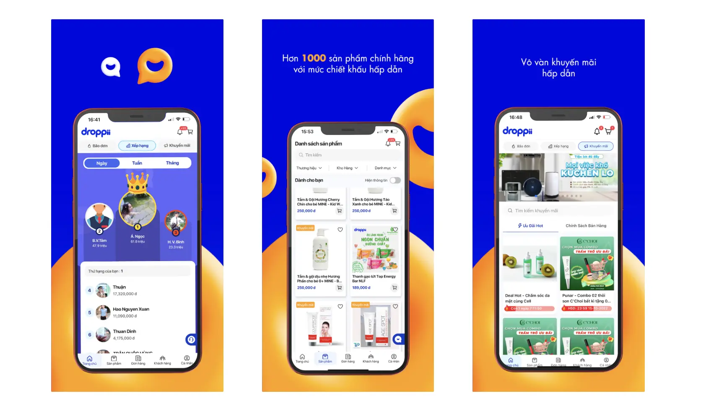

**Industry**\
E-commerce, dropshipping

**Location**\
Vietnam, with a US web build in October 2022

**Engagement**\
August 2022 to October 2023, in two phases

**Team**\
Eight people at the September 2022 peak: a project manager, a designer, a tech lead, two web engineers, two React Native engineers and an automation QA. Three by mid-2023.

**Stack**\
React and React Native on our side. Droppii's own engineers owned the .NET and Java services behind them.

**Our service**\
Full-stack development / Agile project management

Droppii's seller app went live in May 2022. Our team started on 8 August, shipped the web build of Droppii for Business v3 on 10 October and the iOS and Android apps on 20 October, then delivered a US web build by 1 November. That is ten weeks from the first day to the mobile release. A second phase ran until October 2023 and covered ERP screens, a commission dashboard for sellers, API and end-to-end test automation, and a shared frontend toolkit. We wrote 51 weekly changelogs along the way.

## Challenge

Droppii built its first platform in a campaign it called "90 Days Rushing". By mid-2022 that code carried a growing business. The seller app had launched on 20 May, according to [Tuoi Tre](https://tuoitre.vn/droppii-startup-viet-voi-he-sinh-thai-kinh-doanh-online-4-0-20230220154138966.htm), and the roadmap in our project document listed four surfaces: an admin dashboard, Droppii for Business (app and mobile web), a customer web store and a seller portal. Vietnam came first. A US web build came second.

Droppii's engineers owned the backend and the business data, and they were strong there. They needed frontend capacity, a UI that could be extended without a rewrite each quarter, and a partner who ran delivery in sprints. We started with an assessment of the existing frontend, the product management and the workflow, and turned the findings into a roadmap.

## Phase 1: v3 in ten weeks

The sprint 3 report of 13 September 2022 put customer features at 85 percent done and order features at 27 percent. Ten days later the Jira counts read 49 customer items and 32 order items done, with 16 order items in progress. The week of 30 September was a polish week for the web app, and the web release went out on 10 October.

The mobile team kept fixing issues and released the apps on 20 October. Two engineers scaffolded translation for the US build in parallel. We reported it delivered in the week of 28 October, after a target of 26 October. Sentry and Google Analytics tracking were on the completed list before the web release. Hotjar reached production in the week of 14 October.

Staffing changed as soon as the release landed. The project manager went part-time on 10 October and left on 23 October, a mobile engineer left on 28 October, and the rest of the team stayed for the next one to two months before Droppii and we reviewed resources again.

## Phase 2: the long middle

From November 2022 the work moved from a release date to a queue. The weekly changelogs name 403 distinct ticket keys as done between 29 November 2022 and 9 October 2023. That count is a floor, because the first weeks of the engagement carried no ticket keys.

- **ERP and seller tools.** VAT export requests, vouchers, product label management, a cross-check tool, a commission dashboard for sellers, e-contract status in June 2023 and a livestream list and detail screen in August 2023.
- **Test automation.** The product service back office had 60 of 103 APIs covered on 10 October 2022 and finished a week later. Promotion, user, marketing, notifier and newsfeed services followed, plus end-to-end flows that create an order from the order list, the customer list and the customer detail page. We presented the framework to Droppii's team on 9 December 2022. The QA engineer rolled off on 26 April 2023.
- **Shared toolkit.** A release flow for the monorepo in the last week of December 2022. A shared ESLint package published to npm in July 2023. Dashboards moved to pnpm and read GrowthBook configuration from a CDN in August 2023. The last Done list in the final changelog was documentation: how to use the React toolkits, and the authentication flow.

In mid-2023 we also prototyped a GPT-based product consultation chatbot for Droppii. It is covered on the [AI services page](/services-ai).

## What did not go smoothly

The Issue and Block list in a weekly report is a short list by design, and ours stayed nearly empty. Three entries in 51 weeks were not "None", and all three describe the same dependency. On 14 November 2022 it read "FE sometimes need to wait for BE work to complete: potential blockage". On 9 and 13 January 2023 it asked for planning so that frontend engineers had enough work, with the fallback of pulling items found during the audit phase. A frontend team in one company that waits on a backend team in another will always carry this cost, and we never removed it.

One ticket shows how a thin team spends its time. "Update README to include release process" sat under In Progress in 22 weekly reports between 6 February and 9 October 2023, and never reached Done in any of them. The monorepo release flow itself was set up in January 2023. Writing it down lost every sprint to a feature ticket.

The team also shrank faster than the scope. Eight people peaked in September 2022, four remained after 30 December, and three after 26 April 2023, while ERP and dashboard work kept arriving.

## Outcome

Public evidence is thin and Droppii's own numbers belong to Droppii. The app has since moved from v3 to v4.22 and its App Store listing shows 4.8 stars from 15,000 ratings as of October 2026 ([listing](https://apps.apple.com/vn/app/droppii-biz-d%C3%A0nh-cho-ng%C6%B0%E1%BB%9Di-b%C3%A1n/id1623128934)). At the December 2023 launch of its consumer app, Droppii Mall, Droppii said the seller app had passed 100,000 downloads and distributed more than 135,000 SKUs a month, per [Congly](https://congly.vn/ra-mat-ung-dung-droppii-mall-mo-rong-giai-phap-mua-sam-danh-cho-khach-hang-408018.html). Those figures describe the product, not our share of it.

