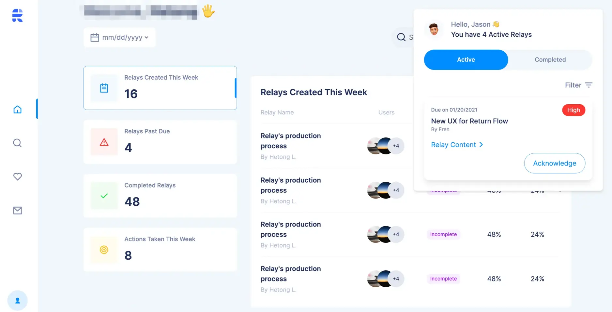

> "The context changes. We change accordingly." That was Relay's product owner, Hetong, on the brief.

**Industry**\
Productivity tools

**Location**\
United States

**Product**\
Relay at teamrelay.co, a tool that shows a manager who acknowledged an assignment, who finished it and how long it took. It is not the later relay.app automation product.

**Engagement**\
Weekly changelogs run from 4 July 2021 to 14 March 2022, 32 issues in all.

**Team**\
Two engineers until the end of September 2021, one from October.

**Stack**\
Ruby on Rails, React with TailwindCSS and Storybook, AWS Amplify, WebSockets, Amplitude.

**Our service**\
Full-stack development / Agile project management

Relay was an early-stage startup that needed a basic but viable product to put in front of customers and to raise a seed round on. The brief had two parts that pull against each other: ship fast, and expect the requirements to change with market feedback. We supplied two engineers who could pick up the product context quickly and keep a steady weekly pace.

## Challenge

Hetong stated the need plainly: a version with basic features, finished fast and clean, that could attract customers and support the seed round. Speed mattered. Early customers would ask for changes within weeks, and a codebase that resisted change would cost more than a late launch. Relay needed a team that could shift with the product without slowing the weekly rhythm.

## Solution

We planned to support Relay for a few months. The engagement ran into 2022, because Relay welcomed ideas as well as tasks.

For project management we used Slack for communication, Notion for documents and Trello for tasks. All designs lived in Figma. Every week from July 2021 we wrote a changelog for Relay with three headings: what is new, what improved, and the plan for next week. The table below is those changelogs, reduced to ten dated changes.

| Changelog dated | What shipped                                                                        |
| --------------- | ----------------------------------------------------------------------------------- |
| 18 Jul 2021     | A staging environment. The extension syncs its badge count when the network returns |
| 30 Jul 2021     | Relay Sequence work stops mid-week and the team moves to the Performance dashboard  |
| 21 Aug 2021     | Performance dashboard live on production, a week after staging                      |
| 28 Aug 2021     | Single sign-on with Okta through omniauth                                           |
| 11 Sep 2021     | Flagging on staging, a closed feedback loop between sender and receiver             |
| 2 Oct 2021      | Slack app submitted to the Slack App Directory                                      |
| 30 Oct 2021     | Gmail add-on, version 1, under review for the Google Workspace Marketplace          |
| 20 Dec 2021     | Free-tier limits implemented, scheduling for paid plans under way                   |
| 3 Jan 2022      | Weekly summary email to team leads                                                  |
| 14 Mar 2022     | Export for a single Relay, a team and an individual                                 |

## One API, four surfaces

Relay users met the product in a Chrome extension, a web dashboard, a Slack app and a Gmail add-on, with Okta for sign-in. All of them talked to one Rails API.

Three decisions came out of that shape.

**Extension versions carry their environment.** We used a custom semantic versioning scheme for the Chrome extension. Builds with a `-develop.x` suffix are staging builds that talk to the staging backend, and testers downloaded them from an extension distribution page. The version string alone tells a tester which environment a build belongs to.

**The Performance dashboard stayed unpaginated.** It reports open rate, complete rate and average time to finish a Relay, calculated when the request arrives. Sorting works. Pagination does not, because sorting and paging an on-the-fly aggregate together would have hurt performance. We wrote that down in the 7 August 2021 changelog and postponed it until team sizes justified a dedicated service.

**Plans became code in December 2021.** The free tier allows one content link per Relay and 20 Relays a month, and it excludes the Performance dashboard, the Okta settings page and the Slack integration. Relay's own site, as archived in 2022, listed a Premium plan at $19.99 per user per month ([archived page](https://web.archive.org/web/2022/https://www.teamrelay.co/)).

Every action a user takes also records where it came from: dashboard, extension or Slack. We added that source tracking on 16 October 2021, alongside the Amplitude events.

Flipper and Sidekiq together drove A/B tests and gradual rollouts, and the codebase was one monorepo.

## What it cost

Relay Sequence never shipped. The chain relay form started on 4 July 2021, the sequence component followed on 11 July, and the Sequence Chart and Progress view were designed on 23 July. On 30 July the priorities changed, and the team moved to the Performance dashboard that same week.

The Slack app spent months in review. We submitted it on 2 October 2021. On 28 February 2022 we were still working through feedback from the Slack team, and the 7 March changelog reports the app "pending for another round of review". The changelogs never record a listing approval.

The team also thinned. After the end of September 2021 the project moved from product speed to fundraising and sales, and one engineer carried it. Slack flagging, company tiers, bulk invitations, the Gmail add-on, scheduling, SMS notifications and exports all appear in the changelogs of the five months that followed.

## Outcome

The MVP went out with a Chrome extension, a web app for settings, an analytics dashboard and a Slack bot. We kept shipping after launch. Relay published its own notes on this period, including its [May 2021 product update](https://teamrelay.medium.com/relay-product-updates-may-2021-f7b3db7002c5).

By early 2022 the Relay site carried named customer quotes from support teams and a pricing page, whose new UI is in our 13 December 2021 changelog.
