This is the talk version of [Five layers to tune before you fork your agent](/agent-tuning-layers). Read the slides alone for the argument, or read the notes beside them for the numbers from circle and Hermes.

## The question

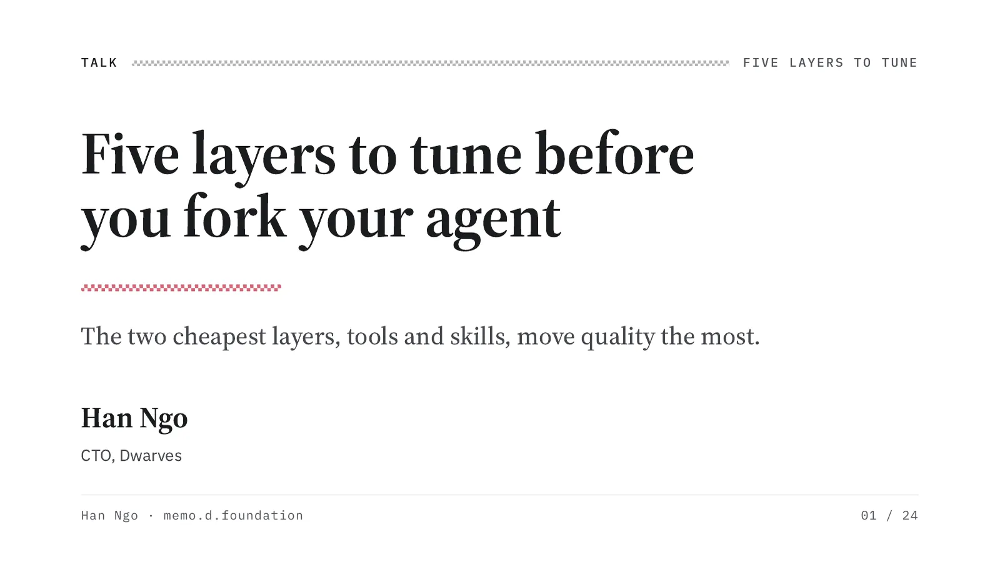

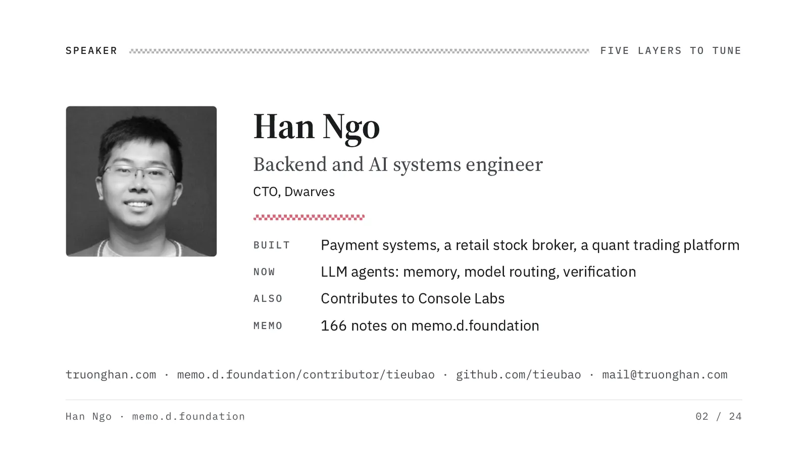

I build backend and AI systems at Dwarves. This talk comes out of one project: circle, a relationship tracker we run on Cloudflare and wire into our Hermes desks over MCP. The numbers in the notes come from that system.

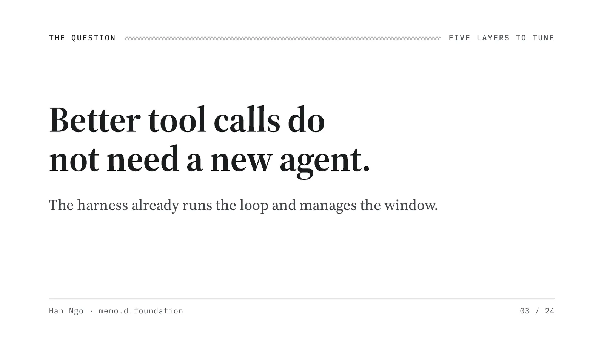

We built circle and wired it into Hermes. Then I asked the obvious next question. If I want better tool calls and better context management, do I have to rebuild the agent? The answer is no. The harness already runs the loop and manages the window. What I control sits in five layers outside it, and the two cheapest ones, my MCP tools and my skills, move quality the most.

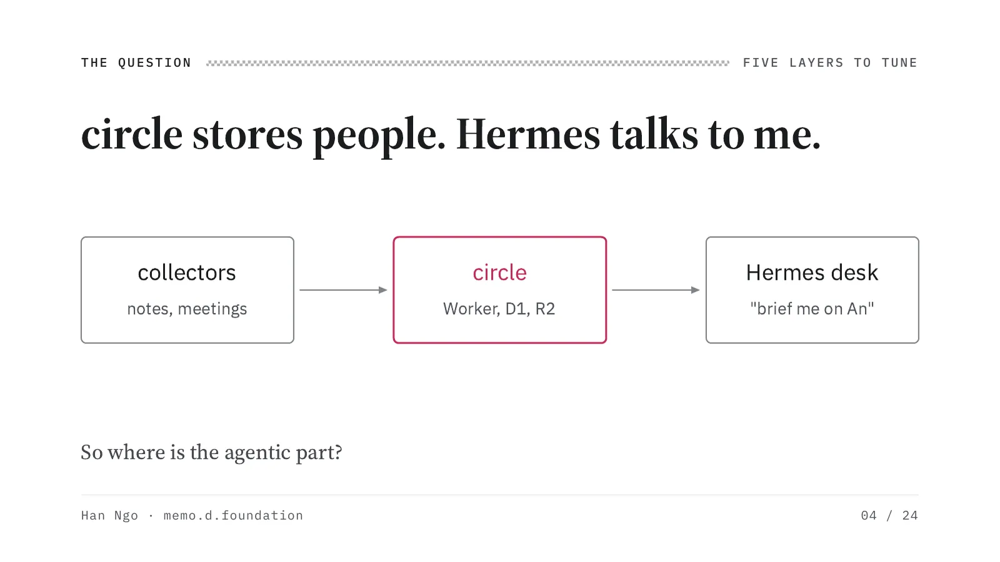

circle stores one record per person across every channel: notes, meetings, promises, and a warmth score that decays with silence. It runs as a Cloudflare Worker with D1 and R2. Collectors feed it, and a Hermes desk reads it, so I can type "brief me on An" in chat and get one screen back.

The design looked like a normal software system: a database, a REST API, some cron jobs. That made me uneasy. Where is the agentic part? And if a Grok bot should read circle too, do I hook it up through MCP, through a skill, or both?

## One loop, one window

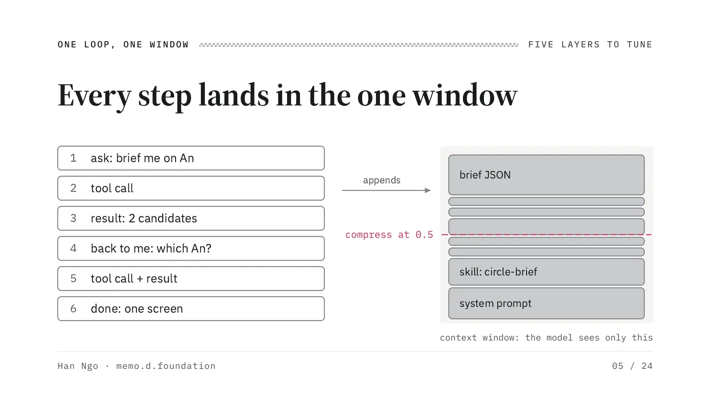

One real ask, walked through the system. I type "brief me on An". The model writes a tool call, a JSON request, and circle runs it; the model executes nothing itself. The result names two people called An, so the model asks me which one, then calls again and renders one screen. Tool calls repeated until the task is done are the agent loop, and Hermes is the harness that runs it. Every step appends to the context window, the only text the model sees on a turn. Memory is the state outside the window, in circle's D1, that the agent reads back on demand.

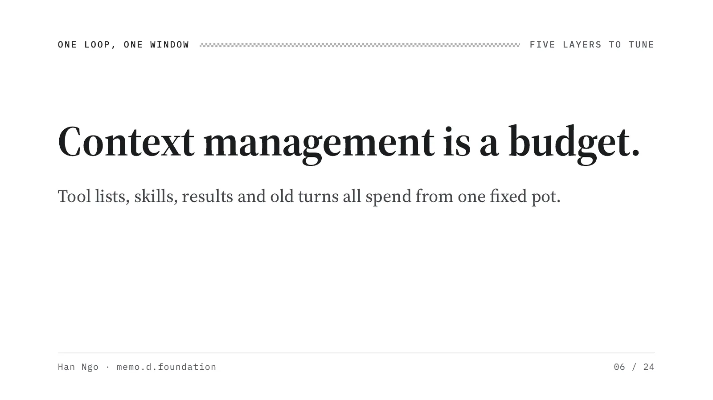

Once I saw the loop this way, context management stopped being abstract. It means deciding what goes into the window and what comes out: which skill loads, how big a tool result is, when old turns get summarized. Every tool description, every skill, every result and every old turn spends from the same pot, and the pot has a hard size limit.

## Who decides the next step

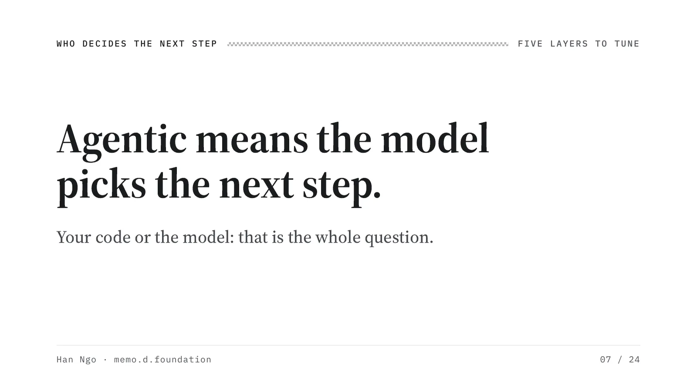

"Agentic" was the word that confused me most. circle already uses a model in several places, yet only some of them are agents. The difference has nothing to do with how smart the model is. It comes down to one question: who picks the next step, your code or the model?

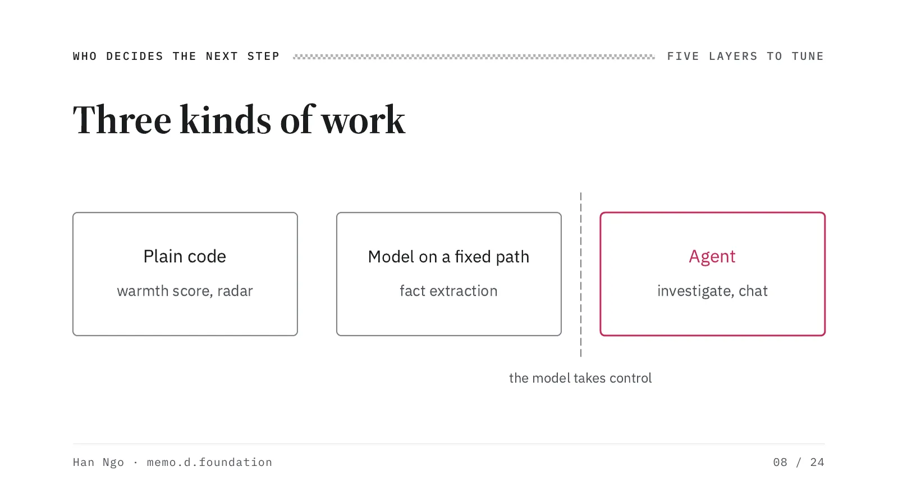

Plain code decides every step and runs no model. The warmth score is a decayed sum of weighted touches over 365 days, and a tier A person is overdue after 30 days of silence. A model on a fixed path is what people call a workflow, the same line Anthropic's "Building effective agents" draws. circle's fact extraction takes a note in and returns a structured list of facts, and each one lands as proposed. The model can't decide to do anything else. An agent picks the tool, the arguments, whether to ask the user, and when to stop. circle has two: the investigate job, and Hermes running every chat request.

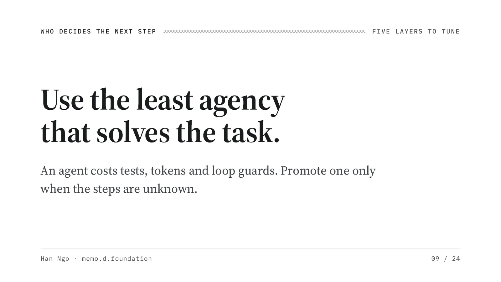

The same task shows the difference. Take "brief me on An" again. Written as a fixed path, code looks up An, finds two matches, and has to fail or guess. Written as an agent, the model sees two candidates in the result and decides to ask which one. Nobody wrote that branch as code. The skill told the model it was allowed to ask, and the model chose to.

That freedom has a price. An agent's path changes from run to run, so it's harder to test. It spends more tokens, because every step goes back through the window, and the window is the budget from the slide before. It can get stuck repeating a failing call, which is why harnesses ship loop guards. Ours are real config: the Dwarves Hermes file warns after 3 failures of the same tool, or 2 calls that make no progress, and our Discord desks hard-stop at 8 and 5.

The last cost changes the design. Because the model chooses the tool calls, every permission has to be enforced by the tools themselves. A skill is advice, and a model can ignore advice. That is why circle's investigate job, which reads untrusted pages, gets no write tools at all. The agent can search and fetch as much as it likes, and it still has no way to change a record.

My rule now is to use the least agency that solves the task. Plain code when the rule fits in a formula, a model on a fixed path when the input is messy language, and an agent only when you can't know the steps in advance. Promote something to an agent when the steps are unknown, and keep everything else in code you can test.

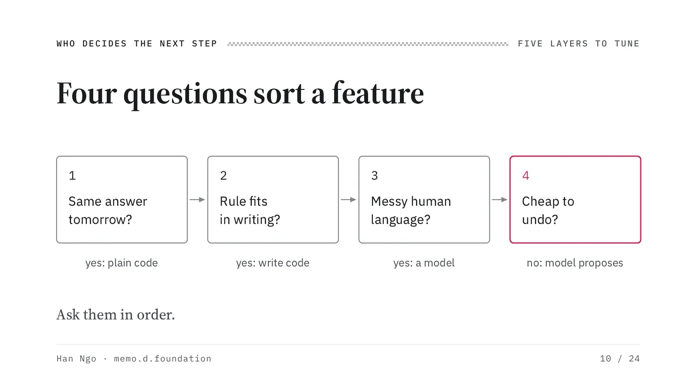

Must the same input give the same answer tomorrow? Scores, money, dates and permissions say yes, and that's the core. Can you write the rule down exactly? Then write it as code, even if a model could also do it. Is the input messy human language, or does the task need judgment over open-ended content? That's where a model earns its place. Is a wrong answer cheap to catch and undo? If yes, the model may act. If no, the model proposes, and a person or the core commits.

## Core and edge

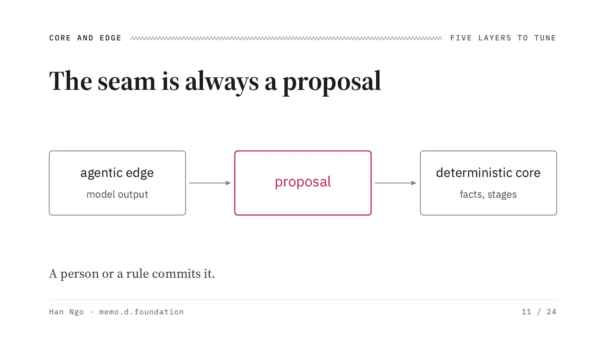

Sorting circle's pieces through those questions gives a clean split. The warmth score, the radar and the cadence are plain code. Name lookup is plain code too, and ambiguity comes back as candidates instead of a guess. Stage and rating changes are code that proposes, and I accept or reject. Facts from notes are a model on a fixed path. Two patterns fall out. Nothing a model produces becomes a fact, a stage, or a sent message until a person or a rule commits it. And some features split down the middle: name lookup is code, and the conversation about which An you meant is the agent.

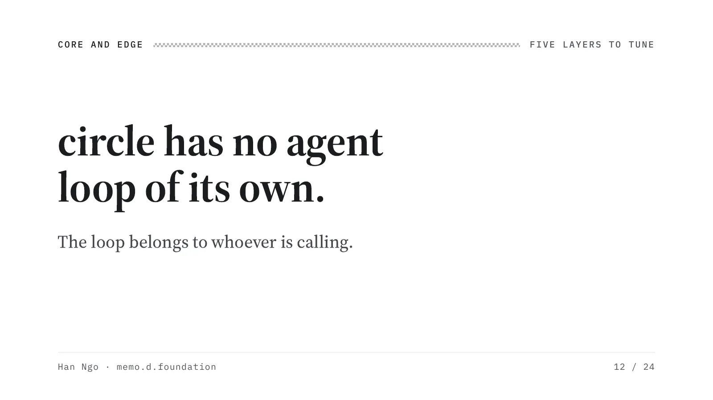

The biggest decision is the one circle doesn't make. I was tempted to build an agent loop inside the Worker. That would have meant writing prompt assembly, tool dispatch, retries and compaction from scratch, all of which Hermes already does. circle is the core, and the loop belongs to whoever is calling.

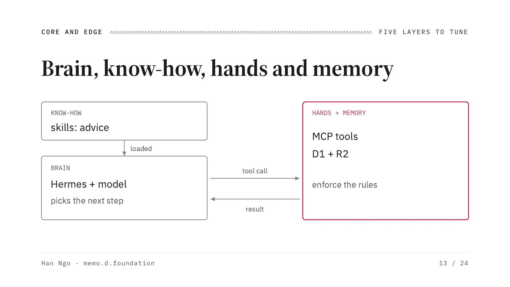

Once the core and the edge were separate, every agent integration I looked at had the same three parts. Most of my design confusion came from mixing them up.

The brain is the model plus the harness that runs the loop. It decides the next step, reads results, talks to the user, and manages the window. It owns no facts and enforces no rules. In circle's case the brain is Hermes, and the model inside it is swappable by config. A good test: swap the model, and only answer quality should change. If anything else breaks, something that belongs in another part leaked into the brain. You change the brain through config: the model, compression, the guards.

The know-how is the skills: written judgment the brain loads into its window when a task matches. It covers which tool fits which ask, the order of steps, how to render the answer, and edge cases such as an ambiguous name. Our circle-brief skill says: call the brief tool; if the result carries candidates, ask which person instead of guessing; render one screen; never draft a message or change a stage from here. You change know-how by editing text, redeploying, and starting a fresh session.

The hands and memory are the tools the brain can call and the durable state behind them. In circle they're one Worker: 32 MCP tools for an admin key, 10 for a reader key, and D1 and R2 holding people, notes, facts and history. The hands own what's possible, who may do it, input validation, and every deterministic calculation. circle's MCP layer is a thin adapter: each tool call becomes a request to the matching REST route with the caller's key. So the CLI, the web UI and every agent pass through the same rules. The tools are the only way in, which means no model ever writes to the memory directly. Changing the hands takes code and schema changes.

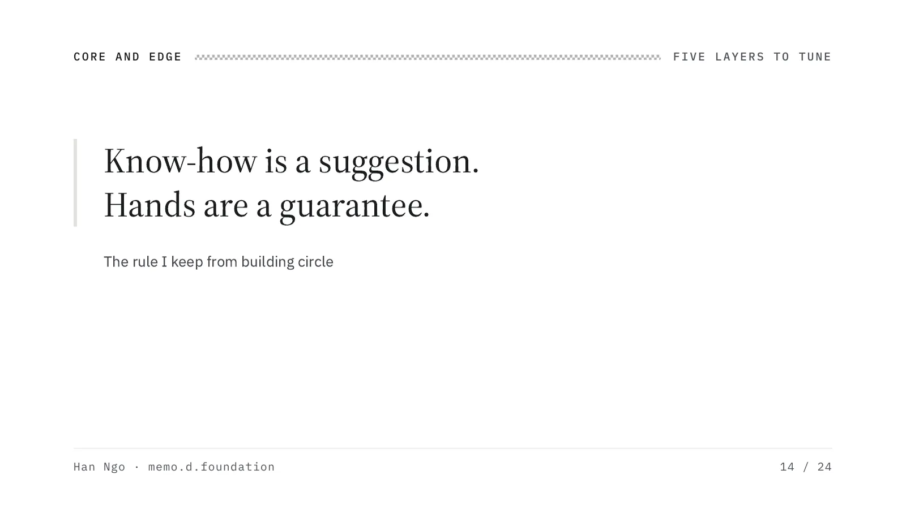

"Never write from a brief" belongs in the skill, so the model behaves well. The reader key belongs in the hands, so it can't misbehave anyway. Know-how is advice, and a model can ignore advice, so anything that must never happen also has to be enforced by the hands.

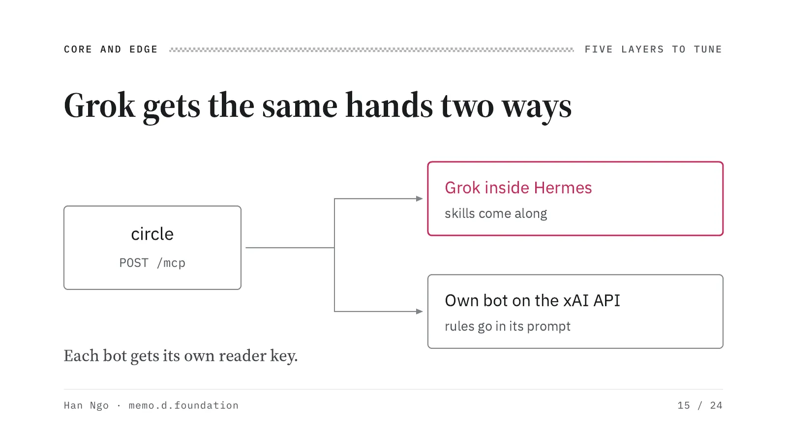

With the parts named, the Grok question answered itself. MCP is how you ship the hands to any brain: circle serves a stateless Streamable HTTP endpoint, and any agent that speaks MCP connects with a URL and a key. The cheapest path is to make Grok the model inside Hermes. One of our instances already has a Grok profile, and tools and skills stay as they are. The other path is a bot on the xAI API, which can register a remote MCP server but won't read our skill format, so the rules go into its system prompt by hand. Either way, each bot gets its own reader key. I can revoke one bot alone, and the audit trail shows which bot wrote what.

## The five layers

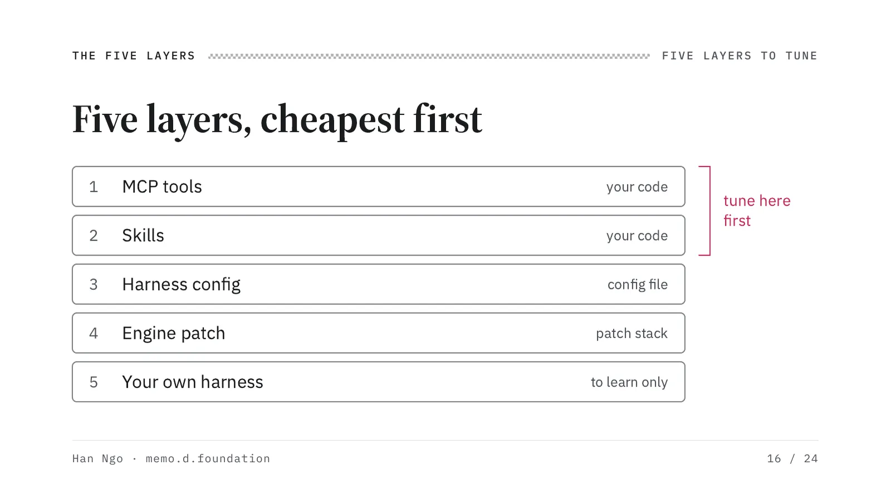

Now the actual question. I wanted better tool calls and better context management, and my first instinct was that this meant opening up Hermes. It doesn't. This is the stack from cheapest to most expensive. Layers 1 and 2 live in my own code, so I start there. Layer 3 is a config file, layer 4 is a patch stack against upstream, and layer 5 is writing the loop from scratch.

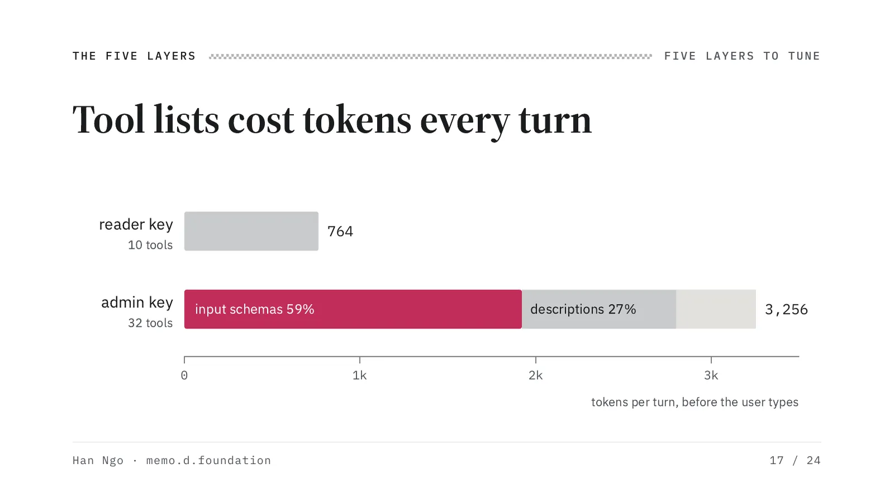

The model reads every tool definition on every turn, before the user has typed a word. So tool design is context management from the server side.

I measured ours by calling circle's real tool list handler once per role. An admin key sees 32 tools, and the list costs about 3,300 tokens on every turn. A reader key sees 10 tools for about 760. Least privilege turns out to be a context saving too: the reader list is 76% smaller. A bot that only needs to read gets the smaller list and the smaller bill on every single turn.

The breakdown surprised me. Descriptions, the part I'd been polishing, are only 27% of the admin list. Input schemas are 59%. The three largest tools are all schema-heavy update tools with many optional fields: the profile add, the general update, and the media update. If I wanted to cut the list, I'd split those into narrower tools or move rarely used fields out, before I touched a single description. Polishing prose felt like the work, and the bytes were somewhere else.

The second half of this layer is result size. A brief that returns one compact screen keeps the window small. Returning the whole person row, every note and every fact would flood it on the first call. When a tool result is large, the fix is almost always a narrower tool or a summary field.

So the two checks I run first are cheap ones. Count the tokens your tool definitions cost per role, and look at your largest tool result. Both live in code you already own, and neither needs anyone to open the harness.

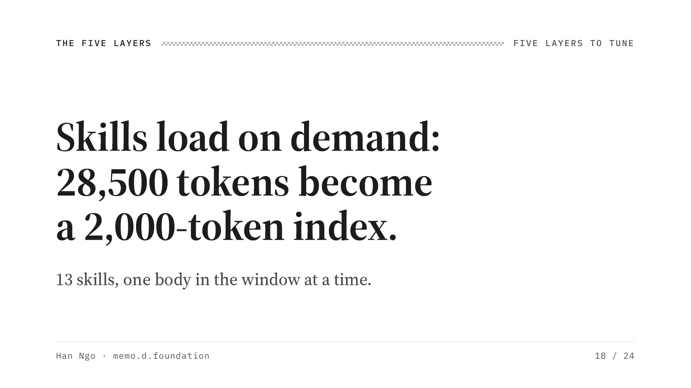

A skill loads only when its trigger matches, so the window carries the playbook for the task at hand and nothing else. The harness keeps just the one-line description of every skill in context and pulls the full body on demand. circle ships 13 skills, about 114 KB of markdown, roughly 28,500 tokens if they all loaded at once. The descriptions that stay resident come to about 2,000 tokens. One skill, circle-due, is 19% of the whole set on its own, which makes it the first candidate for a split.

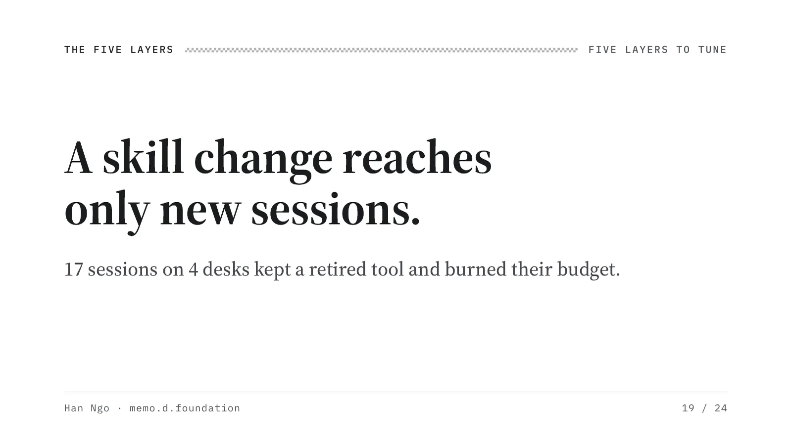

This layer has the sharpest edge I've hit. Hermes bakes the list of available skills into a session's system prompt when the session starts, and never rebuilds it on resume. When we retired an MCP integration across our Dwarves desks, 17 chat sessions across 4 desks kept the old roster. The model kept reaching for a capability that no longer existed and burned its whole iteration budget before it gave up. Restarting the daemon did nothing, because the stale prompt lived in the session store. Deleting those sessions fixed it.

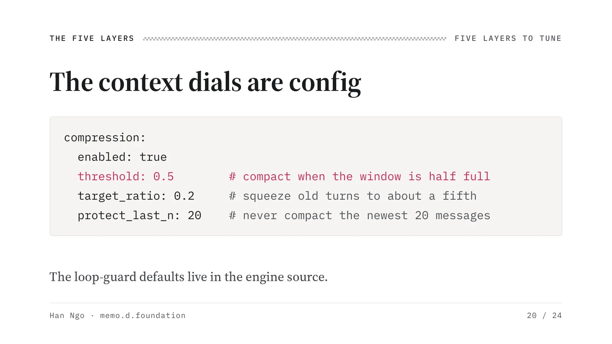

This is context management in the textbook sense. The same file sets loop guards, and it says the hard stop is off. My first draft read that as "the guard only warns." The engine source says otherwise: a second flag defaults to true and turns hard stops on for unattended platforms such as Discord, Telegram and cron. A config file shows you the keys someone set, and the defaults live in code. Model choice, toolsets and the MCP server list sit here too, and compaction runs on a cheaper model than the main loop. None of it needs a rebuild, only a redeploy and a fresh session.

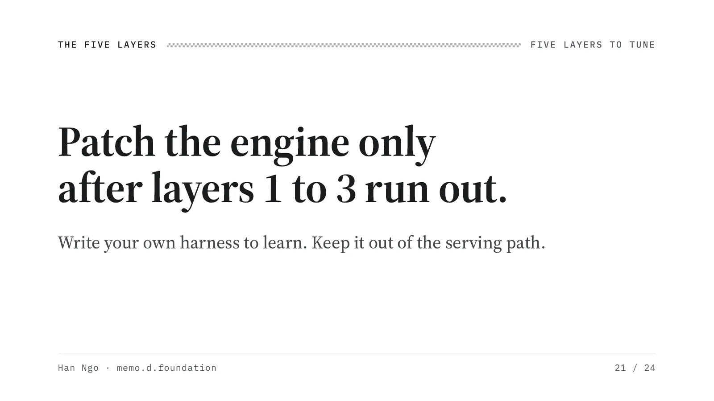

When the config key you need doesn't exist, you change the loop code. We keep a small patch stack against upstream Hermes for exactly this: Discord mention handling, dispatch dedup, treating kanban reads as untrusted input. Each patch has to survive every upstream upgrade, which is real ongoing cost. A bare agent loop on a model SDK is about a hundred lines, and writing one is the fastest way to learn what a harness does for you. Running production on it means re-solving compaction, retries, approval flows and session storage.

## What to keep

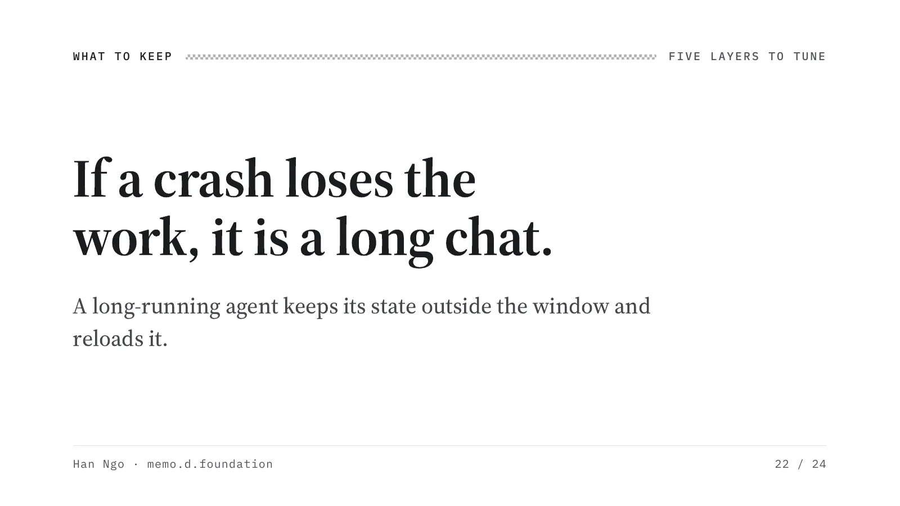

The term is fuzzy because two ideas share it. One is task length, an agent that works for hours or days across many steps, which people call long-horizon. The other is durability, an agent that survives its window filling up and its process restarting. Compaction alone doesn't get you there, because whatever the summary drops is gone for good unless it lives somewhere the agent can read back. By that test, circle is the durable memory a long-running agent would lean on, with no agent of its own.

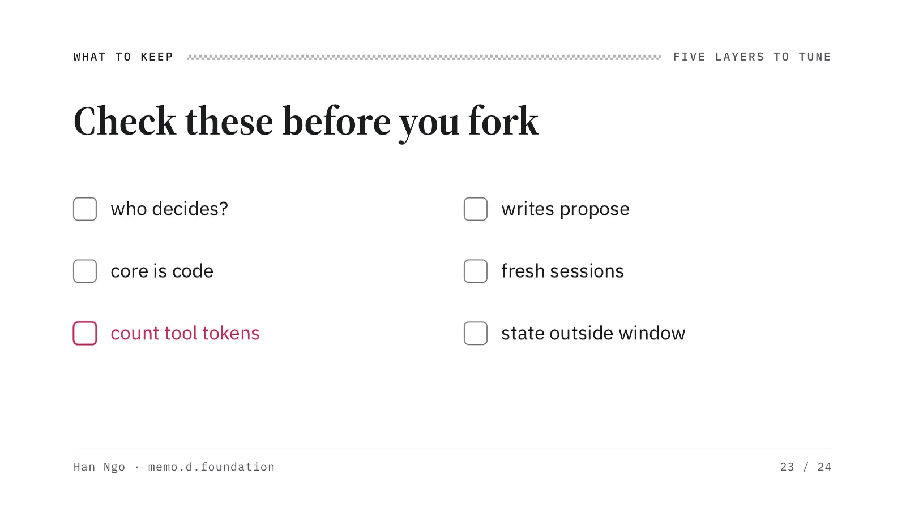

Each item maps to one of the slides before it. The full list sits below the last slide, ready to copy, so you can run it against your own agent integration before you touch the harness.

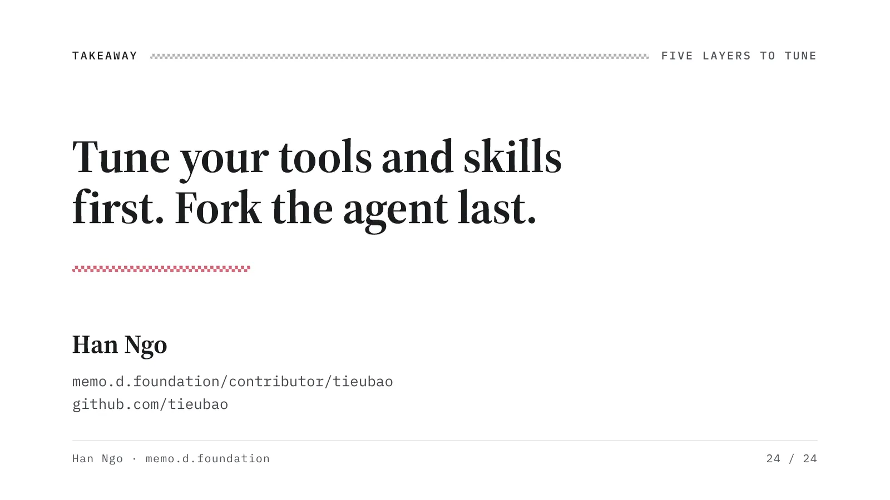

---

The checklist, to copy against your own agent integration:

```text
[ ] For each AI feature, name who decides the next step. Use the least agency that works.
[ ] Anything that must match tomorrow (scores, money, permissions) is plain code.
[ ] Count the tokens your tool definitions cost per role. Trim the biggest description first.
[ ] Check your largest tool result. Can a narrower tool or a summary field replace it?
[ ] Every write tool returns a proposal, or a human confirms it.
[ ] Untrusted-input agents (web readers) get no write tools.
[ ] Each external bot has its own least-privilege key.
[ ] Each skill description names when it should not fire as well as when it should.
[ ] After a skill or toolset deploy, start fresh sessions; resumed ones keep the old prompt.
[ ] Read your harness's compression and loop-guard settings before you assume you need a patch.
[ ] Durable state lives outside the window, so a restart loses nothing.
```

circle is internal, so you can't run it; the patterns transfer, the code doesn't. The token figures were measured on our tool table when the [essay](/agent-tuning-layers) came out and will drift as tools change. Everything here assumes a harness like Hermes or Claude Code that already does compaction well. On a thin harness, layer 3 may not exist, and you'll hit layer 4 sooner.
