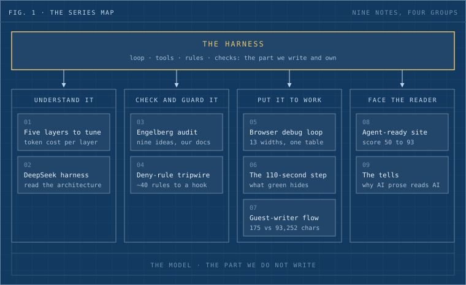

We run agents all day at Dwarves. They write code, deploy Workers, review incoming posts and measure layouts in a real browser. Under each of them sits a model, and the model is the part we do not write. Around it sits the harness: the loop that calls tools, the rules loaded when a session starts, and the checks that run before and after every action. Our working bet is that the harness decides whether an agent is useful, more than the model does. [What the Engelberg report got right about us](/engelberg-report-audit) tests that bet against a report written by forty CTOs and senior engineers. The other eight notes are the evidence, written while things were breaking.

_Fig. 1: The series map. The numbers match the reading order below._

## Reading order

Each note stands alone. Read in this order if you are new to agents, or jump to the group that matches your problem.

**Understand it**

1. [Five layers to tune before you fork your agent](/agent-tuning-layers) answers whether better tool calls and context management mean rebuilding the agent. It does not: five layers sit outside the harness, and it prices each one in tokens on a system we run.
2. [DeepSeek harness, dissected](/deepseek-harness-architecture) answers what a new open-source harness does differently and whether to bet automation on it. Our verdict: study the design now, hold off on production use until the plugin API settles.

**Check and guard it**

3. [What the Engelberg report got right about us](/engelberg-report-audit) answers which of nine ideas from a Thoughtworks retreat we already practiced and which we did not. One gap we closed the same week is a lens that hunts for the input your tests forgot.
4. [Claude Code 2.1.259 turned our Read() deny rules into a Bash tripwire](/claude-code-read-deny-bash-prompts) answers why unattended sessions kept stalling on a prompt. About 40 deny rules moved into a hook we control.

**Put it to work**

5. [The debug loop: make the agent measure the browser before it touches the CSS](/browser-loop-layout-debug) answers how to stop an agent from guessing at layout. One probe, thirteen viewport widths, one table.
6. [Our publish step took 110 seconds, then 78. Our release tab took three tries.](/deploy-pipeline-formula) answers what a green CI step hides, and what changes when agents press deploy all day.
7. [Guest writers on memo, keyed by the writer's own domain](/memo-guest-writers) answers how an agent-assisted review pipeline survives bad inputs. Its first run judged a post on 175 characters out of 93,252.

**Face the reader**

8. [Making our site AI-agent-ready, 50 to 93](/agent-ready-website) answers what an AI agent needs from a website before it gives up. It lists the full rubric and what each fix did.
9. [The tells](/ai-writing-tells) answers why agent-written prose still reads as agent-written after word-level rules. The giveaway sits in structure, and the post ends on a ruleset we load into the agent's instructions.

## What you can run

Some notes ship a tool and some do not. This table says which, using each note's own statements.

| #   | Note                 | What is public                                                                                       |
| --- | -------------------- | ---------------------------------------------------------------------------------------------------- |
| 1   | Five layers          | Nothing runnable. circle is internal, so the patterns transfer and the code does not.                |
| 2   | DeepSeek harness     | The harness itself is DeepSeek's open-source repo. We published no tool.                             |
| 3   | Engelberg audit      | The break-it review lens is public in the dwarves-kit repo, linked from the note.                    |
| 4   | Read() deny tripwire | Public: the installer, the hook and its test suites, linked from the note.                           |
| 5   | Browser debug loop   | browser-harness-js is public. The probe code is in the note.                                         |
| 6   | The 110-second step  | The platform repo is private. The note's pull request numbers link nowhere.                          |
| 7   | Guest-writer flow    | A writer can join through memo.d.foundation/skill.md.                                                |
| 8   | Agent-ready site     | The scanner is third-party (`npx is-agentic <domain>`). Our own audit skill, web-drift, is internal. |
| 9   | The tells            | No tool. The pattern list is in the note.                                                            |

<!-- needs Han: confirm the public status of each row before merge; the table repeats what the notes say and nothing more -->
