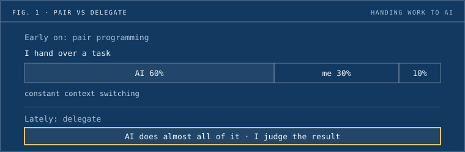
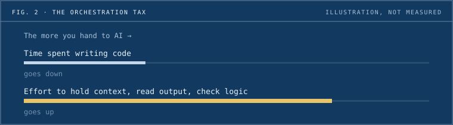

Tuan Dao writes code at Dwarves and has worked with AI in two phases: first as a pair programmer, then as something he delegates to. His short answer: **"Can AI code?" is an old question now. It can. The hard part is reviewing its work without a jam.** What follows is his account, in his words.

**By the numbers**

|              |                                                                                       |
| ------------ | ------------------------------------------------------------------------------------- |
| 60 / 30 / 10 | His old split on a task: the assistant's first pass, his hand edits, one last prompt. |
| 1 to 2       | Sessions he keeps open at once. Three at most, for a batch of small tasks.            |
| 2019         | The year he joined Dwarves.                                                           |

**Who is Tuan**

Tuan Dao is a full-stack engineer on web projects at Dwarves. He joined in November 2019.

_Tuan Dao. Photo: GitHub._

He is on GitHub as [tuanddd](https://github.com/tuanddd), goes by `vincent` on the Dwarves Discord, and has a memo profile at [/contributor/tuanddd](/contributor/tuanddd). He told an earlier story in [#4 Tuan Dao on learning from mistakes](https://memo.d.foundation/careers/life/2021-03-31-0-tuan-dao), part of Life at Dwarves.

**Why this piece**

It is the first piece in AI in their words, a part of [Once a Dwarf](../site/once-a-dwarf.md) where Dwarves people say how AI changed the way they work.

## Where AI fits in my day

_He uses it most where the work is open-ended, and wants to hand it more._

I'm Tuan Dao, a software engineer at Dwarves. My days are still the usual dev work: read code, understand the requirement, find an approach, write the implementation, refactor, then check it again before it goes into the product.

I use AI most for investigation, implementation and refactoring. I use it for testing, debugging, docs and review too, just not as much. I'd like to offload more of those. I haven't found a setup that works well enough to keep using.

## Pair programming, and why it wore me out

_The 60/30/10 split looked like teamwork. In practice it meant constant switching._

At first I used AI almost like pair programming. I'd put in a task and the assistant got about 60% done. I'd read through it, jump in and hand-code another 30%, then prompt again for the last 10%. Each side did a piece, and the pieces made the final output.

After a while I found this took a huge amount of time. I kept reading output, fixing it, going back to the prompt, then reading again. It created a new kind of context switching. The code still came out, but I no longer worked on it from start to finish. I got pulled into several roles at once: writer, fixer, explainer and reviewer. Some days it didn't feel like pair programming anymore. It felt like babysitting a half-done output and patching it.

_Fig. 1: From stitching code together piece by piece to handing over the whole task and judging the result._

## Delegating means preparing more

_The worst miss is the one that looks right._

Lately I delegate more. I hand AI almost the whole task, then judge what it gives back. This suits me better. It doesn't mean tossing the task to AI and sitting back, though. It makes me prepare more before I hand anything over.

With thin context, AI misreads the task easily. The annoying part is that it can misread it and the output still looks fine: clean code, a flow that seems reasonable, an explanation that sounds right. Only when I check the requirement again do I see it has wandered off and solved a different problem.

So for me, "which task does AI do best?" matters less than how I hand the task over. Refactor, debug or test is just the surface. The core is context. Put simply, if it doesn't drift from the original goal, it did a good job.

When AI looks like it got everything done and I still have to review it again, the cause is usually thin planning up front and missing facts. Either it asks me back, or it guesses. Guessing is often worse, because it guesses with full confidence. Another common miss is not stating the definition of done. So before I hand off a task, I run a planning session with the AI to clear up whatever it is unsure about. It takes a bit more effort, but far less than letting it run wrong and fixing it after.

## The orchestration tax

_Agents scale without limit. Human review does not._

That's why testing and validation matter more than I thought. They do a lot to keep AI's "hallucinations" in check, and they let me review less by gut feeling. A person's attention has limits. The number of agents one dev can spawn doesn't. The ratio is so lopsided that the bottleneck is always the human review step.

I also don't open many sessions at once: usually one or two, three at most for a batch of small tasks. More sessions sound more productive, but each one adds one more thing to read and check. Or maybe I'm just a noob, hehe.

_Fig. 2: "The Orchestration Tax", a term borrowed from Addy Osmani. An illustration, not a measurement._

Addy Osmani has a piece on this called "The Orchestration Tax". It sounds a bit fancy, but it fits how I've felt lately. The more work I hand to the model, the less time I spend writing code. In exchange I spend more effort holding context, reading output, checking logic, and deciding whether to use what the AI gave me.

It's true I code less, and I think more about framing the problem. People might call that "engineer as orchestrator". I still find that a bit of a buzzword, and "harness engineering" sounds even buzzier _omegalul_. Strip the labels off and my day is fairly simple: know which tasks I can hand off, what information to put in, which parts the tool can handle on its own, and which parts I have to decide myself. To do that I still need to understand the code and the requirement, and have test cases or some clearer way to verify.

## Steal this: handing a task to an agent

These are the habits Tuan describes above. Copy the ones that fit.

- **Plan with the AI first.** Run a short planning session and let it ask its questions before it starts.
- **Give it the context.** With thin context it guesses, and it guesses with confidence.
- **State the definition of done.** Leaving it out is one of the most common misses.
- **Keep few sessions open.** One or two, three at most for small tasks. Each one is more to read.
- **Have a way to verify.** Test cases or another clear check, so you review less by gut feeling.

## The next 6 to 12 months

_Next, he wants better ways to check output before he trusts it._

If I improve my AI workflow, I'll probably look more at testing and validation. How to stop reviewing everything by eye. How to have a clearer way to verify before I trust the output. If I could automate part of that step, it would likely help more than just trying to make AI write more code.

And if I can't solve review, opening more agents is often just making more work for myself.

## Takeaways

- **Review is the bottleneck.** How fast AI writes code matters less than the human reading it. Agents are close to unlimited; a person's reading is not.
- **Each session costs review.** Opening more does not raise output by itself. Each one is one more thing to read and check.
- **Context and a definition of done matter most.** They matter more than picking which task to give AI, because AI guesses wrong with full confidence.

Thank you to Tuan for writing this down and letting us share it.

---

**Once a Dwarf: notes from people who were here.** People who passed through Dwarves and people still here, in their own words. Read the rest of the series on the [Once a Dwarf](../site/once-a-dwarf.md) page.

_This piece was translated and edited from Tuan's Vietnamese original. His sign-off on the English text is PENDING._
