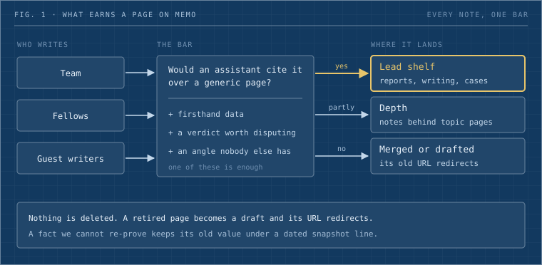

Dwarves Foundation sells something that is hard to show in a pitch deck: judgment about production systems. The website says it in six words, "Code got cheap. Consequences did not." Memo is where you can watch that judgment at work. It holds the reports, verdicts and case studies we're able to publish from the systems we build, run, audit and break, each one dated and signed by the person who did the work.

This page is for two readers: someone deciding whether memo is worth their time, and someone deciding whether to write for it. It replaces a 2021 draft whose rule was "if it's documented and worth sharing, it probably lives on Memo." We followed that rule for years. It filled the vault with notes that a search engine summarises better than we do, and it buried the pages only we could have written.

_Fig. 1: Every note meets the same bar, whoever wrote it. Nothing that fails it is deleted; it is merged, drafted or kept as depth._

## What memo is for

Memo is the research shelf of a consulting firm. Most engagements leave a record behind of what broke and what the fix cost. Memo carries the part of that record we're allowed to publish, plus the research we do between engagements on the tools and methods we sell.

That gives a lead piece a narrow shape. It starts from a real system or a named question. Its verdict and its numbers sit near the top, along with the check that proved them. It says what broke. A reader should be able to cite it, copy the method, or come back in a year and hold us to it.

Memo also keeps a long tail. The team wrote a large learning notebook between 2022 and 2025, and most of the vault is still that notebook, alongside our playbooks and this handbook. The tail stays. It sits behind topic pages and search, where a reader who wants depth on a subject can find it, and it no longer decides what the front of the site shows.

Sales pages and service offers live on [d.foundation](https://d.foundation), and internal policy stays inside the company. A link roundup with no angle of our own doesn't get published anywhere.

## Who reads it

Five kinds of reader arrive, usually on a single page from a search, a share or a link on the website.

| Reader                                                                                                                              | The question they bring                                                                   | What serves them                                                                                       |
| ----------------------------------------------------------------------------------------------------------------------------------- | ----------------------------------------------------------------------------------------- | ------------------------------------------------------------------------------------------------------ |
| A CTO or head of engineering at a finance or technology company, often holding AI-written or legacy code before an audit or a raise | Do these people understand a problem like mine, and will they tell me the truth about it? | Field reports and analyses in their domain, then case studies                                          |
| An engineer at another company                                                                                                      | Is there a method here I can copy?                                                        | A formula, a checklist, a runnable tool, before-and-after numbers                                      |
| A candidate                                                                                                                         | What is the bar, and how does this team argue?                                            | A team writer's page, their reports, the essays and the handbook                                       |
| A writer with their own blog                                                                                                        | Is this a shelf worth being on?                                                           | A credited byline, a link back to their site, good company on the shelf                                |
| An AI assistant fetching for a person                                                                                               | Which dated, signed page answers this?                                                    | Typed pages with the verdict near the top, stable URLs, [llms.txt](https://memo.d.foundation/llms.txt) |

The engineer rarely buys anything from us, and we write for them anyway. Their trust is what makes a page worth citing, and the page peers cite is the one a buyer finds.

The fifth reader has changed how we write more than the other four. An assistant runs no JavaScript and gives up fast. If the answer isn't in the page text, near the top, with a date on it, the assistant quotes somebody else.

## What we publish

Every post has a kind, which says what job it does. The folder sets a default, a `kind:` line can override it, and the byline shows it.

| Kind         | What it is for                                                                                                         | An example                                         |
| ------------ | ---------------------------------------------------------------------------------------------------------------------- | -------------------------------------------------- |
| Field report | A dated account of a system we built, ran, migrated or fixed, with its measured result and the check that proved it    | [Memo, rebuilt](/memo-rebuilt)                     |
| Essay        | An argued claim, or a sourced verdict on one outside thing (a codebase, a report, a standard). Analysis lives here too | [The tells](/ai-writing-tells)                     |
| Case study   | A client engagement told as problem, constraints, approach and outcome                                                 | [Case studies](/case-studies)                      |
| Playbook     | Ordered steps for a job we repeat, with a done condition                                                               | [Getting your post onto memo](/contribute-to-memo) |
| Reference    | A page you look things up in: handbook policy, site pages, this page                                                   | [What memo does for readers](/memo-features)       |
| Note         | One concept, pattern or book, with its sources. Most of the research notebook is notes                                 |                                                    |
| Digest       | A dated entry in a recurring series, which loses its meaning without the date                                          |                                                    |

Series sit on top of the kinds. A series is a set of notes that read in order, and we use it three ways: codebase breakdowns, long guides split into parts, and the shape we want more of, a puzzle. A puzzle is one hard, open question worked in public. Each part records what we tried, what happened, and what changed in our belief. The dead ends stay published, because watching someone reason under uncertainty is the closest a reader gets to seeing judgment before hiring it.

## Why we publish in public

We started memo to learn in public, and that reason still holds. Writing a thing down for strangers is the quickest way we know to find the hole in it.

What changed is how readers reach us. More of them arrive through an assistant that read our page for them, so a page now earns its place on memo only if an assistant answering a question would cite it over a generic page on the same subject. Three things win that race: firsthand data, a verdict a competent peer could dispute, or an angle nobody else has. A definitional page ("what is the saga pattern") loses every time, and we published a great many of them.

Our position is that a firm selling judgment should be judged by the pages an assistant would quote. That bar also forces candor. A report that admits what broke is more useful, and more citable, than one that lists benefits, so our field reports name their incidents. Memo's own [rebuild report](/memo-rebuilt) is one, written about the site you're reading.

Machine readers get the same pages people do, plus an index at [llms.txt](https://memo.d.foundation/llms.txt) and a read API. The reader tools that sit on top of each note, including asking a question about it, are on [What memo does for readers](/memo-features).

## How memo grows

Memo grows only through new writing by the people who did the work.

There are three doors in. Members, meaning current staff and contractors, open a pull request on [dwarvesf/brainery](https://github.com/dwarvesf/brainery), the public repo behind the site. Fellows, anyone who once worked at Dwarves, use a fork or the guest door. Guest writers who own a blog domain prove the domain, an editor approves them, and each approved post lands on memo as a native note that links back to the original. [Getting your post onto memo](/contribute-to-memo) walks every door step by step, and [the guest-writer report](/memo-guest-writers) explains how the import works.

Two gaps are worth stating plainly. No outside writer has published through the guest door yet; the one guest note so far came from the maintainer's own blog. And most recent writing on memo comes from one person. A shelf meant to show a team's judgment needs more than one person's, which is the reason the doors above exist. The [writers page](/writers) shows the current mix, split into team, fellows and guests.

Memo also hosts [program pages](/programs) for the things you can take part in, such as guest writing and the Fellow program. Each program has a status (active, paused or ended), one call to action, a named owner and a dated updates log. An ended program stays up under an ended banner with its end date, so the record of what we tried survives the program.

## How the vault stays honest

A vault this old goes wrong in quiet ways. Two notes answer the same question. A tool we dropped years ago is still in the handbook. A URL someone bookmarked stops working. In October 2026 we ran a cleanup in public pull requests on brainery, and the rules below are the ones that came out of it.

**Merge what overlaps.** Fragments of one source or one procedure become one page, and every member's author stays on the byline. In [brainery #407](https://github.com/dwarvesf/brainery/pull/407), 27 short engineering notes became six pages and 54 old URLs moved with them. Notes that answer different questions stay apart, even when they share a topic. Most clusters we tested for merging came back as keep.

**Draft, never delete.** A retired page gets `draft: true`, which takes it off the site and leaves the file in the repo. One wave drafted about 137 pages across [#413](https://github.com/dwarvesf/brainery/pull/413), [#415](https://github.com/dwarvesf/brainery/pull/415) and [#416](https://github.com/dwarvesf/brainery/pull/416). Each PR also lists the pages it kept published and why, usually because a live page still linked to them. A draft keeps the history for the next person who asks why a page existed, and bringing it back is a one-line change.

**Every old URL lands somewhere.** When a page is drafted, its old address, its legacy aliases and its short link move into the redirect list of the nearest live page. This page is a small example. Until this rewrite it sat as a draft, and its old address still sends readers to the contributor guide. The eight 2025 build notes that [Memo, rebuilt](/memo-rebuilt) replaced redirect to it.

**Old facts are marked old.** We change a fact only when a current company record proves it. Otherwise the text stays and gets one italic line, `Snapshot from 2020. Some tools and numbers have changed.` [#418](https://github.com/dwarvesf/brainery/pull/418) updated five handbook pages where a record proved the new fact and added that line to 22 others. An old fact labelled old does less damage than a new one we guessed.

**Length has a floor and a ceiling.** Each kind has a minimum and a maximum word count, and the lint warns on either: a 150-word floor for a note, 400 for a playbook, 800 for an essay or case study, 1,200 for a field report, with ceilings from 2,500 to 4,500. [#423](https://github.com/dwarvesf/brainery/pull/423) found 59 published notes under their floor and cleared 49. Only one of those 49 grew. The other 48 were relabelled: a short "field report" that was really a lab note became a note. The floor turned out to catch mislabels far more often than thin writing. At the other end, [#426](https://github.com/dwarvesf/brainery/pull/426) split 17 notes that ran past their ceiling into 43 parts in 17 series, moving the text verbatim and keeping each original URL as part 1.

**Credit what isn't ours.** Some reading notes paraphrased other people's work without saying so. They now carry a credit line naming the source and no Dwarves byline, starting with [#406](https://github.com/dwarvesf/brainery/pull/406).

None of this makes a page worth reading. The cleanup was mostly drafting, redirecting and relabelling, and it left the vault tidier and roughly as interesting as before. The front of the site still depends on new writing.

## How we judge memo

We judge memo by what a reader can conclude after three pages. The sentence we want a buyer to reach is this one: these people work on systems like mine, they check before they claim, and more than one of them writes it down every month.

That breaks into checks anyone can run against the site:

- Every month has at least one new lead piece. Memo went most of a year without one, from late 2025 to mid 2026, and the empty months showed.
- More than one writer publishes each quarter.
- Each domain we sell into (AI agents, production readiness, platform operations, financial systems, digital assets, architecture) has recent firsthand pieces, beyond old notebook entries.
- A lead piece puts its verdict and its numbers on the first screen, with a date and a byline.
- A thin list stays short. The home page lists what exists and never pads a section with placeholders.

Guest posts follow the same idea. A published guest post earns a reward an editor sets for that post, and views and likes never enter that math.

## Where to go next

- To read: [What memo does for readers](/memo-features) for the reading tools, [Memo, rebuilt](/memo-rebuilt) for how the site is built and published, and [Guest writers on memo](/memo-guest-writers) for the guest door.
- To write: [Getting your post onto memo](/contribute-to-memo). If an agent is helping you, point it at [contribute-skill.md](https://memo.d.foundation/contribute-skill.md), or at [skill.md](https://memo.d.foundation/skill.md) if you have your own blog.
- To ask: write to team@d.foundation.
