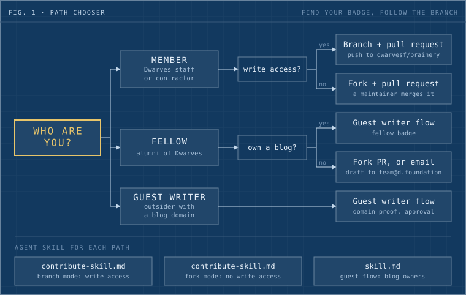
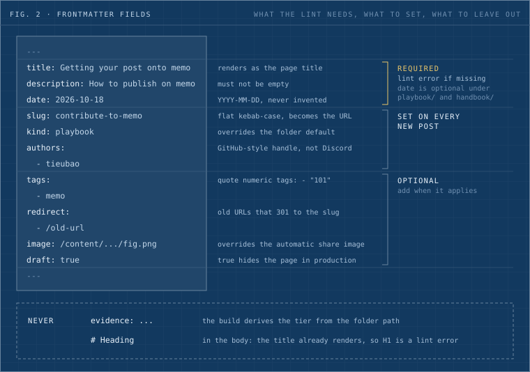
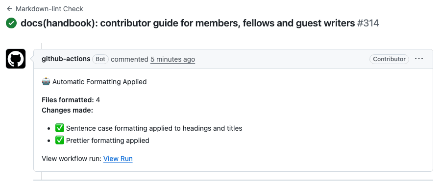
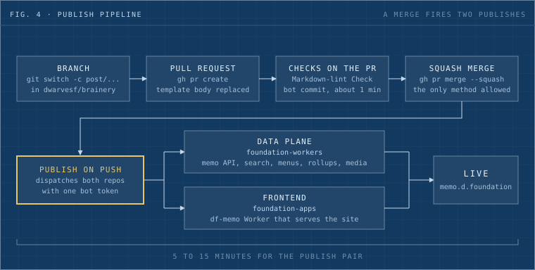
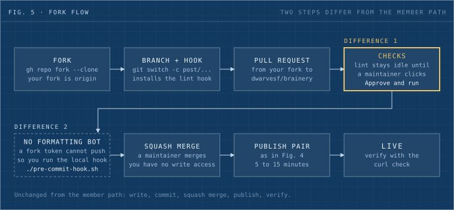
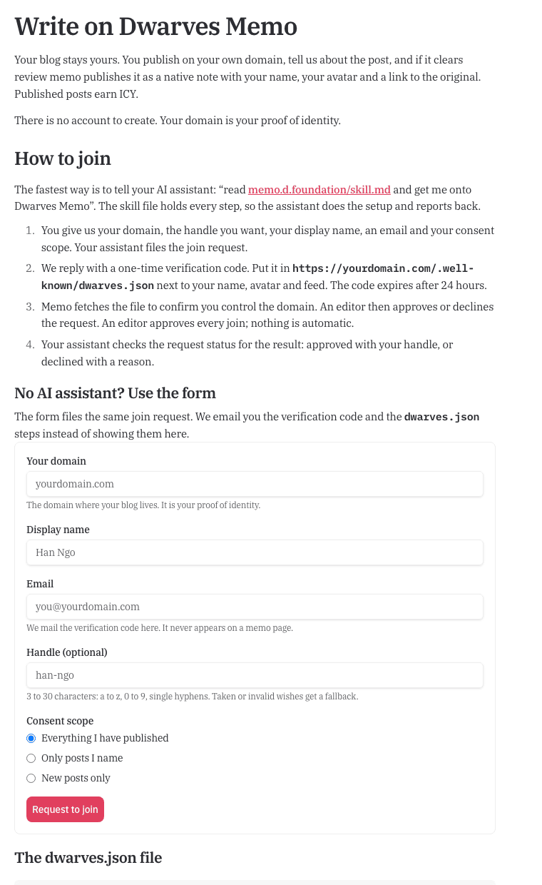
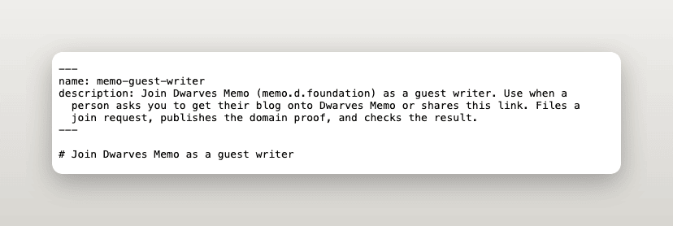
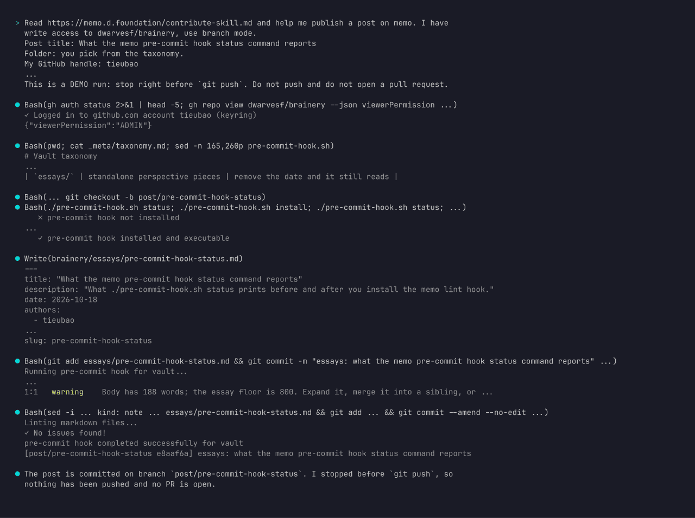
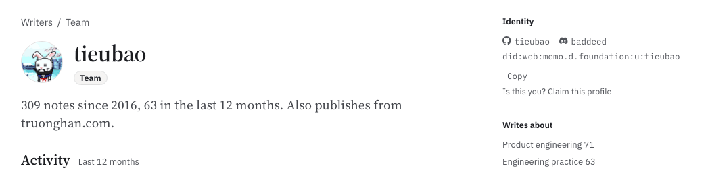

Memo has three doors, and the one you use depends on who you are: a member (current staff), a fellow (alumni) or a guest writer. Staff with write access open a branch in `dwarvesf/brainery` and send a pull request. Staff without write access and alumni without a blog send the same pull request from a fork. A writer who owns a blog domain skips the repo: they prove the domain, an editor approves, and each approved post lands as a native note.

No outside writer has published on memo yet. The only guest note so far comes from truonghan.com, the maintainer's own blog, so the guest door works and has never been used by a stranger. The fork door has a similar record, covered in the fellow path below.



_Fig. 1: Find yourself, follow the branch. The bottom row names the agent skill for each path._

## Find your path in 30 seconds

| You are                                          | Your door                       | First move                          | Chapter                                         |
| ------------------------------------------------ | ------------------------------- | ----------------------------------- | ----------------------------------------------- |
| Dwarves staff or contractor with write access    | Branch and pull request         | `git clone`, then a branch          | [The member path](#the-member-path)             |
| Dwarves staff or contractor without write access | Fork and pull request           | `gh repo fork`                      | [The fellow path](#the-fellow-path), fork steps |
| Alumni with a blog                               | Guest writer flow               | Tell your agent to read `skill.md`  | [The fellow path](#the-fellow-path)             |
| Alumni without a blog                            | Fork and pull request, or email | Fork, or write to team@d.foundation | [The fellow path](#the-fellow-path)             |
| Outsider who owns a blog domain                  | Guest writer flow               | Tell your agent to read `skill.md`  | [The guest writer path](#the-guest-writer-path) |

Not sure about write access? One command answers it, and it prints `true` or `false`:

```bash
gh api repos/dwarvesf/brainery --jq .permissions.push
```

An outsider with no blog and no Dwarves history has no built door yet. Write to team@d.foundation and say what you want to write.

## Why write on memo

Memo publishes a page only when it can win a search against a generic one. That bar has a name, the GEO bar, short for generative engine optimization: would an AI assistant answering a question about your subject cite your page? A page earns that with one of three things: firsthand data, a real verdict, or an angle nobody else has. A definitional page ("what is a pull request") loses every retrieval race, and the editors do not publish it.

You can test your own draft before anyone else does. Delete every specific from it: the numbers you measured, the date you decided, the thing that broke. If the post still stands, it was generic, and no amount of polishing fixes that. A post that survives names a verdict a competent peer could dispute and admits one thing that did not work.

The folder tests in the next chapter show the bar for each kind of post. A report in `reports/shipped/` needs a deployment that has been live for two weeks, with real metrics. A report in `reports/lessons/` needs three months of hindsight, checked against records instead of memory.

What you get back depends on your door.

| Door              | Byline                                                                                                             | Reward                                                                                       |
| ----------------- | ------------------------------------------------------------------------------------------------------------------ | -------------------------------------------------------------------------------------------- |
| Member            | A contributor page at `memo.d.foundation/contributor/<handle>`, with a Team badge for current staff or contractors | No per-post reward for member posts today                                                    |
| Fellow, fork path | The same contributor page, with a Fellow badge for former staff or contractors                                     | No per-post reward rule is published                                                         |
| Guest writer      | A contributor page with your verified domain and a Guest badge, plus a `rel=canonical` link back to your own site  | 5 to 20 ICY per published post, set by an editor, under a monthly cap the editors can change |

Dwarves has no rule that pays members for posts in the repo, so this page promises none. The ICY figures for guests come from the live join page, and chapter 5 covers them.

## Anatomy of a memo post

A memo post is one Markdown file, a folder of media beside it, and a frontmatter block the lint reads line by line. Four decisions shape it: the folder, the frontmatter, the voice and the figures.

### Pick the folder

Each folder holds one kind of claim, and each has a test. [`_meta/taxonomy.md`](https://github.com/dwarvesf/brainery/blob/main/_meta/taxonomy.md) is the source of truth for the full list. This table keeps the folders most posts land in.

| Folder                | Test                                                          | Default kind | Word floor |
| --------------------- | ------------------------------------------------------------- | ------------ | ---------- |
| `reports/shipped/`    | A live deployment, two weeks or more, with real metrics       | Field report | 1,200      |
| `reports/experiment/` | A controlled, reproducible setup with honest limitations      | Field report | 1,200      |
| `reports/lessons/`    | Hindsight on a project three months or more old, from records | Field report | 1,200      |
| `reports/commentary/` | Cited sources plus an original Dwarves angle                  | Essay        | 800        |
| `essays/`             | Remove the date and it still reads                            | Essay        | 800        |
| `journals/<series>/`  | Remove the date and it loses its meaning                      | Digest       | none       |
| `case-studies/`       | A client project outcome                                      | Case study   | 800        |
| `site/`               | A website function page                                       | Reference    | none       |

A second classification goes in `tags` or `series`, never in a new folder. Reports stay flat: `reports/<tier>/<name>.md`, with no subfolders.

A series is a set of notes that read in order. Put `series: <kebab-slug>` in the frontmatter of every part and number them with `series_part: 1`, `series_part: 2` and so on. The slug names the series, and memo groups the parts on the note pages and on each author's contributor page. Editors can also define a series for existing notes in the site code. Either route works, and a frontmatter `series` needs no code change.

### Write the frontmatter



_Fig. 2: A frontmatter block, annotated. Required fields, optional fields, and the two things that never belong._

Three fields are required: `title`, `description` and `date`. Playbooks and handbook pages may skip the date. Add a `slug` to every new post. It is flat kebab-case, unique across the vault, and it becomes the URL, `memo.d.foundation/<slug>`. The build fails on a duplicate.

The lint does not parse YAML. It counts any `key:` line as a top-level key and wants exactly one colon outside quotes on each. A title like `Why: a thing` fails until you quote it. Put nested values on one line in flow style, and quote a numeric tag such as `"101"`.

The lint treats everything else as optional: `authors`, `tags`, `kind`, `series`, `image` and `redirect`. Set `authors` anyway, or the post credits nobody. A page adapted from someone outside the contributor list sets `credit: <source name>` instead (add a quoted `credit_url:` for a link) and leaves `authors: []`. The byline then reads "Adapted from <source name>" and links no contributor page. The same pair covers a note nobody can name an author for: use `credit: Dwarves Foundation` with `authors: []`, and the note counts toward no one's contributor page. A moved file keeps its slug and appends its old URL to `redirect:`. `draft: true` hides a page in production, and a draft cannot be a redirect target. Two things never go in the frontmatter. An `evidence` key is out because the build derives the tier from the folder. A Discord name in `authors` is out because it creates a wrong contributor page, which chapter 7 covers.

### Kinds and word floors

Every note resolves to one kind: note, reference, digest, playbook, essay, field report or case study. The folder sets the default and a `kind:` line overrides it. The lint warns when the body falls under the floor: 150 words for a note, 400 for a playbook, 800 for an essay or a case study, 1,200 for a field report. Reference and digest have no floor. Code blocks, images and link addresses do not count. A warning does not fail the check. Expand the post, merge it into a sibling, or set the kind it really is.

### Voice

Memo reads as an essay, so first person and contractions are fine. Three things make a post worth reading: something firsthand that only the author could write, a verdict a peer could dispute, and evidence in the page, such as a command, a pull request or a before-and-after.

AI writing gives itself away through structure more than word choice. [The tells](/ai-writing-tells) lists the patterns the editors reject, among them corrective negation, antithesis pairs, setup-and-payoff landings and summary closers. Name the concrete thing in your title, and leave the body H1 out because the title already renders.

### Figures and media

The full rules sit on their own page, the [Memo media and styling standard](/memo-media-standard). They apply to every path, guest imports included. The budgets are targets that editors check by hand.

- **Format.** Draw diagrams as SVG. Use a raster only for photos, screenshots and scans, as webp at quality 80 or PNG after `pngquant`. Keep one file per image, because the worker never serves a `.webp` twin beside a `.png`.
- **Size.** Aim for a raster under 200 KB and between 704 and 1600 pixels wide, and an SVG under 60 KB. The reading column is about 704 pixels wide, so a narrower image blurs.
- **SVG.** Author at a `viewBox` width of 760 with no fixed `width` or `height`, and add `style="width:100%;height:auto;max-width:<W>px;display:block"`. Start with an opaque background rect, or the figure floats on the dark theme.
- **Alt and captions.** Every image gets non-empty alt text. Write each figure as `` and refer to it with `@fig-id`. Name files in lowercase, `<slug>-figN-<name>.svg`.
- **Hero and share card.** The first image in the body is the hero and the social card. Set `image:` only when the hero is not first, with an absolute path like `/content/<vault-path>/assets/<file>.png`.
- **Credit.** Credit any image you did not make on the line under the caption.

After a merge, `media-sync` moves raster files to the storage bucket and strips them from git. SVG stays in the repo. The workflow compresses each raster first and prints a warning in the run summary for any file still over 200 KB. The warning never fails the run.

Before review, run the [post rubric](/memo-post-rubric): a script for the mechanical rules and fifteen judgment questions for the rest.

### Parts that come from Markdown

Memo lays out a term peek, a step rail, a checklist, a definition grid, avoid and prefer pairs, a status line and an abstract from plain Markdown and frontmatter. [Write memo notes that lay out as parts](/memo-note-parts) shows the exact shape each one needs.

## The member path

You are Dwarves staff or a contractor and you can push to `dwarvesf/brainery`. This road is short, and it has fewer guard rails than most people assume.

The rules here are conventions. `main` has no branch protection and no ruleset, the repo has no CODEOWNERS file, and no check is required. A direct push to `main` works. Dwarves asks for a branch and a pull request anyway, because the pull request is the only place the lint and the formatting bot run before a page goes live. In 2026, 139 pull requests have merged into the repo. The same person opened and merged every one, with a median of 113 seconds from open to merge. Nobody assigns you a reviewer. If you want a second reader, ask a teammate yourself.

### Check your access

Run the `gh api` command from the chooser. Roughly ten people get `true`: the direct collaborators plus the members of the `leadership` and `community` teams. Dwarves does not hand out more push access, because with no branch protection every push right is also a push-to-main right. Staff who get `false` take the fork steps in chapter 4. Everything after the clone is identical.

### Clone and branch

```bash
git clone git@github.com:dwarvesf/brainery.git
cd brainery
git switch -c post/my-first-memo
```

The repo is text only and has no submodules, so the clone stays small. Branch names carry no rule. Pull request titles do follow a pattern: recent ones read `feat(commentary): ...` and `fix(content): ...`, which is conventional-commit style, and yours should match.

### Write the post

Chapter 2 covers the folder, the frontmatter and the voice. Three frontmatter fields are mandatory because the lint rejects a file without them: `title`, `description` and `date`. The date is optional only under `playbook/` and `handbook/`. Every new post also gets a `slug`, which becomes its URL.

If your post carries raster images, expect a follow-up commit after the merge. Brainery's `media-sync` workflow uploads raster images, video and PDF files to a storage bucket and strips them from git. The site keeps serving them at the same address. SVG stays in git.

### Lint before you commit

```bash
./pre-commit-hook.sh install
```

The script writes a `pre-commit` hook into `.git/hooks`. On every `git commit` the hook downloads the current `ci-lint.js` from `memo.d.foundation/tools/ci-lint.js` and runs it on your staged Markdown files. It needs `node` and either `curl` or `wget`. `./pre-commit-hook.sh status` shows whether the hook is installed, and `remove` takes it out.

After the lint, the hook runs `_meta/scripts/post-check.mjs` on the same files. It only warns and never blocks the commit. Its rules are part A of the [post rubric](/memo-post-rubric). Reinstall the hook once to get this step.

The hook also fixes. On a test file with a double-spaced heading and star bullets, it ran prettier, rewrote the file to a single space and dash bullets, and staged the result. It does not run the sentence-case check without AI-gateway credentials. It prints `sentence-case: CF_AI_GATEWAY_URL/CF_AIG_TOKEN not set ... skipping`, and CI runs that check for you.

### Open the pull request

```bash
git push -u origin post/my-first-memo
gh pr create --title "feat(essays): what we measured on X" --body "Adds a field note on X to essays/. Figures are SVG."
```

The organization's default pull request template is a generic code form, with prompts like "What's this PR do? Add new routes for user". Overwrite it with two sentences about the post and where it sits. Never write `[skip ci]` in the body. Brainery squash-merges with the pull request title plus body as the commit message, and that string in the message makes GitHub skip the publish run for the merge.

### What runs on the pull request

<!-- ch3: screenshot pending until the article PR exists -->



_Fig. 3: The article's own pull request, with the lint check and the "Automatic Formatting Applied" comment._

Any pull request that touches a `.md` or `.mdx` file runs the "Markdown-lint Check" job on the changed files only. When the job fixes something, it pushes a commit named `chore: automatic formatting (sentence case, prettier, lint fixes) [skip ci]` to your branch within about a minute and leaves a sticky comment headed "Automatic Formatting Applied". Run `git pull --rebase` before your next push, or the push is rejected as non-fast-forward. Do not force-push over the bot.

Read the bot's diff before you merge. It sentence-cases headings, and its proper-noun list is partial, so chapter 8 lists what it mangles. The check is not required, so a red lint does not block the merge button. Treat red as a stop anyway, because every error names a real defect in the page.

### Merge

Squash is the only merge method the repo allows. Merge commits and rebase merges are switched off.

```bash
gh pr merge --squash --delete-branch
```

The repo does not delete merged branches by itself, so the flag keeps the branch list short.

### Two halves publish



_Fig. 4: A merge to main fires two publishes. The formatting bot lands within about a minute, and the publish pair takes 5 to 15 minutes._

A merge to `main` triggers the workflow "Publish memo.d.foundation on content push". It dispatches two other repos with one bot token. `dwarvesf/foundation-workers` publishes the data plane: the memo API, search index, menus, rollups and the media bucket. `dwarvesf/foundation-apps` publishes the `df-memo` frontend Worker that serves the site. A full pair takes 5 to 15 minutes, since each repo runs its publishes one at a time.

### Verify it is live

```bash
curl -s https://memo.d.foundation/<slug> | grep -c "a phrase only your post contains"
```

The count should be above zero. Grep the body for something specific to your post instead of trusting a status code alone. Then confirm the publish ran for your merge:

```bash
gh run list -R dwarvesf/brainery --workflow publish-on-push.yml --limit 1
```

The newest run must carry your merge commit. If it does not, fire the publish by hand:

```bash
gh workflow run "Publish memo.d.foundation on content push" -R dwarvesf/brainery --ref main
```

If the page is still absent after 15 minutes, tell the editors. A failed earlier publish run can make later content-only runs refuse, and an editor resets that with one full publish.

## The fellow path

A fellow is anyone who once worked at Dwarves, as staff or as a contractor. The programs page puts it as "once a Dwarf, always a fellow." Your road splits on one question: do you have a blog?

A fellow with a blog could use either door, and the choice decides where the post lives. The guest door keeps your own site as the source, with memo holding a mirrored copy that points back to it. A pull request makes memo the home of the post. Pick the guest door when your site should stay canonical. Pick the fork when you want the post to exist only on memo. The guest door also has an approval flow built for outsiders, while a first fork pull request waits on a manual click.

### You have a blog

Use the guest writer flow. The fellow program page's own "Write as a Fellow" button leads to [memo.d.foundation/programs/guest-writers/join](https://memo.d.foundation/programs/guest-writers/join). Tell your agent to read [memo.d.foundation/skill.md](https://memo.d.foundation/skill.md) and get you onto Dwarves Memo, or fill in the form on the join page. Chapter 5 walks the flow.

Two points apply to fellows. If you already have a contributor handle from earlier posts, ask the editors at team@d.foundation to link your domain to it. The `dwarves.json` file you publish has an optional `native` field for that link, and memo treats it as a proposal that an admin confirms. After the link, your page is the member page, and the old contributor URL redirects there. Posts that arrive through the guest flow follow the guest reward rule in chapter 5.

### You have no blog

Send a pull request from a fork. The repo is public, forking is allowed, and four forks exist today.

```bash
gh repo fork dwarvesf/brainery --clone
cd brainery
git switch -c post/my-first-memo
./pre-commit-hook.sh install
```

`gh repo fork --clone` makes your fork `origin` and keeps `dwarvesf/brainery` as `upstream`. Write and commit as in chapter 3, then push to your fork and name the target repo explicitly:

```bash
git push -u origin post/my-first-memo
gh pr create --repo dwarvesf/brainery --head <your-login>:post/my-first-memo --title "feat(essays): ..." --body "Two sentences about the post."
```



_Fig. 5: The fork flow. Two steps differ from the member path: a first-run approval, and no formatting bot._

Two things differ from the member path, and both come from how GitHub treats fork pull requests.

The first run needs an approval. The repo's contributor-approval policy is `first_time_contributors`, so the lint workflow stays idle until a maintainer clicks "Approve and run". Your pull request can sit with no check at all until someone does. No response time is published for this click.

The formatting bot does not run on forks. A fork's token cannot push to your branch, so the format step and the sticky comment are skipped by design. The lint itself still runs, and a missing title or an H1 in the body still fails it. The sentence-case check skips with a warning, because it needs credentials that fork runs do not receive. You get no automatic fixes. Run the local hook before every commit, and write headings and the title in sentence case by hand. Only a maintainer can merge, since you have no write access. After the merge, publishing and verification match chapter 3.

The fork door has a thin record. In the repo's history, all 17 fork pull requests came from a single contributor. Fifteen merged, the last on 2025-06-20, and the other three forks have never sent one. That contributor wrote internal handbook pages and appears in the author alias table, so they were most likely staff. I found no outsider fork pull request that merged. The door works for staff. How a stranger fares is untested.

### You have no GitHub account

Email the draft to team@d.foundation. Include the Markdown in the message, say whether you are staff or alumni, and say what the post is about. An editor takes it from there. No reply time is published, so plan around that.

### Staff without write access

The fork steps above are yours too.

## The guest writer path

You own a blog domain, and your post lives on your own site first. After approval, an editor imports it as a native memo note with your name, your avatar and a link back to your original. The import is a bot commit straight to `main`, so there is no pull request to open.

### Join

Two routes lead to the same request. Tell your agent to read [memo.d.foundation/skill.md](https://memo.d.foundation/skill.md), or fill in the form on [memo.d.foundation/programs/guest-writers/join](https://memo.d.foundation/programs/guest-writers/join). The form emails you the verification code and the setup steps. Your agent shows them in the chat instead.



_Fig. 6: The join page. The agent route sits at the top and the form below it files the same request._

The request carries your domain, an optional handle, a display name, an email and a consent scope. Memo answers with a one-time code. You publish it at `https://<domain>/.well-known/dwarves.json` next to your name, and it expires after 24 hours. The file requires `name` and accepts optional `avatar`, `feed`, `bio`, `memo_verification` and `native` fields. Unknown fields are rejected. Memo fetches it to confirm you control the domain, and then an editor approves or declines. Nothing is automatic.



_Fig. 7: The top of `skill.md`, the one file an agent reads to run the join._

### Consent scope

You pick one scope at join, and editors can only select posts inside it.

| You choose                    | What it means                                                          |
| ----------------------------- | ---------------------------------------------------------------------- |
| "Everything I have published" | Memo may list any post from before today. Editors pick which to import |
| "Only posts I name"           | Memo lists only the URLs you give. Nothing else is touched             |
| "New posts only"              | Nothing from before today. Memo may suggest posts you publish later    |

Your consent also covers memo storing a copy of the images in a post it imports. Removing the post removes the copies.

### How posts get picked

A post reaches review in one of three ways. If you gave memo a `feed`, it checks the feed daily and suggests new posts to the editors. An editor can also pick past posts from your site, inside your scope. Or you email the URLs to team@d.foundation. There is no submit API, so the email is the whole mechanism, and no reply time is published.

### Review and rewards

A review agent judges each post against a written rubric: original, grounded in real work, and coherent. The bar is deliberately permissive. The verdict is published, rejected with a plain reason, or held for a human. A published post becomes an ordinary note in a folder an editor chooses, credited to you and linked to your original.

A published post earns 5 to 20 ICY, a whole number an editor sets for that post. A skipped post earns 0 and carries a written reason. Each person has a monthly cap that the editors can change. Views and likes never enter the math. Payouts are manual and batched, and wallet linking opens later.

### Removal

Delete or unpublish the post on your own site and memo takes its note down at the next daily check. Serve a `410` and it goes that day. A `404` gets a one-day grace period. Small edits sync through, and a rewrite or a new title goes back through review.

### What happens to your images and styling

When an editor publishes your post, memo copies each `https` raster image into its own storage and serves it from `memo.d.foundation/content/guest-media/`. The links in the note point to memo's copy. Memo checks the file bytes, so a renamed file does not pass. Nothing is copied when you submit or when an editor previews. Copying happens at publish only. So:

- Memo accepts png, jpeg, webp, gif and avif. The first copied image becomes the note's share image, so the social card uses your first image.
- An image over 200 KB is still copied, and the editor sees a warning. An image over 5 MB keeps its original link. So does any image past 25 MB or 30 images in one post. Those links still point at your server, so keep them online.
- An SVG file in an `` stays linked to your site, with a warning. Memo does not copy it. Inline `<svg>` rich figures work as before.
- An `http:` or `data:` image is dropped, and so is an `` inside a `figure.fig`. The editor now sees a `dropped_images=N` warning.
- Memo does not compress or resize the copy. Aim for a raster under 200 KB and at least 704 pixels wide. The editors' checklist on the media standard page covers both.
- When memo takes your note down, it deletes the copies too. When an editor re-imports an edited post, memo removes the old copies after about 30 minutes. Takedown runs once the takedown switch is on, and the guest writer report tracks that status.

The one live guest note, "Designing Out SNAP Fraud", has no raster image. All 26 of its rich figures came through intact, and it has not yet exercised the copy path.

Your site probably does more than memo carries over. The table lists the common cases. The full list is in the [Memo media and styling standard](/memo-media-standard).

| Your site does this            | On memo                                    | Do this instead                                                |
| ------------------------------ | ------------------------------------------ | -------------------------------------------------------------- |
| Custom web fonts               | Dropped. Type maps to memo's sans and mono | Set type with `--font-body`, `--fk-font` and `--fk-mono`       |
| Page-wide CSS, theme or layout | Not loaded. Only figure stylesheets load   | Put figure styles in a `figures.css`, with `fig` in the path   |
| Inline `<script>` or `<style>` | Ignored                                    | Use figkit attributes such as `data-tip` and `data-animate`    |
| `<iframe>` embeds              | Removed                                    | Link out, and add a still image with alt text                  |
| `` inside `figure.fig`    | Dropped, with a `dropped_images` warning   | Draw it as inline SVG, or place the image in a plain paragraph |
| `<svg>` outside `figure.fig`   | Removed, with a `dropped_figures` warning  | Wrap it in `<figure class="fig">`                              |

Rich figures follow their own contract at [`memo.d.foundation/figures.md`](https://memo.d.foundation/figures.md). The static figure must read fully with scripts off, and memo loads at most three same-host stylesheets whose path contains `fig`.

### Where this stands

The door has worked once, for the maintainer's own domain. No outside writer has gone through it. The rubric and the reward rule are written down, and neither has been tested on a stranger's post. If you are the first, tell the editors at team@d.foundation what confused you.

## Let your agent do it

Every door has a file an agent can read. You paste one sentence and the agent does the setup. A person still approves the steps that need one.

| Your path                            | Agent skill                                                                            | Mode   |
| ------------------------------------ | -------------------------------------------------------------------------------------- | ------ |
| Guest writer, or fellow with a blog  | [memo.d.foundation/skill.md](https://memo.d.foundation/skill.md)                       | Join   |
| Member with write access             | [memo.d.foundation/contribute-skill.md](https://memo.d.foundation/contribute-skill.md) | Branch |
| Staff or fellow without write access | [memo.d.foundation/contribute-skill.md](https://memo.d.foundation/contribute-skill.md) | Fork   |

Whichever path you use, tell the agent to fetch the [post rubric](/memo-post-rubric) and run both parts on the draft before it opens the pull request.

Paste the prompt for your path into Claude Code, Codex, Cursor or any agent that can run shell commands.

**Guest writer, or fellow with a blog**

```text
Fetch https://memo.d.foundation/skill.md with curl, read it whole, and get me onto Dwarves Memo.
```

**Member with write access**

```text
Fetch https://memo.d.foundation/contribute-skill.md with curl, read it whole, and help me publish a post on memo. I have write access to dwarvesf/brainery, use branch mode.
```

**Staff or fellow without write access**

```text
Fetch https://memo.d.foundation/contribute-skill.md with curl, read it whole, and help me publish a post on memo. I do not have write access, use fork mode.
```

Ask for `curl` by name. Some assistants summarise a page they fetch, and a summary drops the exact commands. In a test run, an agent that read a summary took its commit message from the wrong file.

### What the guest skill does

`skill.md` is named `memo-guest-writer`. The agent asks you for a domain you control, an optional handle, a display name, a contact email and one of three consent scopes. It posts the join request, publishes the one-time code at `https://<domain>/.well-known/dwarves.json` on your site (or stops and tells you when it cannot write there), and checks the result with a read-only call until an editor approves or declines. Memo sends no email about the outcome today, so that check is how you hear it. It refuses to improvise: on a `409`, `422` or `429`, or an expired code, it reports the error to you. Anything outside the join flow ends with a pointer to team@d.foundation. It also refuses to tell you your contributor URL from memory. The page address can change after an editor links you to a member profile, so the agent reads it from the API.

### What the contributor skill does

`contribute-skill.md`, named `memo-contributor`, is written for people who edit the repo. The agent first asks GitHub what access you have, and that answer picks the mode. In branch mode, it clones, branches, writes, installs the hook, opens a draft pull request with a body that replaces the template, and verifies the live page with the `curl` check from chapter 3. In fork mode, it forks first and then covers the same ground, and it warns you about the two fork differences: the first-run approval and the missing bot. With no GitHub account, it writes the post and an email to team@d.foundation for you to send.

The skill has hard stops. It never merges, never pushes to `main`, never skips the hook with `--no-verify`, never force-pushes, and never writes `[skip ci]` into a pull request body. It puts your GitHub handle in `authors`, never a Discord name, and checks that your slug is free. It reads the taxonomy file for the folder choice, and when two folders fit, it asks you.



_Fig. 8: An agent session running `contribute-skill.md` in branch mode, stopped before the push. Lines are trimmed from the real transcript._

The skills do not replace a person at the two steps that need one. An editor approves a guest join, and a maintainer clicks "Approve and run" on a first-time fork pull request. Your agent can report that the step is waiting.

## Getting credited

Put your GitHub-style handle in `authors:`, one entry per author:

```yaml
authors:
  - tieubao
```

Memo builds a contributor page for every author string it finds. The route is `/contributor/<slug>`, where the slug is the name lowercased and stripped to letters, digits and hyphens. A free-text name such as `Jane Doe` becomes `jane-doe`, and `jane` and `Jane D.` become separate pages. Nothing registers a page, so a mistyped handle gets a page of its own. The handle `tieubao` appears in 453 non-draft notes, all under one spelling, so the credit sits on one page.

A Discord username is the wrong value. Discord names create wrong pages, and the editors spent a pass cleaning them up: brainery #387 credited `minhluuquang` instead of the `0xm` alias, #388 credited `tuanddd` and `zlatanpham` instead of Discord aliases, and #389 credited `tieubao` instead of the `baddeed` alias. All three merged on 2026-10-18.



_Fig. 9: The header of a contributor page: name, avatar, the Team badge, and linked GitHub and Discord accounts with a DID._

The page shows a name, an avatar, a bio and links when the contributor has a profile record. A handle with no profile still gets a page. It shows the handle as the name and no picture. The page also shows one badge. Team marks current staff or contractors. Fellow marks former staff or contractors, taken from the Notion Contractors status that memo syncs into its people list. Guest marks an approved guest writer from the guest registry. A handle with no known source shows no badge, as `/contributor/claude` does. Guest writers get a handle that memo assigns, so they never choose a byline in frontmatter.

If you are outside the Dwarves Discord and want to prove that a GitHub byline is yours, open [memo.d.foundation/claim](https://memo.d.foundation/claim). You add one token to your GitHub profile README, and memo checks it. There is no account to create and no password to enter.

**Choose your Selected work.** A team member's contributor page shows up to three notes under "Selected work". You pick them. Add `featured: true` to the frontmatter of the notes you want shown, and memo lists them newest first. More than three flagged notes show the newest three. If you flag none, the page falls back to your newest three notes under the heading "Latest". The flag sits on the note, so on a co-authored note it counts on every co-author's page.

**Notes with no individual author.** Unsigned or adapted pages carry `authors: []` and a `credit:` line (chapter 2). They appear on no contributor page, so they never inflate anyone's count or series list. Do not put your own handle on a note you did not write to make it show up.

Two things live in code and have no frontmatter field. Merging two bylines into one needs a row in `dwarvesf/foundation-apps` for the redirect, and so does a request to have your Discord handle tagged when memo announces your post. The foundation-apps code keeps that directory by hand on purpose, because a wrong guess would tag the wrong person. Ask the editors, and attach the handle you want.

## When the lint says no

Run the hook before you push, and most of these never reach CI. The messages below come from running the live `ci-lint.js` against small test files.

| What you see                                                                   | Cause                                                                                                        | Fix                                                                                                                         |
| ------------------------------------------------------------------------------ | ------------------------------------------------------------------------------------------------------------ | --------------------------------------------------------------------------------------------------------------------------- |
| `H1 headings are not allowed in this document` (`markdown/no-heading1`, error) | A `# Title` line in the body. The frontmatter title already renders the page title, so a body H1 doubles it  | Delete the line, or demote it to `##`                                                                                       |
| `Required frontmatter field missing: 'title'` (also `description`, `date`)     | The field is absent or its value is empty. Legacy gaps in a file you touch block the lint too                | Fill it in. Take a missing date from `git log --diff-filter=A --format=%as -1 -- <file>`, and never invent one              |
| `Line 1 should contain exactly one colon outside quotes`                       | The frontmatter reader works line by line, not as YAML, so a second colon in `title: Why: a thing` breaks it | Quote the value: `title: "Why: a thing"`                                                                                    |
| `TypeError: e.replace is not a function`, no file reported                     | A numeric tag such as `- 101` crashes the lint                                                               | Quote it: `- "101"`                                                                                                         |
| Headline changed after the bot's commit, for example `What i'd do`             | The sentence-case bot lowercases a mid-heading `I` or a product name outside its short proper-noun list      | Rephrase the heading to avoid a mid-heading `I` or a product name                                                           |
| Publish skipped after a merge                                                  | `[skip ci]` in the pull request body ended up in the squash message                                          | Dispatch the manual publish from chapter 3, and keep the string out of future bodies                                        |
| A figure runs into the sidebar                                                 | A fixed-width SVG wider than the reading column                                                              | Drop the fixed `width` and `height`, keep `viewBox`, and add `style="width:100%;height:auto;max-width:<W>px;display:block"` |
| `git push` rejected as non-fast-forward                                        | The formatting bot pushed a commit to your branch                                                            | `git pull --rebase`, then push again. Do not force                                                                          |
| A fork pull request shows no checks                                            | First-time contributor approval is pending                                                                   | Wait for a maintainer to click "Approve and run"                                                                            |

Warnings do not fail the check, but two are worth reading. A `markdown/relative-link-exists` warning means a relative link points at a missing file; raster media is exempt because it lives in the bucket and not in git. A `markdown/kind` warning means the body is shorter than the floor for its kind, 400 words for a playbook.

## Pre-PR checklist

Run down this list before you open the pull request. The contributor skill checks the same items.

- [ ] File lives in the folder that matches its test (taxonomy)
- [ ] Frontmatter has title, description, date and a unique slug
- [ ] Every tag is a quoted string, and no value has a stray second colon
- [ ] `authors:` holds a GitHub-style handle, not a Discord name
- [ ] No H1 in the body; headings are in sentence case
- [ ] Figures are SVG without a fixed width, or optimized raster; every image has alt text and a caption
- [ ] The [post rubric](/memo-post-rubric) ran: `node _meta/scripts/post-check.mjs <note>` is clean or each warning is explained, and part B has a verdict
- [ ] `./pre-commit-hook.sh install` ran and the commit passed
- [ ] The pull request body is mine, and contains no `[skip ci]`
- [ ] Fork path only: I asked a maintainer to click "Approve and run"
- [ ] After the merge: the publish run shows my sha, and the curl check finds my phrase
