This is a talk about the talk format, built in that format. Each slide below sits beside the words that go with it. Read the slides alone for the argument, or read the notes for the evidence. The deck is the reference implementation that [Contribute to memo](/contribute-to-memo) links to, so every file named here exists in this post's folder.

## Why a talk page

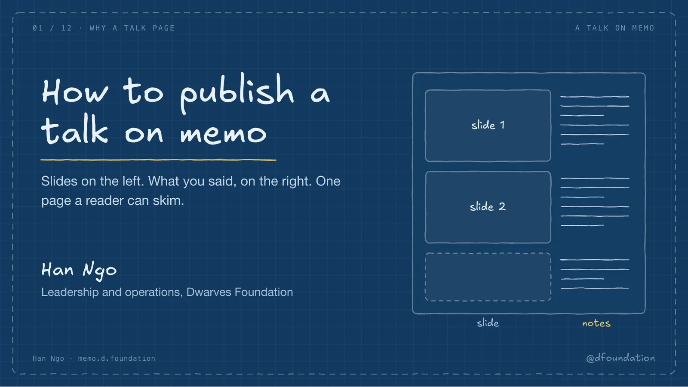

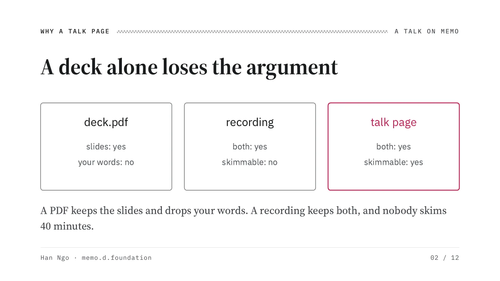

We give talks at OGIF and to clients, and afterwards the deck goes into a drive folder. Reopened a month later, the bullets no longer say why they mattered, because the why was spoken. The recording has the why, but a reader who wants one number from minute 31 has to scrub for it. A talk page puts the slide and the spoken part side by side, and the reader scrolls to the number they want.

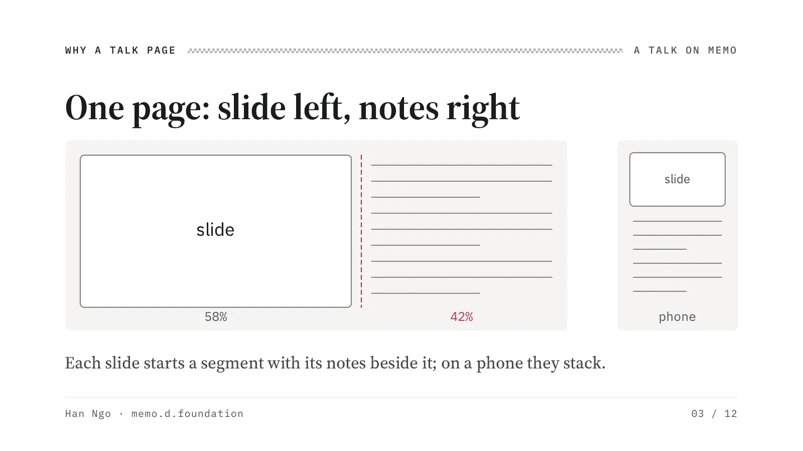

The layout comes from [Geoffrey Litt's talk page](https://www.geoffreylitt.com/2026/07/02/understanding-is-the-new-bottleneck.html): the slide on the left, the notes on the right, one segment per slide. On memo the grid is wider than the 704 pixel reading column, about 1,200 pixels, because a slide squeezed into the column is too small to read. That is the one place memo breaks its single-measure rule, and the media standard says so in writing.

## The files

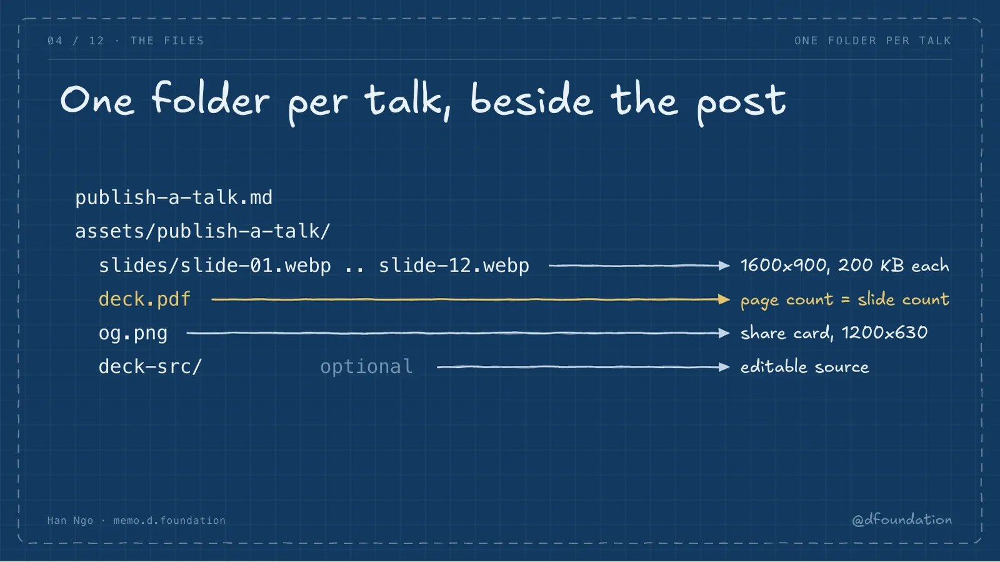

Everything for a talk lives in one folder named after the post. The slides are webp rasters at 1600 by 900, which matches a 16:9 deck and stays under the 200 KB cap at quality 80. The PDF is the file people download and present from, so its page count must equal the slide count. After the merge, media-sync moves the rasters and the PDF to the storage bucket, and the site keeps serving them at the same address.

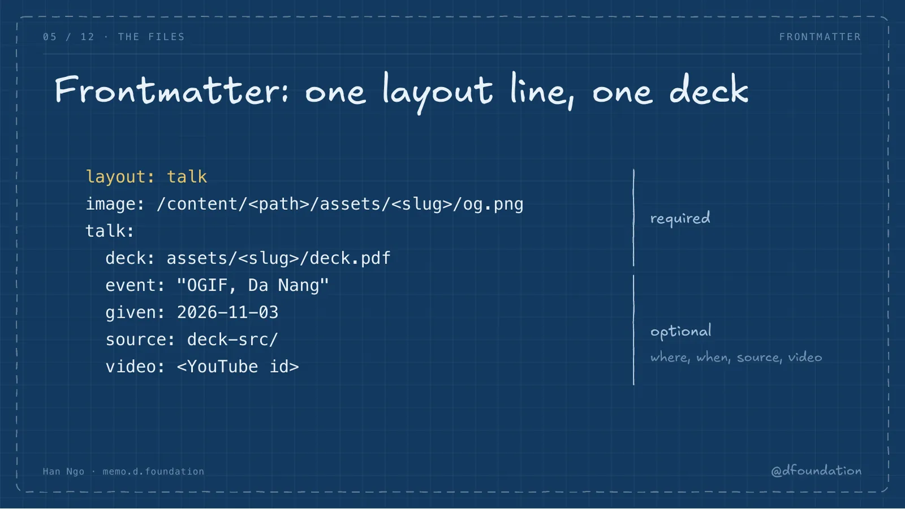

Only an explicit `layout: talk` turns the layout on. The deck path is the one required field under talk. Add where and when you gave it, a link to the editable source, and a YouTube id when there is a recording. Point the image field at og.png, or the share card falls back to the site default.

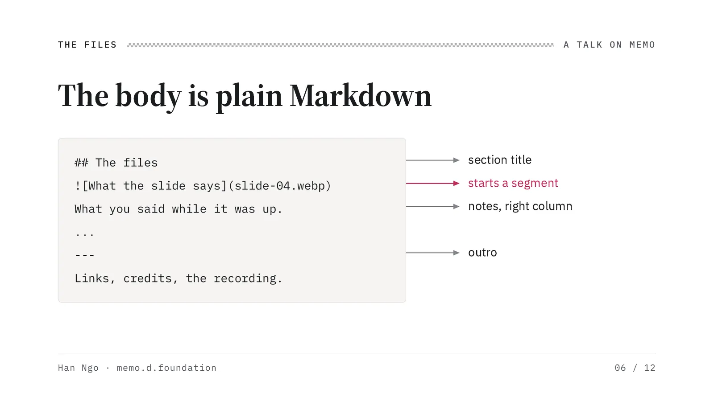

There is no new syntax. A paragraph that holds only one slide image starts a segment, and everything after it, up to the next slide, the next section heading or the closing rule, is that slide's notes. Paragraphs before the first slide are the intro. A plain Markdown reader, a feed or an agent sees images and paragraphs in order, which still reads fine.

## Two ways to build

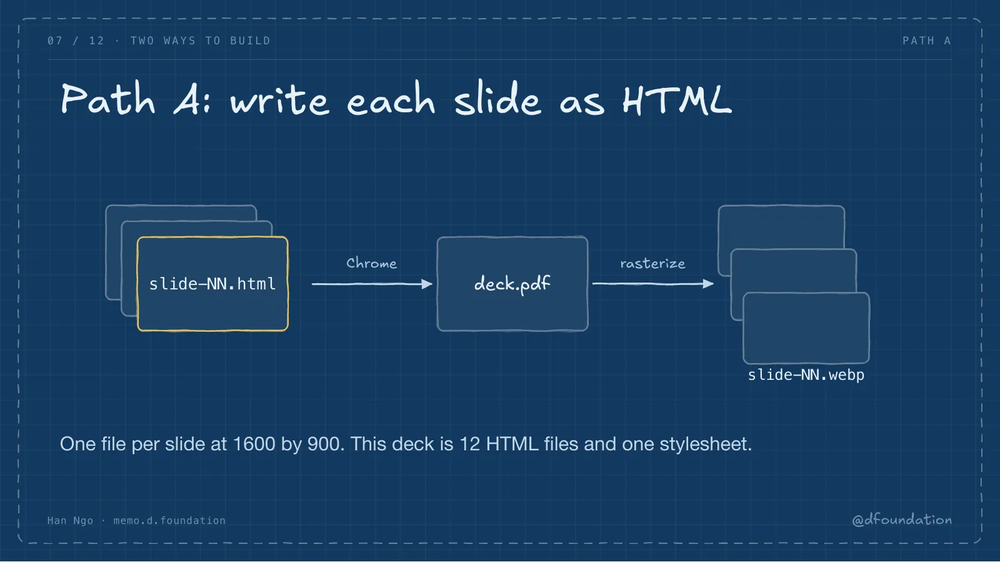

I wrote this deck as 12 HTML files and one stylesheet in deck-src. Each file sets a print page of 1600 by 900 pixels with no margin, so headless Chrome prints it to exactly one PDF page. The hand-drawn strokes are an SVG displacement filter on plain rectangles and lines, so editing a box means editing one rect, with no drawing tool in the loop. The font is Excalifont, embedded in the stylesheet so the deck renders the same on any machine.

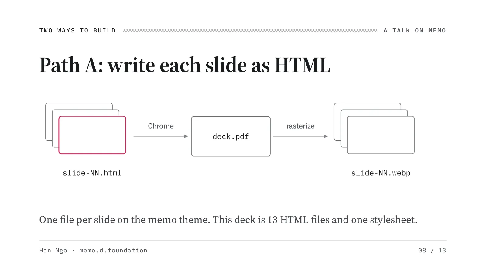

A guest speaker should not have to learn HTML to publish a talk. Export the deck you already have to PDF, put it at deck.pdf in the talk folder, and run the same script. It splits each page into a slide file. A deck that is not 16:9 gets letterboxed rather than stretched, and the script prints a warning so you can fix the export instead.

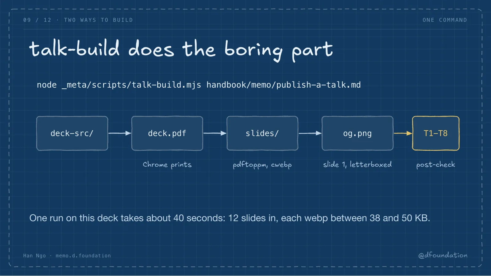

The script uses tools that were already on my Mac: Chrome or Edge, poppler and cwebp. It installs nothing, and it names any binary it cannot find. Two things bit me while writing it. Headless Chrome writes the PDF and then never exits, so the script polls for the file and stops the browser itself. And slide 1 is 16:9 while a share card is 1200 by 630, so the card is letterboxed in the slide's own background color instead of cropping the speaker's name.

## Stay in shape

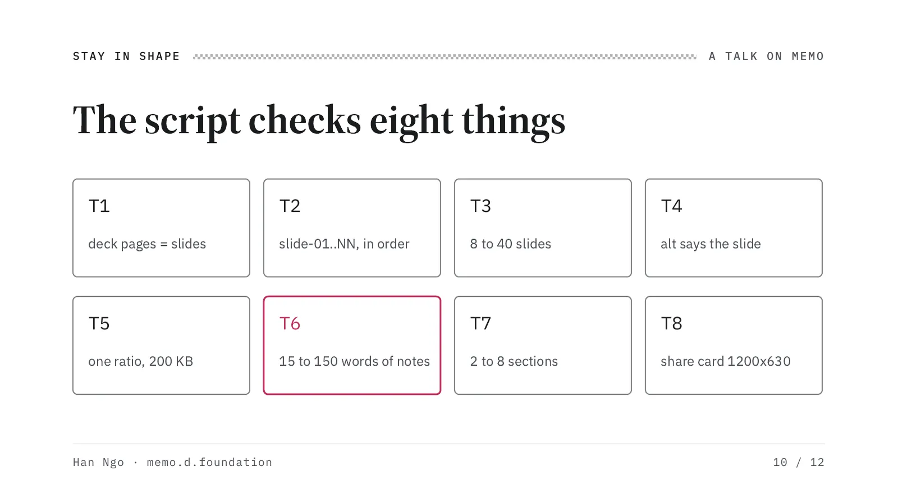

The post checker runs these eight only when the layout is talk. The first run on this post flagged every slide with the figure rules: a slide image has no caption title and no figure id, and it should not, because the notes are its caption. So the checker now hands slide images to the talk checks and keeps the figure rules for real figures. A worse bug came next: the checker crashed on its first talk run, the build script read the empty output as a pass, and only the fixture tests caught it. The build now fails when the checker fails. The notes check keeps a talk page honest. Under 15 words, the slide is unexplained. Over 150, it is an essay with pictures.

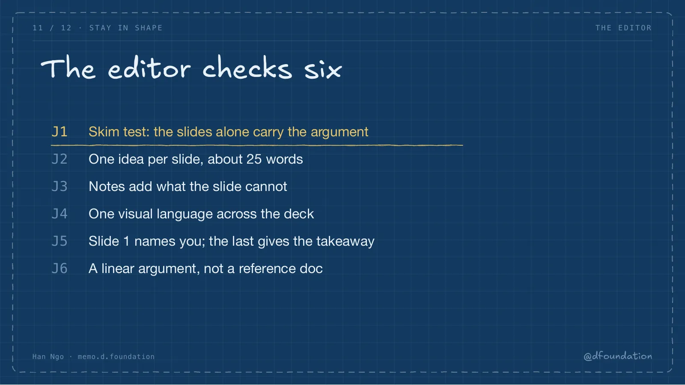

No script can tell whether a deck makes sense, so the editor answers six questions. The skim test comes first: read only the slides, and the argument should still land. Then one idea per slide, notes that add what the slide cannot, one visual language, a first slide that says who is speaking, and a last slide with the takeaway. The last check is fit. A playbook or a data-heavy report stays prose, because a talk works only when the argument runs in a line.

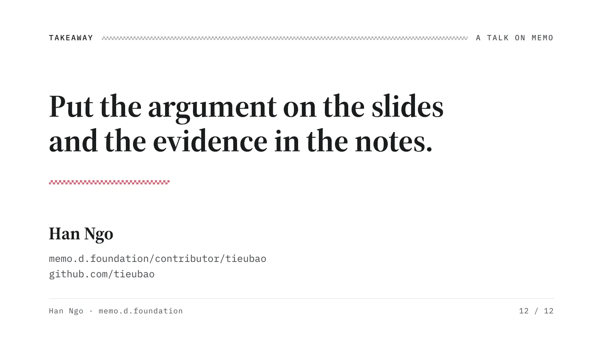

---

The rules behind this deck live in three places. The [post rubric](/memo-post-rubric) has the talk checks T1 to T8 and the editor table J1 to J6. The [media standard](/memo-media-standard) has the slide, deck and share-card budgets. [Contribute to memo](/contribute-to-memo) has the file layout and both build paths. The editable source of this deck sits in this post's deck-src folder.
