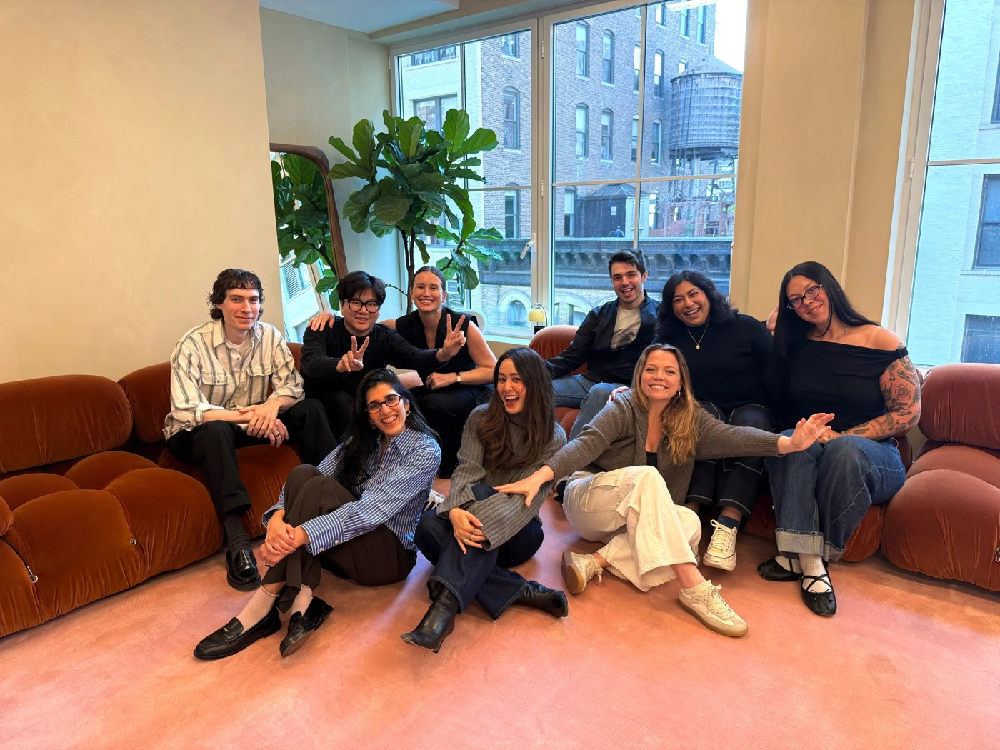
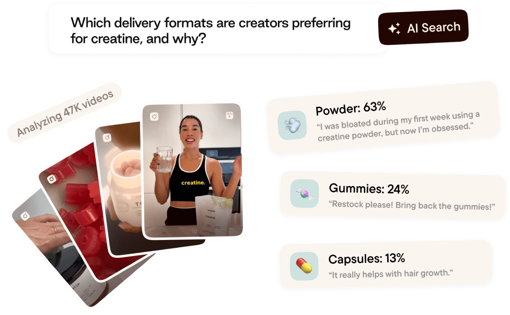
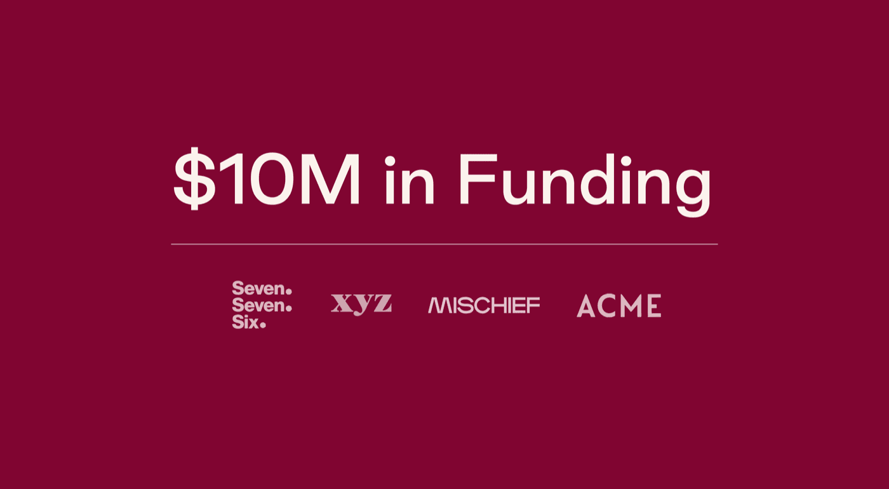
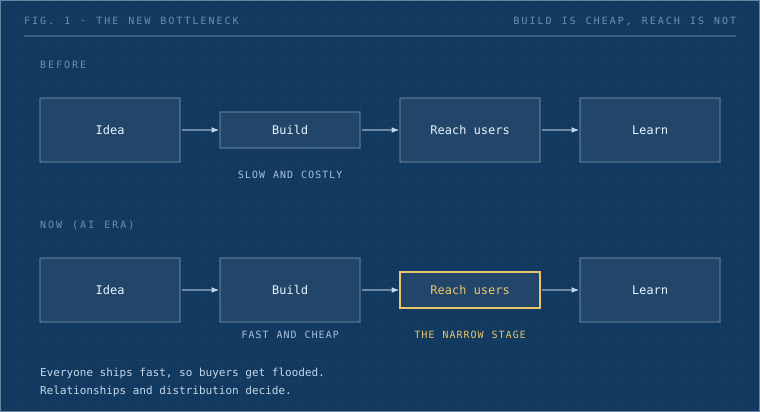

I talked with Ethan Phan, CTO of Plot, about how a small AI-native startup decides when to pivot, stays lean, and runs engineering when every engineer works with agents. His short answer: **building is cheap now, so reaching the right people is the hard part**. The people who direct the agents still need taste, accountability, and a habit of sharing what they know.

**By the numbers**

|                |                                                                                                                  |
| -------------- | ---------------------------------------------------------------------------------------------------------------- |
| About 8x       | Per-engineer velocity since Q1. It doubled every quarter.                                                        |
| Top 10%        | Still top 10% against startups of the same engineering size, every quarter. So the whole industry doubles too.   |
| 2.5 to 3 years | Time to product-market fit (the stage where real customers want the product enough to keep using and buying it). |
| Fewer than 20  | People in the whole company.                                                                                     |
| \$10M           | Seed round, announced June 2026 (public).                                                                        |

**Who is Plot**

Plot ([plot.so](https://plot.so)) is a New York startup founded in 2022 by Megan Duong (CEO) and Ethan Phan (CTO), who met through Y Combinator's co-founder matching. About 80% of brand mentions in TikTok and Instagram video carry no tag, so Plot's multimodal AI watches the video itself. Today it calls itself a social intelligence platform, "a brain for marketing teams", with named customers that include Visa, Mastercard, PepsiCo, Fenty Beauty, and Benefit Cosmetics. In June 2026 it announced a \$10M seed led by XYZ Venture Capital and Mischief Ventures, \$14M raised in total. Dwarves engineers have worked alongside the team.

_The Plot team in their New York office. Photo: [plot.so](https://plot.so)._

**Who is Ethan, and why this talk**

Ethan is Plot's co-founder and CTO. Before Plot he led product engineering at Formation Bio and was a software engineer at Microsoft.

My own engineering has slowed lately, so I asked what I wanted answered: how does someone who runs an AI-native team every day keep moving? What follows is the call, edited for grammar and filler, with Ethan's sign-off.

## The pivot signal

_The hard part of a pivot is knowing when the old idea is done._

**Han:** How do you know when to switch? Do you track the market, talk to investors, run a pilot for three to six months?

**Ethan:** For us it was one call. We were still running the old product. I had been watching what video intelligence made possible. On that call I showed a customer what the product could look like. Their reaction was immediate: "I want it now." That is a very clear signal. **After that call we moved the whole team to the new product**.

Most people say "this is great", and then you rarely hear back. They are being nice. A real need sounds like "I want it now". **If you get a lot of that, make the bet**.

Talking is not enough, though. People do not know what they want. **Give them a real product, even a rough one, and watch whether they use it**. Would they use a bad solution to this problem?

## One product, two vocabularies

**Han:** You also changed how you describe the category. How did the market react?

**Ethan:** We are not a traditional social listening product. We are more an evolution of it: we do not just listen, we also take action. The new wave of AI lets us do much more: richer insights from social and video content, and far more automation.

For investors, it is important to define who we can be, so **we call ourselves a brain for marketing teams**. In sales and go-to-market, a new category is very hard, because you have to re-educate the market first. So in go-to-market you stick to a well-known category, which is why we sell as video social listening. **Customers and investors need different language**. Customers need words that show them the gap. Investors need words that show them the future.

_Plot's AI Search reads thousands of creator videos to answer one marketing question. Image: [plot.so](https://plot.so)._

## Stay lean, expect a long road

_Lean sounds like a style. For Plot it was a bill that ran for years._

**Han:** Were you self-funded in the early days?

**Ethan:** No. We were lucky to have an early investor who believed in us before we even had an idea. We were super lean: me, my co-founder, and later some engineers from Dwarves. **Keep burn low and iterate fast until product-market fit**. You do not want a 10-person team before you know what you are doing. You make the call and run with it, to extend the runway to the next milestone.

**Han:** How long did that take?

**Ethan:** Almost 2.5 to 3 years. It is a long time.

_Plot announced a \$10M seed in June 2026. Image: Plot newsroom._

## Distribution is the new bottleneck

_Anyone can ship in a weekend now. If that is true for everyone, shipping stops being the edge._

**Ethan:** You can build an app in a couple of hours these days. But **building fast is no longer the constraint**. The question is whether you can reach the right people fast enough for them to use the product and for you to iterate. Everyone is fast, so those people get bombarded. You need connections in place.

**Han:** If you started again, would you talk to people first, or build?

**Ethan:** Both at the same time. If you have a bet, build it, and keep talking to people, because that is who you hand the product to. Iterate every couple of days and run several experiments with different groups. **If traction drags, that is a learning too**.

I mean B2B here. Early selling is mostly relationships, because enterprise decision-makers are hard to reach. That is why founders go to conferences. For us, **enterprise relationships are a moat**, and being technically advanced is another.

_Fig. 1: Building got cheap; reaching the right people is the new bottleneck._

## Running engineering with agents

_This is the part I came for. When I talk to an agent, I often trust my own judgment more than a handoff to a person. I wanted to know if that is a trap._

**Han:** How big is the team, and how do you split the work?

**Ethan:** Fewer than 20 people in total. Most of the time **one engineer owns a project end to end**. We only put several people on one when it needs a specific skill set or it is really large. Engineers run several projects at once, and so do I.

**Han:** With six or seven projects in flight and agents producing piles of output, how do you keep quality up?

**Ethan:** First, have the agents talk back to you in Simplified Technical English [a plain-word writing standard first built for aircraft manuals: short sentences, one meaning per word]. Look it up. Agent output is long for no reason, and this keeps it readable. Second, **know where you are okay with slop** [low-quality AI output] and where you are not.

**Han:** And the output from your engineers?

**Ethan:** We still have traditional code review, but rarely. Auto-approval is common now, and it has caused quality problems. So I am adding accountability: **from the moment you hand code to stakeholders to test, I count your bugs**. It is a forcing function. You cannot slop all the way. I also try to stay curious: I ask questions to understand how things work and what the fix was, and I want that curiosity in the team culture. It forces everyone to understand what they shipped and to explain it. I do not have a perfect answer. We want to move fast and still understand what we ship.

**Han:** Still doing scrum?

**Ethan:** No. We are project-based, and **almost every engineer leads their own projects** as the directly responsible individual. We are building a Claude-assisted process for transparency and alignment, without making engineers project managers. It comes from a Q3 lesson: no process, projects slipped, and engineers handed off to design too early.

_That Q3 is the cost side of the story. With no process, work bounced between engineering and design and the team lost time._

**Han:** How do you balance time with agents and time with people?

**Ethan:** That is why most projects are solo. It is easier to control the agents. But we enforce an RFC review before building, a technical critique session where people share the plan and improve the architecture, because sometimes you let the agent plan and just run with it. We also enforce a demo step after shipping. Engineers move between projects, so **without knowledge sharing they cannot form taste and judgment**, and then they cannot guide the agent. My goal is to step in as little as possible, except on critical projects.

## Steal this: running an AI-native team

Ethan says the process is still a work in progress. These are the habits he described. Copy the ones that fit.

- **One owner per project.** Name one person who owns it end to end. Add people only for a missing skill or a very large scope.
- **Hold an RFC review before building.** Share the written plan in a short technical critique to improve the architecture, even when the agent drafted it.
- **Demo after shipping.** The demo is how the team builds taste and judgment.
- **Count bugs from handoff.** From the moment code goes to stakeholders, count the bugs against its owner.
- **Be curious, and make it the culture.** Ask how things work and what the fix was. Everyone should be able to explain what they shipped, because that knowledge is where taste and judgment come from.
- **Talk to agents in Simplified Technical English.** Have them answer in it too, so output stays short.
- **Decide where slop is fine.** Name which output can be rough and which must be right.

## Hiring: research mindset, agency, learning

**Han:** If you hired now, what would you look for?

**Ethan:** AI engineers, which really means full-stack engineers who know how to work with AI. **You need a research mindset**. Many of our LLM problems are research: thousands of possible approaches, so you need a good hypothesis and you cannot give up early.

**Also high agency**, because I do not want to tell people what to do. Vetting is a million-dollar question, and I do not claim to have solved it. Here is what he does, in a form you can use in your next interview:

- **Ask:** "What did you learn recently?"
- **Red flag:** "I want to work with LLMs but I haven't had time." Learning is so easy right now that time is no excuse.
- **Look for a research mindset:** a hypothesis when stuck, and a step back before pushing another direction.
- **Look for high agency:** people who do not need to be told what to do.

Delegation only works with a really strong engineer in place, which is why our US engineering team is still very small. **One strong engineer is 100x better than ten mediocre ones**.

## Speed and the race ahead

**Han:** Are you happy with the last few months of output?

**Ethan:** Per-engineer velocity has doubled every quarter, about 8x since Q1. But against startups of the same engineering size we were top 10% in Q1, Q2, and Q3, so **the whole industry is doubling every quarter**. For us the hard part is moving fast without breaking things, because our pipeline is complex and enterprise customers raise the cost of mistakes. I have not got that balance right yet.

**Han:** What keeps you going from here? Where do you want to take Plot?

**Ethan:** Grow as much as we can. It is competitive and it is fun. I think we are ahead of most of the field. There is one main competitor, ahead of us in some parts and behind in others. But it is a race, and **there will probably be only 1 or 2 winners**. We want to be one of them.

## What we're taking back to Dwarves

Before this call, I liked to work with a few people I trust plus AI agents, more than to hand work out to many people. Ethan said **delegation only works when a really strong engineer is in place**. That matches what I see.

But I also want Dwarves to be a place where people grow and build their own products. **These two wants pull against each other**. If I keep the work in a small circle, the rest of the team gets less room to build.

Ethan's way out is **one owner per project, with two checks**: an RFC review before building, and a demo after shipping. I will try both at Dwarves. One question stays open for me: when I do the work myself with an agent instead of handing it to a person, is that a strength or a trap?

## Takeaways for the team

- **Read the pivot by energy.** "I want it now" beats polite praise.
- **Use two vocabularies.** Customers need words for the gap today. Investors need words for the future.
- **Stay lean until you know.** Plot needed 2.5 to 3 years to find product-market fit.
- **Distribution is the bottleneck.** If anyone can build in days, relationships decide who wins.

Thank you to Ethan for the open, unscripted conversation and for letting us share it.

**Follow along.** Follow Plot at [plot.so](https://plot.so) to see where Ethan and Megan take it. Know a builder we should walk around with next? Tell us who should be the next WALA guest. Dwarves builds AI products with founders: [d.foundation](https://d.foundation)

---

**WALA: to walk around, learn around.**

In our line of work, we hear and talk about domain knowledge all the time. WALA aims for exactly that: we, people in tech, take a break from sitting in front of our computers, to go out, connect with new people, and get to understand other businesses.

Through stories collected from WALA conversations like this one, we hope our community members get the chance to learn from others' successes and failures, gain insights into what works and doesn't, and reflect on their own works and practices.

Besides, breaking away from the stereotype of "tech people are introverts" is always fun.
