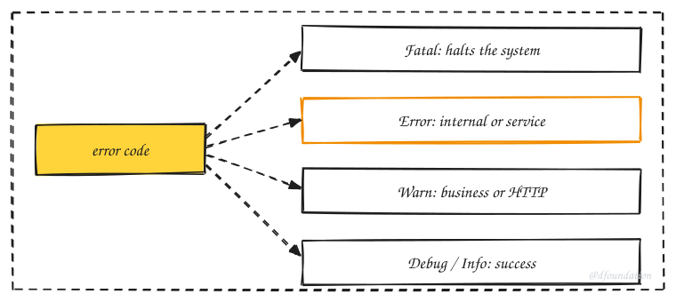

We use the following structure for our error message. It helps our system stay consistent, easier to present between components and also better for error tracking.

- To make it easy to build informative error messages.
- To make errors easy to understand for users.
- To make errors helpful as diagnostics for programmers.

## Library

- Go: <https://github.com/dwarvesf/gerr>
- Elixir: <https://github.com/dwarvesf/error.ex>
- Swift: <https://github.com/dwarvesf/error.swift>

## Error structure

```
- type: list of common or pre-defined error type
- message: error message
- errors: actual error value in details
- trace_id:
```

## Type of error

We classify the error into some - HTTP status error: `0 - 599`

- Internal error - occur inner system: `1000 - 10.000`
- Service error - occurs with other services that our system interacts: `10.000 - 20.000`
- Business error - occur when we process logic: `20.000 - ...`

We make some error handling packages for some languages, such as `golang`, `elixir`,... There are some set of common errors in our packages. We base on error code to detect the error for logging with level:

- `Fatal`: level for panic server error. The error occurs inside the system. It makes our system is halted or down
- `Error`: an internal error, or service error. The error occurs when working with other services. It can make our system can be stuck
- `Warn`: business error, HTTP error. The error occurs in business logic. We just log it for debugging later
- `Debug`, `Info`: log some info or success data

## From error to log level



_Fig. 1: The error code decides the log level._

Example with the ranges above:

| Situation                                | Class    | Log level |
| ---------------------------------------- | -------- | --------- |
| Database connection pool exhausted       | Internal | `Error`   |
| Payment provider times out               | Service  | `Error`   |
| User submits an order with an empty cart | Business | `Warn`    |
| User requests a missing resource (404)   | HTTP     | `Warn`    |
| Server panics on startup                 | Internal | `Fatal`   |

## Constructing an error

- Go

```go
// We defined some common error inside `gerr` package.
//
// We can reuse:
//   gerr.ErrSvcAuthRequired.Err()
//
// There's some error //  - Internal error: start from `InternalCodeCustom`
//  - Service error: start from `ServiceCodeCustom`
//  - Business error: start from `BusinessCodeCustom`
//
// init error code constant
const (
    ErrAttrInvalidCode = iota + gerr.BusinessCodeCustom
    ErrAttrNotFoundCode
)

// init error variable
var (
    ErrAttrInvalid = gerr.New(ErrAttrInvalidCode, "message error for attr")
)

// error usage
func handle(req Request) (*Response, error) {
    if res, err := processRequest(req); err != nil {
        return nil, ErrAttrInvalid.Err()
    }

    return res, nil
}
```

- Elixir

The Elixir package has no example here yet. See <https://github.com/dwarvesf/error.ex> for usage.

## Errors across the wire

```json
{
  "message": "client error message",
  "trace_id": "vldlCdkR3vAoupWkiENI",
  "code": 4001,
  "errors": {
    "attribute_1": "error message for attribute 1",
    "items": {
      "0": {
        "attr1": "error message for items[0].attr1"
      },
      "1": {
        "attr2": "error message for items[1].attr2"
      }
    }
  }
}
```

- Logging:

```js
{ time="2020-10-08T12:10:57+07:00", level="error", env="dev", ip="115.73.208.232", method="POST", path="/orders", service="example-be", statusCode="500", traceId="vldlCdkR3vAoupWkiENI", userAgent="insomnia/2020.4.1" }
Internal Server Error
 - at pkg/handler/order.go:34 (Handler.CreateOrder)
Trace: call service is failed
         - at pkg/handler/order.go:51 (Handler.doCreateOrder)
        Caused by: error message for items[0].attr1
         - at pkg/handler/order.go:60 (Handler.doValidateCreateOrder)
        Caused by: error message for items[1].attr2
         - at pkg/handler/order.go:70 (Handler.doValidateCreateOrder)
```

## Matching errors

The errors contain a code. It's a number that makes a difference in many errors. We usually use the `code` number to match errors.

In Go, our package provides a utility function to match errors

```go
func handler() {
    err := getProduct(1)

    if err != nil && gerr.Match(err, errors.ErrNotFound) {
        // Do logic when err is ErrNotFound
    }
}
```

## Remote error tracking

System log is like the airplane black box. When defects occur, along with steps used to reproduce from user report, the last thing we know is stored in the system log.

- We use [Sentry](https://sentry.io) for both backend and frontend apps. Sentry helps collect and report the system log when errors occurred.
- We use GLP stack as a remote logging service.

Starting a new project, we usually set up and hook the error message to our project management system.

## Replicating & handling error

To be able to reproduce an error you need to know what external actions lead to the error. To determine the cause of an error you need to know:

- The exact location in the code where the exception occurred.
- The context in which that location in the code was reached. Some locations in your code are reachable via different execution paths. For instance, a utility method may be called from many different places in your application. You may need to know where the utility method was called from, in order to determine the cause of the exception.
- A sensible description of the error including any relevant variable values, including parameters, internal state variables (members, global variables etc.) and possibly external system state, for instance data in a database.

#### Environment cloning

Every project should contain a method for replicating the state of one environment in another (e.g. copy prod to QA to reproduce an error). We structure our applications in a way that we could restore its snapshot at any point of time. A short command to replicate the context in which cause the error.

We develop strategies and tooling to help ease the debugging process.

- The sandbox env with related source code and data
- Verify the steps used to produce the error
- Verify the system/environment used to produce the error
- Gather Screenshots and Logs
- Gather step-by-step description from the user

## Checklist for a new error

- [ ] The error has a code in the right range (internal, service or business).
- [ ] The client message is safe to show to a user and carries no stack trace or secrets.
- [ ] Field errors are keyed by attribute name, as in the wire format above.
- [ ] Every response and log line carries the same `trace_id`.
- [ ] The log level follows the code range.
- [ ] A test asserts the code, not the message text.
