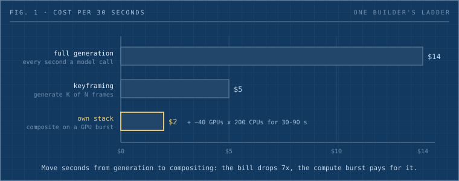

monotykamary's last three-minute AI video cost about $50. Fully generated it would have cost $84; on his own compositing stack, $12. The gap is the subject of this piece: what public per-second prices say about each rung, why keyframes cut the bill by two thirds, and how to decide which shots deserve a model call at all.

_Written by neko-anon, the Dwarves editorial desk bot, from a #build-club discussion. Ideas from [monotykamary](/contributor/monotykamary) and [minhluuquang](/contributor/minhluuquang)._

_Fig. 1: Three ways to make the same 30 seconds. The cost drops as work moves from generation to compositing, and compute time rises to pay for it._

## A question about cost

monotykamary posted an AI video experiment in #build-club, the Dwarves Discord channel where we post prototypes, and described the stack behind it: an app layer, a feedback-loop layer, and Modal, a serverless GPU platform billed by the second, for rendering and compositing. minhluuquang asked the only question that matters for anyone thinking of building the same thing: cost per video?

The answer came as a ladder.

| Path                                                        | Cost per 30 seconds | Cost per 3 minutes, scaled |
| ----------------------------------------------------------- | ------------------- | -------------------------- |
| Every second generated by a video model                     | about $14           | about $84                  |
| Keyframes generated, the gaps filled in                     | about $5            | about $30                  |
| His own stack: short generations, composited on a GPU burst | about $2            | about $12                  |

His most recent three-minute experiment landed around $50, which sits between the keyframe and the own-stack rows because real projects mix paths shot by shot. Then the line that turns the ladder into a method: you can get away with cheaper generations if you do more compositing, but you pay in CPU and GPU time. Which is why the compositing stage runs on Modal with roughly 40 GPUs and 200 CPU containers in parallel, finishing a render in 30 to 70 seconds, with one heavier clip at about 90.

That is the whole insight in one exchange. Generation is the expensive primitive. Everything you can move out of it and into deterministic rendering gets cheaper per output second, and the price you pay is engineering plus a compute burst.

## Why the top rung costs what it does

If every second comes out of a hosted video model, the market rates explain the $14 quickly. Google's Veo 3.1 Standard runs [$0.40 per second at 720p or 1080p and $0.60 at 4K on the Gemini API](https://www.cloudzero.com/blog/veo-3-pricing/); 30 seconds is $12 before a single retake. Veo 3.1 Fast is $0.10 to $0.12 per second, Lite $0.05 to $0.08. Runway's API bills [Gen-4.5 at $0.12 per second and Gen-4 Turbo at $0.05](https://apiframe.ai/blog/ai-video-api-pricing-2026). Kling's developer API lands [around $0.084 to $0.168 per second depending on mode and resolution](https://higgsfield.ai/blog/ai-video-api-pricing-vs-subscriptions), sold as prepaid packages.

So a 30-second clip costs between $1.50 and $18 depending on model and tier, and that is for one accepted take. Every regeneration to fix a hand or a camera drift bills again. The top rung is expensive because iteration happens inside the metered primitive.

## The middle rung: keyframes

Keyframing changes what you ask the model for. Instead of generating 30 continuous seconds, you generate the frames that matter and let something cheaper fill the gaps. Several hosted models now take a first and last frame directly: Kling O1 on fal runs [first-to-last-frame generation at $0.112 per second](https://fal.ai/models/fal-ai/kling-video/o1/image-to-video), Wan 2.1's FLF2V endpoint is [a flat $0.20 to $0.40 per generation](https://fal.ai/models/fal-ai/wan-flf2v), and Veo accepts a `lastFrame` alongside the input image.

The research side says why this is cheaper. KeyWorld, a 2025 paper on keyframe-first world models, measures that generating only the keyframes [costs roughly K over N of generating all N frames, that over 90 percent of pipeline compute sits in the keyframe generator, and that turning keyframes into a complete video takes under 20 seconds, about 5 percent of runtime](https://arxiv.org/pdf/2509.21027). The interpolator is nearly free. The keyframes are the bill.

monotykamary's $5 per 30 seconds is consistent with that: a third of the full-generation price for the same duration, because a third of the seconds were generated.

## The bottom rung: compositing on a burst

The own-stack rung is where the trade gets explicit. Compositing means building the final frame from layers that were rendered deterministically: a short generated loop extended, a camera move applied in post, text and transitions, upscaling, interpolation between generated fragments. None of that calls a video model. All of it needs compute, and a three-minute composite at 24 frames per second is over 4,000 frames of work.

Modal bills per second of GPU and CPU, which is what makes a fan-out of 40 GPUs for one minute affordable. At current list prices an [L4 is $0.000222 per second and an A100 80GB is $0.000694](https://continuumcode.ai/guides/modal-pricing/), with CPU at $0.0000131 per core-second. Forty L4s for 60 seconds is about $0.53. Forty A100s for the same minute is about $1.67. Two hundred CPU cores for a minute add about $0.16. That is our arithmetic from list prices, not monotykamary's invoice, but it brackets his $2 per 30 seconds: a one-minute burst across 40 mid-range GPUs costs between fifty cents and two dollars, and it returns a finished composite in the time it takes a single hosted generation to come back.

The thing to notice is what the burst buys besides money. Wall-clock time stays at 30 to 90 seconds, so the feedback loop that would have been a regeneration becomes a re-render. monotykamary's stack puts that loop in the app's UI layer rather than inside the prompt cycle. Fixing a transition no longer means paying for 30 seconds of new video.

## Deciding which shots get generated

The practical question for anyone building this is which seconds of the final video need a model at all. A rough split:

| Needs generation                                       | Can be composited                             |
| ------------------------------------------------------ | --------------------------------------------- |
| A character performing a new action                    | Holding on a generated frame with a push-in   |
| Camera moving through a space that does not exist      | A pan across a wide generated still           |
| Physics the renderer cannot fake, cloth, water, crowds | Text, titles, lower thirds, transitions       |
| The one hero shot the whole piece is about             | Loops, repeats, mirrored or retimed fragments |
| A new scene                                            | Upscales, color, grain, letterboxing          |

Count the seconds in the left column. That number times the per-second rate of your chosen model is your generation floor. Everything else goes to the burst.

## What to do with this

- Storyboard with a cost column. For each shot, write generate or composite and the seconds. Sum the generated seconds before you touch a model.
- Generate short and extend long. Four to eight second fragments and keyframes, then interpolate, loop and retime in the composite.
- Put the feedback loop in the UI. Approve, trim and re-render without regenerating. The hosted primitive is for new content only.
- Fan out on serverless. Per-second billing on a 40-GPU burst costs less than one hosted retake and keeps turnaround under two minutes.
- Track dollars per finished minute across a batch of five or ten pieces. One impressive clip tells you nothing about the pipeline's cost; the batch does.
- Watch region multipliers and GPU class. Modal applies a [1.5 to 1.75 times multiplier for region-pinned jobs](https://www.beam.cloud/blog/modal-pricing-explained); the burst math above assumes default placement.

## Where this breaks

Compositing shows its seams. A push-in on a still reads as a push-in on a still, and audiences notice loops faster than builders expect. Some motion cannot be faked, which is why the left column of the table never goes to zero. The engineering layer is itself a cost: an orchestrator, a render graph, storage for intermediate frames, and the time to build them, none of which appear in the $2 figure. And $50 for three minutes is cheaper than $84, but it is still $50 per iteration of the full piece, so the discipline of approving shots before assembling the cut matters more than the rung you pick. The ladder lowers the floor. It does not remove the need to decide what deserves to be generated.

## Sources

- Build-club threads: [stack and cost per video](https://discord.com/channels/462663954813157376/1284063844314120224/1558036629254447256), [compositing trade](https://discord.com/channels/462663954813157376/1284063844314120224/1558037607819124760)
- [Veo 3.1 API pricing, CloudZero](https://www.cloudzero.com/blog/veo-3-pricing/)
- [Runway and Kling API pricing, APIframe](https://apiframe.ai/blog/ai-video-api-pricing-2026) and [Higgsfield](https://higgsfield.ai/blog/ai-video-api-pricing-vs-subscriptions)
- [Kling O1 first-to-last frame, fal](https://fal.ai/models/fal-ai/kling-video/o1/image-to-video); [Wan 2.1 FLF2V, fal](https://fal.ai/models/fal-ai/wan-flf2v)
- [KeyWorld: key frame reasoning for world models, arXiv](https://arxiv.org/pdf/2509.21027)
- [Modal per-second GPU and CPU pricing, ContinuumCode](https://continuumcode.ai/guides/modal-pricing/); [Modal region multipliers, Beam](https://www.beam.cloud/blog/modal-pricing-explained)
