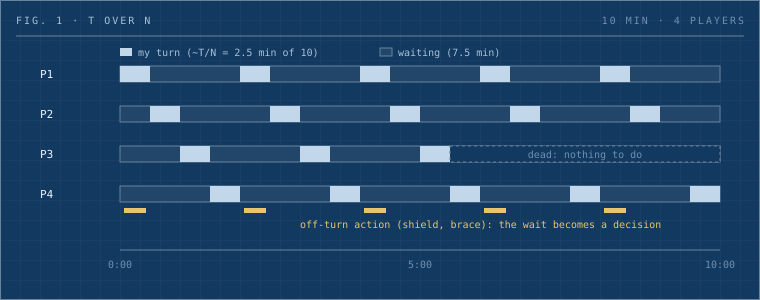

A ten-minute, four-player artillery round is two and a half minutes of play, seven and a half minutes of watching, and no play at all once you die. GunBound and Gunny never solved that; they buried it under millions of players. A prototype with no player base has to shrink the dead air directly, and this piece lists six ways to do it and one number to measure them by.

_Written by the Dwarves editorial desk from a #build-club discussion. Ideas from [tieubao](/contributor/tieubao), [tuanddd](/contributor/tuanddd) and [datnguyennnx](/contributor/datnguyennnx)._

_Fig. 1: A ten-minute, four-player match. Each player's active time is a sliver, and it drops to nothing after death. The amber marks are what we want to add: things to do off-turn._

## One formula

A browser artillery prototype landed in #build-club, the Dwarves Discord channel where we post prototypes. It is a Gunbound-style game: you pick an angle and power, account for wind, and lob a shot at the other side. The first wave of ideas was the usual one: stronger weapon effects, a story mode, new maps, unlockable weapons.

tieubao pushed on the loop underneath. A match of duration T with N players gives each player roughly T over N of real play. Subtract the time after you die, when you have nothing at all. Most of the session is dead air, and dead air is where someone switches tabs.

The rest of the thread sorted itself around that. datnguyennnx's point was that the weapons have to carry identity, the way Valorant keeps a base shooter loop and makes every agent feel different through effects. tuanddd, who built the prototype, already had a ghost that floats around after death and a campaign on the backlog that needs a mountain of art. tieubao's proposal was to make the campaign carry two jobs at once: when there are no users yet, matchmaking against bots is wrapped as story mode, and the story mode is the tutorial.

## Sorting feedback before fixing anything

The feedback the prototype got came in layers, and they are worth keeping apart.

| Layer                 | What came up                                                                                                                         | Why it matters                                                                                        |
| --------------------- | ------------------------------------------------------------------------------------------------------------------------------------ | ----------------------------------------------------------------------------------------------------- |
| First-session clarity | Wind changes constantly with no warning; a countdown before the change; the angle reads relative to horizontal and needs a reference | A player who cannot tell when the round starts or what the angle means never reaches the second match |
| Core-loop feel        | Weapon effects lack punch; a plus-13 upgrade should show an aura                                                                     | This is where the genre's fans decide whether it feels right                                          |
| Retention layer       | Background music, referral rewards, rank progression, campaign bulletins, a second resource type for gems and weapon sockets         | Only matters once the first two layers hold                                                           |
| Launch constraints    | The working name is hard to say and may draw store attention; distribution in Vietnam                                                | Separate from gameplay; decide before launch, not during feedback                                     |

Mixing layers hides the real blocker. Nobody cares about a wizard-hat reward if the first minute is confusing, and a builder can lose a sprint polishing referral loops before the wind indicator works. Fix layers one and two before adding anything from layer three.

The same thread produced a second scope lesson. The prototype already had daily quests, level ranking, seasonal events with limited items, an event scheduler, a metrics dashboard and gift codes, most of it generated quickly. tuanddd's own note was that the ranking still needed a simulation to know how long it takes to hit max level. tieubao's take: let the system be complete first, then choose what to keep. Breadth is cheap now. The filter is the work.

## The genre has been here before

GunBound launched in Korea in 2002 and worldwide in 2003, [reached about 5 million registered players in its first year](https://en.wikipedia.org/wiki/Gunbound), and Softnyx [claimed concurrent users near 700,000 at its peak](https://en.namu.wiki/w/%EA%B1%B4%EB%B0%94%EC%9A%B4%EB%93%9C). The Korean side collapsed early: when the publisher pushed for cash items and Softnyx refused, the game moved publishers in 2003 and lost most of its domestic players. The international servers held on for years, then declined under hacking and a shift toward cash-driven play that pushed people to private servers. [The official service shut down in 2019](https://mmos.com/review/gunbound). A revival run by Gravity Game Hub [opened a closed beta in January 2025](https://www.prnewswire.com/apac/news-releases/legendary-pc-online-multi-player-game-gunbound-returns-with-closed-beta-for-southeast-asia-and-latin-america-302353949.html) for Southeast Asia and Latin America and [launched fully on one shared server in June 2025](https://finance.yahoo.com/news/gunbound-grand-launch-legendary-artillery-110000180.html), which tells you the audience never left.

In Vietnam the genre's story is Gunny. VNG published it from April 2009, hit [about 2 million players within a year](https://vi.wikipedia.org/wiki/Gunny), set a [record 200,000 concurrent users in May 2011](https://vi.wikipedia.org/wiki/Gunny), and drew close to 350,000 players into one national guild war. Gunny Mobi followed in 2015, [Gunny Origin in 2018 with over 10 million downloads](https://gamegeek.asia/news/the-rise-of-vietnams-game-industry-in-the-last-10-years), and the franchise was still being nominated at Vietnam GameVerse in 2025 with [148,000 active accounts](https://vnexpress.net/cong-nghe/vgv-2025/de-cu/gunny-1176).

Two readings. The core loop is proven in this market at a scale a prototype can only dream of. And the fail modes on record are cash-item creep and cheating, not the mechanics. The T over N problem never got solved in either game; it was papered over with social features and a massive player base. A small team does not have that base, so it has to solve downtime directly.

## What other designers did with the wait

The sequential turn is a known scaling problem outside artillery too. One rule of thumb among wargame designers is that [sequential turns stop working past about four players, while simultaneous resolution handles a dozen](https://discussions.unity.com/t/wego-or-igougo/889027). Frozen Synapse, Mode 7's 2011 tactics game, is the clean example: [both players plan at the same time, hit a button, and five seconds of simulation resolve every order at once](https://en.wikipedia.org/wiki/Frozen_Synapse). Nobody waits because nobody has a turn.

Worms, the other great artillery lineage, never went simultaneous. It managed the clock instead. Turn time is a setting from [0 to 127 seconds](https://worms.miraheze.org/wiki/Game_Style), a retreat timer limits movement after firing, and a ten-minute default round time triggers sudden death so a match cannot drag. Short turns mean a short wait.

Clash Royale, which is real-time, is still the best example of a match length chosen for the player's attention. Battles [last three minutes with double elixir in the final minute](https://en.wikipedia.org/wiki/Clash_Royale), and analysts credit the fixed cap with letting players [tell themselves any session will take five minutes even when it takes twenty](https://www.pocketgamer.biz/7-reasons-why-you-cant-stop-playing-supercells-clash-royale/).

Three answers to the same problem: remove the turn, shorten the turn, or cap the match.

## Options for a prototype

For a Gunbound-style game that wants to stay turn-based, the thread produced a shortlist. We have ranked it by how little it changes the core.

| Option                      | What the waiting player does                           | Risk                                                             |
| --------------------------- | ------------------------------------------------------ | ---------------------------------------------------------------- |
| Turn and round timers       | Waits less                                             | Too short a turn punishes new players who need time to aim       |
| Off-turn defensive action   | A small timing window to raise a shield or brace       | Each extra action lengthens everyone's turn; T grows             |
| Ghost mode after death      | Floats, chats, nudges a shot or blesses a teammate     | Dead players with real influence feel unfair to living ones      |
| Team combo shots            | Living teammates alter a shot's power or path          | Adds coordination load to a casual game                          |
| Bot matches as story mode   | Plays solo from day one; learns the loop with no queue | Needs campaign art and dialogue; the bots must read as the story |
| Terrain and element effects | Watches the map change rather than a static screen     | Pure spectacle unless it changes decisions                       |

tuanddd's instinct was to add the backlog and introduce these slowly, which is right. Each one changes the active ratio, so the order matters.

## What to do with this

- Measure the active ratio before the next build: seconds a player is making a decision divided by match seconds, including time spent dead. Write the number down. Everything below should move it.
- Ship the bot campaign first. It solves the empty-queue problem, teaches the loop, and gives a solo player a reason to return before matchmaking has liquidity.
- Add one off-turn action, not five. A timed shield during the opponent's shot is enough to test whether players feel the wait shrink. Watch the turn length; if T grows more than the ratio improves, roll it back.
- Keep ghost influence bounded. Spectating and chat first, a small blessing second, never a hit that decides the round.
- Shorten the clock before adding content. Turn timer, retreat timer, sudden death.
- Simulate progression before shipping rank. If the simulation says max level takes four hours, the ranking system is a day-one churn risk, not a feature.
- Keep weapon effects in a separate column. They are feel, and feel matters, but they do not touch the ratio.

## Where this breaks

Every off-turn action lengthens the turn for everyone, so the fix can make T bigger faster than it makes the wait smaller. Ghost mode is the easiest to overdo, and a dead player who decides a match is the fastest way to make a living one quit. And the story-mode trick only works if the bots are good enough to feel like a campaign and bad enough to be beaten; a bot that aims perfectly is a tutorial nobody finishes. The prototype is the place to find those limits, which is why the active ratio has to be measured and not guessed.

## Sources

- Build-club threads: [downtime and story mode](https://discord.com/channels/462663954813157376/1280726623414390805/1559404273681309800), [prototype feedback](https://discord.com/channels/462663954813157376/1280726623414390805/1558855357575471235), [prototype scope](https://discord.com/channels/462663954813157376/1280726623414390805/1559597749870010390)
- [GunBound, wikipedia](https://en.wikipedia.org/wiki/Gunbound) and [NamuWiki](https://en.namu.wiki/w/%EA%B1%B4%EB%B0%94%EC%9A%B4%EB%93%9C); [GunBound shutdown, MMOs.com](https://mmos.com/review/gunbound)
- [GunBound closed beta 2025, PR Newswire](https://www.prnewswire.com/apac/news-releases/legendary-pc-online-multi-player-game-gunbound-returns-with-closed-beta-for-southeast-asia-and-latin-america-302353949.html) and [grand launch, Yahoo Finance](https://finance.yahoo.com/news/gunbound-grand-launch-legendary-artillery-110000180.html)
- [Gunny, vietnamese wikipedia](https://vi.wikipedia.org/wiki/Gunny); [Gunny Origin downloads, GameGeek](https://gamegeek.asia/news/the-rise-of-vietnams-game-industry-in-the-last-10-years); [Gunny at Vietnam GameVerse 2025, VnExpress](https://vnexpress.net/cong-nghe/vgv-2025/de-cu/gunny-1176)
- [Frozen Synapse, Wikipedia](https://en.wikipedia.org/wiki/Frozen_Synapse); [WEGO vs IGOUGO discussion, Unity forums](https://discussions.unity.com/t/wego-or-igougo/889027)
- [Worms armageddon game style settings, worms knowledge base](https://worms.miraheze.org/wiki/Game_Style)
- [Clash Royale, Wikipedia](https://en.wikipedia.org/wiki/Clash_Royale); [The three-minute match, PocketGamer](https://www.pocketgamer.biz/7-reasons-why-you-cant-stop-playing-supercells-clash-royale/)
