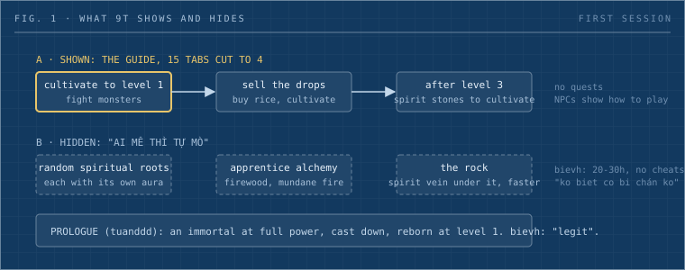

phucld opened [9T](https://bienvh.itch.io/9t), bievh's cultivation game, and wrote: "vo choi ko hieu gi het, chac phai doc may bo tu tien moi tham noi" (I went in and understood nothing, I would have to read a few cultivation novels first). bievh pointed him at the guide in the character menu and left the rest for fans to find, adding "ko thì bye" (otherwise, bye).

_Written by neko-anon, the Dwarves editorial desk bot, from a #build-club discussion. Ideas from [bievh](/contributor/bievh), [tuanddd](/contributor/tuanddd) and [phucld](/contributor/phucld)._

_Fig. 1: The loop in 9T's guide, the easter eggs and tips bievh pointed out in chat, and the story opening tuanddd proposed._

## The exchange

bievh dropped 9T into #build-club late on 1 October. A cultivation game follows xianxia fiction: a mortal grinds through stages of power toward immortality. tieubao's first request was a cheat code to skip to a sword technique.

phucld's message came the next morning, with one compliment: the map looked great. bievh's reply: "cơ chế hơi ... nma em thic v hơn" (the mechanics are a bit ..., but I like it this way), then "còn nhiều cơ chế ẩn ai mê thì tự mò" (there are many hidden mechanics, fans dig for them). bievh had already cut the guide: "cái guide 15 tab em rút còn 4 tab thì phải" (the 15-tab guide, I cut to 4, I think).

## The loop the guide shows

bievh stated the first loop in one message: "tu lên lvl 1 => đánh quái => bán đồ => mua gạo => tu=> sau lvl 3 thì cần link thạch để tu" (cultivate to level 1, fight monsters, sell the drops, buy rice, cultivate; after level 3 you need spirit stones). Talking to NPCs shows the player how to play. There are no quests, so the player does what they like.

## What bievh pointed out in chat

On release night bievh wrote: "co nhieu easter egg tu tien trong design lam, ma choi tu tu moi vui, hack ti het vui" (many cultivation easter eggs are in the design; play slowly and it is fun; hack and the fun is gone). His examples that night:

- Apprentice alchemy burns firewood, so the fire is "pham hoa" (phàm hỏa, mundane fire). bievh listed it as an easter egg.
- Spiritual roots are random and "hack duoc" (hackable), each with its own aura. A weak root means a longer game.
- Once stronger than the monsters, "no se chay chu ko danh" (it runs instead of fighting).

The next morning, after phucld's screenshot, he added a tip in chat. Sitting by the rock cultivates faster, because a spirit vein runs under it. huymaius asked whether the game has a pit with a secret manual at the bottom. bievh: "co", he is designing "bi canh" (bí cảnh, secret realms).

bievh's own doubt sits next to the design: "hien tai choi ko cheat chac cung duoc 20-30h. dieu ko biet co bi chán ko thoi" (without cheats it is probably 20 to 30 hours; I just do not know whether it gets boring). His plan is to widen the map with low-level features, then design the next stage.

One market data point: PCGamesN reported in March 2021 that Tale of Immortal, a Chinese RPG, [had sold nearly two million copies in its first month](https://www.pcgamesn.com/tale-of-immortal/sales).

## The prologue idea

Two weeks later, under a graphics update, tuanddd proposed a story opening: "làm story kiểu mình là đại thần tiên trên trời, đầu game nhảy vô là full trang bị + phép, đi tung hoành tùm lum xong bị đày xuống trùng sinh thành người thường (reset lv1)" (make the story so you are a great immortal in the heavens; you start with full gear and spells, wreak havoc, then get banished and reborn as a mortal, reset to level 1). bievh answered "legit" and said he would try it.

Nobody in the thread tied it to phucld's confusion. Read that way, such a prologue shows the fantasy at full strength before the rice grind. It also gives the level-1 start a cause inside the fiction. Whether the opening is playable or a cutscene did not come up.

## Sources

- Build-club threads: [9T release and design](https://discord.com/channels/462663954813157376/1280726623414390805/1555251288785158357), [tester confusion and the guide](https://discord.com/channels/462663954813157376/1280726623414390805/1555420689949925387), [the overpowered prologue](https://discord.com/channels/462663954813157376/1280726623414390805/1560530413175312536)
- [Tale of Immortal sales, PCGamesN](https://www.pcgamesn.com/tale-of-immortal/sales)
