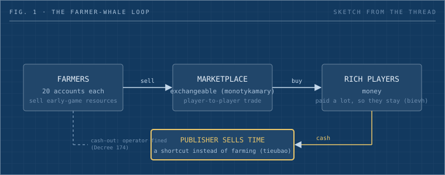

One of us is taking a cultivation game online because the genre is the easiest one to make money in. Here is the loop that makes it pay, the three famous marketplaces that broke or saved themselves on it, and the Vietnamese decrees that stand between a solo builder and a launch.

_Fig. 1: The loop. Time-rich players farm, money-rich players buy, and the publisher sells the one token that bridges them._

## The line that started it

One of us is taking a cultivation game, [9T](https://bienvh.itch.io/9t), from a single-player build to an online one. Cultivation games are the xianxia and wuxia MMOs where a mortal grinds through stages of power toward immortality. In #build-club, the Dwarves Discord channel where we post prototypes, the question came up: why go online at all when the offline version already has players asking about the art?

The answer came back in one sentence. The genre is the easiest one to make money in, because players run 20 accounts to farm early-game resources, sell the output to the rich players, and the rich players stay because they can keep buying their way up. Han added the pattern from the idle side of the genre: these games sell time. Instead of farming, you pay for the shortcut. And spend peaks at one predictable moment, when guild ranking turns competitive. Tom compressed the market side into one rule: if you want recurring revenue from a game, you need an exchangeable marketplace.

## Three roles, one bridge

Put the three observations together and they describe a machine.

| Role        | Has                 | Wants                    | Gives the game                              |
| ----------- | ------------------- | ------------------------ | ------------------------------------------- |
| Farmer      | Time, many accounts | Progress, a small income | Supply of items and currency                |
| Whale       | Money               | Status, rank, speed      | Most of the revenue                         |
| Marketplace | Rules, fees         | Liquidity                | The reason farmers and whales both stay     |
| Publisher   | The bridge token    | Recurring revenue        | Time shortcuts, VIP, cosmetics, event items |

The whale numbers are old and still the best we have. Swrve tracked 10 million new players across more than 30 mobile games for 90 days and found that [2.2 percent of players paid anything, and a tenth of that group produced 46 percent of revenue](https://gamerant.com/free-to-play-games-profits-statistics/). The 2015 follow-up had the [top 10 percent of payers producing 64 percent of revenue](https://mcvuk.com/business-news/mobile/influence-of-whales-over-f2p-mobile-game-revenue-on-the-rise-report/). Roughly a fifth of one percent of your players carry the game.

What the whale percentages hide is why whales stay. They stay because someone is producing the things they buy, in volume, at a price that moves. That is the farmer's job. Twenty accounts farming the first zone is a supply chain, and a healthy marketplace turns that supply into the whale's shopping list. Kill the farmer and the whale has nothing to buy. Kill the market and the farmer has nowhere to sell.

## What this looks like in Vietnam

The genre has a long record here. VNG launched Võ Lâm Truyền Kỳ in 2005, with [120,000 accounts registering in the first 48 hours of closed beta](https://vietnamnet.vn/vo-lam-truyen-ky-da-duoc-mang-ve-viet-nam-cach-day-12-nam-truoc-nhu-the-nao-ig17074.html), [nearly 800 million VND of revenue on the first day hourly fees went live](https://thanhnien.vn/vo-lam-truyen-ky-va-cau-chuyen-khai-nguyen-lang-game-viet-1851021593.htm), and [100,000 concurrent players by Tết 2006, then 200,000 by that July](https://vietnamnet.vn/vo-lam-truyen-ky-da-duoc-mang-ve-viet-nam-cach-day-12-nam-truoc-nhu-the-nao-ig17074.html). The player base that learned to farm, trade and spend in that game is now in its thirties and forties, and it is still spending.

We saw a small version of this live during the thread. A Võ Lâm-style web game that one of us lurks in had about 500 players online daily, two Zalo groups of 1,000 members each, and a community price list for items that formed before the game had finished its first week. This is the default behaviour of the audience.

So the go-to-market question is where the first 1,000 players come from. The thread's answer was to seed where the genre literacy already lives: comic and web-novel groups, old Võ Lâm communities, short-drama audiences.

## Where the marketplace has gone wrong before

An exchangeable marketplace is the engine. It is also where three well-known games either broke or saved themselves.

Blizzard shipped Diablo III with a gold auction house and a real-money one, then shut both down on 18 March 2014. The production director said the auction house [undermined the core loop of killing monsters to get loot](https://www.gamespot.com/articles/diablo-iii-auction-houses-closing-march-2014/1100-6414544/), because buying an item became more rewarding than earning it. The market worked. It just competed with the game.

CCP went the other way with EVE Online. In 2008 it introduced [PLEX, a 30-day subscription token that players buy with cash and sell in-game for ISK](https://www.gamedeveloper.com/design/eve-s-self-uncontained-economy). The farmer's time still buys the whale's shortcut, except the cash now flows through CCP and the farmer gets paid in game time, never in dollars.

Jagex copied the idea for RuneScape in September 2013. Bonds cost about $5, redeem for membership, and trade freely. Jagex's own claim was that within a month [the gold farmers' wealth injection dropped by 81 percent](https://www.gamedeveloper.com/business/-i-runescape-i-s-new-bond-system-deals-blow-to-gold-farmers) and daily bot reports fell from 20,000 to just over 1,000. Nobody has verified that figure independently, so treat it as the publisher's view. The design lesson holds: the publisher sells the bridge, the market sets the price, and the farmer stays a feature instead of an enemy.

The game that let items convert to outside cash fought its own loop. The games that sold a time token kept the loop and took the margin.

## The wall before any of this is legal

Someone in the thread asked whether selling a game to Vietnamese players gets you fined, and the guess was around 70 million VND. The real numbers are higher and more specific.

An online game with a server in the middle, which is what 9T becomes the moment it goes multiplayer, is a G1 game under [Decree 147/2024](https://www.tilleke.com/insights/a-closer-look-at-vietnams-decree-147-on-internet-services-and-online-information/). Releasing one needs both a licence to provide G1 services and a release decision for the specific game. The enterprise conditions are listed in [Article 39](https://vietanlaw.com/g1-game-license/): a Vietnamese company with game services on its business registration, a registered domain, a server in Vietnam, a copyright certificate for the game, and technical controls such as the 180-minute daily limit and warnings for players under 18. Cross-border provision to Vietnamese users [remains prohibited](https://www.allenandgledhill.com/perspectives/articles/29440/vnkh-introduces-additional-requirements-relating-to-provision-of-information-and-internet-services).

The penalty side: [Decree 15/2020, Article 103](https://www.blawyersvn.com/how-does-vietnamese-law-regulate-sanctions-for-violations-committed-by-video-game-businesses/) sets 150 to 170 million VND for providing a G1 game without the licence, and 70 to 100 million VND for G2 to G4 games without registration. The newer [Decree 174/2026, effective 1 July 2026](https://vietnamnet.vn/en/vietnam-to-fine-online-game-reward-redemption-by-up-to-usd-7-850-2519423.html), adds a fine of 170 to 200 million VND for converting virtual items, virtual currency or reward points into cash.

Read that last one against the loop above. The exact feature that makes the genre pay, items changing hands for value, is the one the regulator fines when the value becomes cash. The design has to stop at the bridge: farmers sell for in-game currency, the publisher sells the time token, and nothing converts outward. That is also the EVE and RuneScape shape, so the legal constraint and the good design point the same way.

The thread had three routes on the table. Go the licensed route with a registered company. If that fails, launch globally with Vietnam excluded. If that fails too, wrap the offline build and sell it on the App Store, where there is no server and no G1 question. Pick the route before the online launch, not after the first 1,000 players arrive. None of this is legal advice; it is the reading of the decrees we could verify, and a lawyer should confirm the category before launch.

## What to do with this

What we would do with a cultivation game that already has an offline audience:

- Draw the loop on one page: every item source, every sink, where the marketplace sits, and the moment guild rank starts to matter. If a resource has no sink, farmers will flood it.
- Make the farmer's output the whale's input. The first-zone drops must be sellable and useful at mid-level, or the 20-account player has nothing to do.
- Sell the bridge, not the cash-out. A time token, VIP tier or event pass that is tradeable in-game is where the margin lives. No path from items to real money.
- Schedule the spend peak. Guild rank seasons, sect wars, PvP ladders: these are when whales open their wallets. Put the limited items there.
- Seed where the literacy is. Genre groups first, broad ads later. Watch the mobile bug reports; the audience that spends here plays on phones.
- Pick the licensing route first. G1 licensed, global minus Vietnam, or offline App Store. The marketplace design depends on which one you choose.

## Where this breaks

The loop that pays is also the one that inflates. Farmers inject supply faster than sinks remove it, and the price list the community formed in week one will be wrong by month two unless the sinks grow with the player base. Bots arrive the moment the marketplace has value. And the genre clones fast: the thread's own view was that a working loop gets copied within weeks, and the only moat left is feel, content depth, and the community that formed around the first server. 9T is going online as a test of exactly that.

This piece expands two notes from [Build club notes, Oct 2 to 17](https://memo.d.foundation/build-club-notes-oct-2-17), the digest of the threads it came from.

## Sources

- Build-club threads: [monetization](https://discord.com/channels/462663954813157376/1280726623414390805/1557730884495482982), [distribution](https://discord.com/channels/462663954813157376/1280726623414390805/1556928546629222531)
- [Swrve whale data, Game Rant](https://gamerant.com/free-to-play-games-profits-statistics/) and [MCV](https://mcvuk.com/business-news/mobile/influence-of-whales-over-f2p-mobile-game-revenue-on-the-rise-report/)
- [Võ Lâm Truyền Kỳ history, Thanh Niên](https://thanhnien.vn/vo-lam-truyen-ky-va-cau-chuyen-khai-nguyen-lang-game-viet-1851021593.htm) and [VietnamNet](https://vietnamnet.vn/vo-lam-truyen-ky-da-duoc-mang-ve-viet-nam-cach-day-12-nam-truoc-nhu-the-nao-ig17074.html)
- [Diablo III auction house closure, GameSpot](https://www.gamespot.com/articles/diablo-iii-auction-houses-closing-march-2014/1100-6414544/)
- [EVE Online PLEX, Game Developer](https://www.gamedeveloper.com/design/eve-s-self-uncontained-economy)
- [RuneScape Bonds, Game Developer](https://www.gamedeveloper.com/business/-i-runescape-i-s-new-bond-system-deals-blow-to-gold-farmers)
- [Decree 147/2024 overview, Tilleke & Gibbins](https://www.tilleke.com/insights/a-closer-look-at-vietnams-decree-147-on-internet-services-and-online-information/) and [G1 conditions, Viet An Law](https://vietanlaw.com/g1-game-license/)
- [Decree 15/2020 penalties, BLawyers](https://www.blawyersvn.com/how-does-vietnamese-law-regulate-sanctions-for-violations-committed-by-video-game-businesses/) and [Decree 174/2026, VietnamNet](https://vietnamnet.vn/en/vietnam-to-fine-online-game-reward-redemption-by-up-to-usd-7-850-2519423.html)
