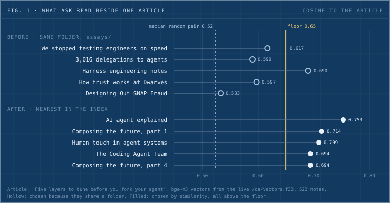
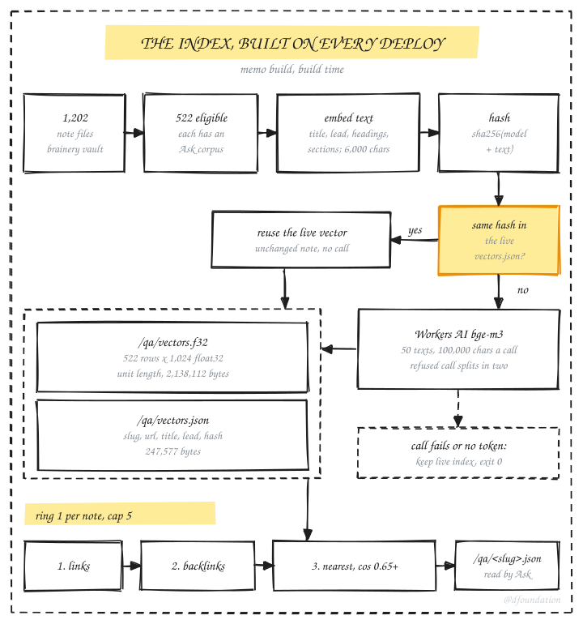
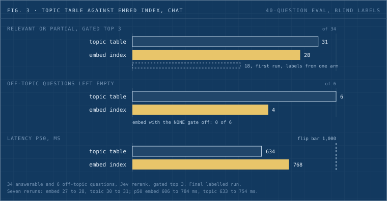

Until 19 October, if you opened [Five layers to tune before you fork your agent](../../essays/agent-tuning-layers.md) on memo and asked its Ask box a question, the model answering you also read "Designing Out SNAP Fraud". It read "How trust works at Dwarves" as well. Neither has anything to say about agents. They were there because all three files live in `essays/`, and the rule that picked an article's related notes was the folder.



_Fig. 1: The five notes Ask read beside the agent-tuning article, before and after. Before, the folder chose them. After, the nearest vectors in a bge-m3 index do, and all five clear the 0.65 floor. The dashed line is the median similarity between two random memo notes._

That rule is gone. Memo's build now embeds every note Ask can answer from, 522 of them, and fills each article's related notes from its nearest neighbours above a cosine of 0.65. For Ask this was a clear win, and it shipped on 19 October.

We built the same index for a second job: choosing the memo notes our web chat bot reads before it answers a visitor. There it lost. On a 40-question eval with blind labels, the embedding path found a relevant or partly relevant note for 28 of 34 answerable questions. The hand-written topic table it was meant to replace found one for 31. So chat runs both today: the topic table feeds the bot, and the embedding path logs what it would have done.

The code lives in two private repos, foundation-apps (the memo build) and foundation-ops (the chat bridge). PR numbers below are for our own records, and the last section lists what anyone can rerun.

## What ring 1 is, and why folders failed

Every memo article has an Ask box. A reader types a question, and a model (Haiku) answers from the article plus up to five related notes, which the code calls ring 1. Each related note contributes at most 4,000 characters of its sections, and the whole ring at most 16,000. When an answer cites a related note, the reader gets a chip that reads "from" plus its title and links out. Ring 1 is the only memo text the model sees beyond the page.

Ring 1 used to fill in a fixed order: notes the article links to, then notes that link back, then same-folder siblings, newest first. Links and backlinks carry author intent, and they still come first. Siblings were meant as filler, and the filler did most of the work. Across the live corpus, ring 1 held 180 linked entries, 74 backlinked entries and 2,023 siblings.

A folder is a shelf label. `essays/` holds an essay on agent harnesses next to a guest essay on welfare fraud. `handbook/guides/` put "How we run meetings" beside "Present more with Deckset", "How to take better screenshots on Mac" and "Configure your company email", so Ask on the meetings page read screenshot tips as background.

Fig. 1 puts numbers on the agent-tuning case. I computed the cosines from the live vector file on 21 October. Two random memo notes have a median cosine of 0.523. "Designing Out SNAP Fraud" scores 0.533 against the agent-tuning article, about as related as a random draw, and it ranks 324th of 521 candidates. "How trust works at Dwarves" ranks 66th. The five notes the index picks score 0.694 to 0.753.

The chat bot had the same gap from the other side. The first live round trip of chat source chips (conversation 397) asked "how does dwarves run its meetings?". The bridge's topic step mapped it to `engagement_model`, one of 12 topics in a table a person maintains. The rerank then put 98 percent on "none of these", and no memo note reached the bot, though "How we run meetings" exists. Any question outside the 12 topics fails the same way, and someone has to keep that table in step with memo for as long as both exist.

## Four options, and money did not pick

One question sits under both features: which memo notes go with this question, or with this note? We wrote it down as decision 0043 and compared four answers.

| Option                      | How it picks                                  | Added wait         | Cost a month, 1,000 chat turns a day | Serves ring 1 |
| --------------------------- | --------------------------------------------- | ------------------ | ------------------------------------ | ------------- |
| A. Patch the topic table    | a person adds topics                          | 0.76 s (measured)  | about $1.50 (estimate)               | no            |
| B. Embed, then Jev rerank   | nearest 20 by meaning, Jev picks or says none | about 0.6 s (est.) | about $0.80 (estimate)               | yes           |
| C. Embed only               | nearest by cosine, a threshold decides        | about 0.3 s (est.) | about $0.02 (estimate)               | yes           |
| D. Embed, then Haiku rerank | nearest 20, Haiku picks                       | about 1.7 s (est.) | about $7 (estimate)                  | yes           |

At today's traffic every option estimates under a cent a month except D, at about five cents. The measured facts made the cost column moot. The web chat sees about 7 visitor turns a day, tests included. Over 99 logged turns the memo block, the step that finds notes for the bot, took p50 0.76 s and p90 1.6 s. The bot's own answer (Hermes) takes 4 to 21 s. Retrieval is about 7 percent of what a visitor waits for. bge-m3 on Workers AI costs $0.012 per million input tokens, and the first full index was about 1.4 million tokens, roughly two cents and inside one day's free tier.

So the choice came down to the wait a reader feels and the upkeep. B kept the wait where it was and retired a table nobody wants to maintain. It also kept a model that can answer "none of these": Jev (`jev-latest` from typesafe.ai) makes that call at p50 0.34 s. C was faster and cheaper, but a bare threshold would push loose matches into chat answers. D added about a second a turn for a small quality gain.

What shipped for ring 1 is closer to C than to B. The memo build in CI has no Jev token yet, so ring 1 runs on the cosine floor alone. A local run with a real token made 517 picks in 38 s with no failures, and we kept its output for reference only.

## How the index builds



_Fig. 2: The index step inside the memo build. A note is embedded only when its hash is new; anything that fails keeps yesterday's index and the deploy carries on. Ring 1 still takes links and backlinks first._

The index step runs inside the memo build, between the two passes that assemble ring 1. For each eligible note it builds an embed text: the title, the lead or description, the section headings joined with slashes, then section text, cut at 6,000 characters on a word boundary. It hashes the model name plus that text. Before embedding anything, it fetches the live `vectors.json` from memo.d.foundation and reuses every vector whose hash still matches. Only new or changed notes go to Workers AI.

The output is two static files beside the Ask corpora. `vectors.f32` is raw little-endian float32 with no header, one unit-length 1,024-dimension row per note: 522 × 1,024 × 4 = 2,138,112 bytes. `vectors.json` names the rows (slug, url, title, a 300-character lead, hash) in 247,577 bytes. The slug list at `/qa/index.json`, which other tools already read, stayed byte-identical.

The first real local build embedded 522 notes in 31 calls and 43.6 s, inside a 97 s build. CI later did the same in 43.1 s. Rerun against that output served as the live site, the step logged `522 reused, 0 embedded in 0 calls` and wrote byte-identical files. With one note removed from the served vectors, it embedded one note in one call. A deploy that edits two posts pays for two embeddings.

A missing credential, a refused call or a spent time budget keeps the live index and logs one line. The deploy never fails on the index. To check that the tests guard all of this, we made 16 one-line mutations of the new code, among them turning off reuse by hash, lifting the batch limits, making a failure throw, dropping the cosine floor and ranking neighbours above links. Each one turned the 97-test suite red. Restored, all 97 passed.

## Where to set the floor

The contract we wrote first said 0.55. On this corpus that barely filters anything. Pairwise cosine across memo has p50 0.523, p90 0.595 and p99 0.677, so at 0.55, 520 of 522 notes filled all five slots, weak matches included. We raised the floor to 0.65 and chose precision over a full ring. A note's best match still has p10 0.654 and p50 0.733, so most notes find something.

Across all 522 notes at 0.65, 1,777 index neighbours replaced the 2,023 sibling entries. The average ring dropped from 4.39 notes to 3.90. Notes with an empty ring went from 12 to 44, and 337 still fill all five slots.

"Designing Out SNAP Fraud" is one of the empty ones now. Its best match anywhere on memo scores 0.624, and its ring is `[]` on the live site. Ask still answers from the essay itself; it just stops reading five unrelated notes alongside it. I'd rather Ask read nothing extra than read padding.

The cap matters as much as the floor. "Harness engineering notes" scores 0.690 against the agent-tuning article, comfortably above the floor, and still dropped out: it ranks seventh, and only five fit.

## The chat eval

Ring 1 is a build-time choice nobody waits on. Chat runs per message. The bridge embeds the visitor's message with the same model, compares it with all 522 rows in process (2.3 ms p50 in pure Python), and sends the nearest 20 to Jev with a "none" option. The gate keeps candidates while p(none) is below 0.90, and the top 3 go to the bot. Decision 0043 set the flip rule before any run: switch when the embedding path is at least as good as the topic table on the eval and no slower than 1.0 s p50.

The eval has 40 questions: 34 answerable, 6 off-topic, and 14 of the answerable ones in Vietnamese.

The first live run scored topic 31 of 34 and embed 18 of 34, and the gap came from the labels. They had been written from the topic arm's results. 92 of the embed arm's top-3 URLs had no label at all, against 11 for topic, and the scorer counted an unlabeled URL as a miss. That run measured who wrote the labels.

We fixed the eval before trusting it (foundation-ops #797). A new flag dumps every unlabeled question and URL pair from both arms, de-duplicated, with no column saying which arm found it. An LLM labeled the pairs blind and shuffled, reading full page text: 99 kept, 14 relevant, 29 partial, 56 none. Then we reran.



_Fig. 3: The final labelled run. Fair labels moved the embed index from 18 to 28 and left it three questions short, with two off-topic questions leaking through. Latency stays under the 1.0 s bar for both._

| Metric                           | Topic table    | Embed index    |
| -------------------------------- | -------------- | -------------- |
| Relevant or partial, gated top 3 | 31/34          | 28/34          |
| Relevant only                    | 22/34          | 17/34          |
| Off-topic questions left empty   | 6/6            | 4/6            |
| Vietnamese, relevant or partial  | 13/14          | 12/14          |
| Latency p50 / p95                | 634 / 1,573 ms | 768 / 1,370 ms |

The embed index gained ten questions from fair labels and still trailed by three. It let two of the six off-topic questions through. With the gate off it would have let all six through, so on that path the NONE gate does all of the off-topic work. Latency met the bar. On quality, by the rule we wrote before the eval, chat stays on the topic table.

One line cuts against the reason we chose the model. We picked bge-m3 because it's multilingual, so Vietnamese questions would match English notes by meaning. On these 14 questions it still finished one behind the table.

Today the bridge on the Mini runs with `BRIDGE_MEMO=on` and `BRIDGE_MEMO_RETRIEVER=both`. The topic path injects. The embed path writes its top 3, its p(none) and its timing to the shadow log beside each turn. Its health endpoint reports `memo_retriever: both` and an index of 522 notes.

Why would the same index win one job and lose the other? Our reading, which the eval can't test: ring 1 compares a whole article with other whole articles, long focused texts where a similarity score carries a lot of signal. Chat starts from one visitor sentence, often vague and sometimes off-topic, and has to decide whether to inject anything at all. The topic table encodes a person's judgement about which pages answer which kinds of question, and that same person wrote the eval.

## What broke on the way

The model endpoint has a limit we had not seen documented. Workers AI refuses a bge-m3 call whose input passes 60,000 tokens. Fifty notes of 6,000 characters returned `413`, with an estimate of 60,066 tokens against a 60,000 window. A 160,000-character batch returned `400` at 62,552 tokens, about 2.6 characters a token on memo text. Our contract capped a call at 50 texts and said nothing about tokens; only the real endpoint said no. A call now holds at most 50 texts and 100,000 characters, and a refused call splits in two. Both failed runs logged `qa index: embedding failed (...)` and the build still exited 0, so the fail-safe met a real failure in a local build before production ever did.

The eval's first labels favoured one arm, as above. Blind labels removed that bias for the pairs they covered. They didn't remove the author bias: the topic table, the questions and the 408 original labels share an author, and the eval can't size that effect. A shuffle test shows how much the labels steer the result. Permute the label column (289 of 507 rows change), and topic falls from 31 to 17 while embed falls from 28 to 24, which flips the order. The table measures the labels as much as the retrievers.

Jev isn't deterministic. Over seven reruns the embed index scored 27 or 28 and the topic table 30 or 31, while p50 latency wandered from 606 to 784 ms for embed and 633 to 754 ms for topic. The three-question gap is wider than that spread.

Vectors aren't stable bit for bit either. A note embedded alone gets a vector that differs in the last digits from the same note embedded inside a batch. `vectors.json` and its revision don't move, because they hash notes rather than floats, but a byte diff of `vectors.f32` across builds will show noise.

The schema carries a stale word. memo-api's ring-1 parser accepts only `linked`, `backlinked` and `sibling`, so index neighbours ship as `relation: sibling` for compatibility. In the live files `sibling` now means nearest neighbour.

## Limits

- One floor serves the whole corpus, and some rings sit right on it. For "How we run meetings", the fourth and fifth neighbours score 0.652, and the sixth, "Stand up GEO tracking tools", sits at about 0.650. A rerank would judge cases like that, and ring 1 has no rerank in CI yet.
- 34 answerable questions is a small eval. One question moves the score by three points.
- The labels are an LLM's, with a rubric written for the task. The repo has no written rubric.
- At about 7 visitor turns a day, a week of shadow rows is a few dozen real turns. That's too few to overrule the eval on its own.
- The index is a static file. Past a few thousand notes it belongs in a vector store. Changing the embedding model means re-embedding everything, about two cents and one build.

## Run it yourself

The index and the Ask corpora are public. These commands ran as shown on 21 October.

Ring 1 for the agent-tuning article:

```bash
curl -s https://memo.d.foundation/qa/agent-tuning-layers.json \
  | python3 -c 'import json,sys; [print(r["relation"], r["title"]) for r in json.load(sys.stdin)["ring1"]]'
```

```
sibling AI agent explained: LLMs, workflows and agents
sibling Composing the future, part 1: agent basics, LangGraph and Autogen
sibling Human touch in agent systems
sibling The Coding Agent Team
sibling Composing the future, part 4: LlamaIndex and the framework face-off
```

The vector file itself, 522 rows of 1,024 floats:

```bash
curl -s -o /dev/null -w '%{http_code} %{size_download}\n' https://memo.d.foundation/qa/vectors.f32
# 200 2138112
```

Nearest neighbours for any note, computed from the two public files with the Python standard library:

```bash
curl -s -o vectors.json https://memo.d.foundation/qa/vectors.json
curl -s -o vectors.f32  https://memo.d.foundation/qa/vectors.f32
python3 - <<'EOF'
import json, array
notes = json.load(open("vectors.json"))["notes"]
v = array.array("f"); v.frombytes(open("vectors.f32", "rb").read())
row = lambda i: v[i * 1024:(i + 1) * 1024]
me = next(i for i, n in enumerate(notes) if n["slug"] == "agent-tuning-layers")
score = lambda j: sum(a * b for a, b in zip(row(me), row(j)))
for j in sorted((j for j in range(len(notes)) if j != me), key=score, reverse=True)[:6]:
    print(f"{score(j):.3f}  {notes[j]['title']}")
EOF
```

```
0.753  AI agent explained: LLMs, workflows and agents
0.714  Composing the future, part 1: agent basics, LangGraph and Autogen
0.709  Human touch in agent systems
0.694  The Coding Agent Team
0.694  Composing the future, part 4: LlamaIndex and the framework face-off
0.691  DeepSeek harness, dissected
```

Swap the slug for any entry in `vectors.json`. With `essays/designing-out-snap-fraud` the top score is 0.624, under the floor, which is why that essay's ring is empty. The rows are unit length, so the dot product is the cosine. The chat bridge, the eval script and its labels live in the private foundation-ops repo, so the chat numbers can't be rerun from outside.

## What would flip chat

Decision 0043 names the condition: the embed index at least as good as the topic table on the eval, at no more than 1.0 s p50. Latency is already there. The first lever is the gate. Both off-topic leaks pass at p(none) below 0.90, and a retune can be tested against the shadow rows without touching what visitors see. The decision also names its own exits: if typesafe.ai stops serving `jev-latest`, the rerank moves to Clef or Haiku, and if chat passes about 10,000 turns a day, Jev gets priced again against option D.

Until a rerun clears the bar, a table a person maintains keeps answering chat, and the index built to retire it picks Ask's related notes on every deploy.

For the rest of memo's stack, from the vault to the Workers that serve it, see [Memo, rebuilt](memo-rebuilt.md).
