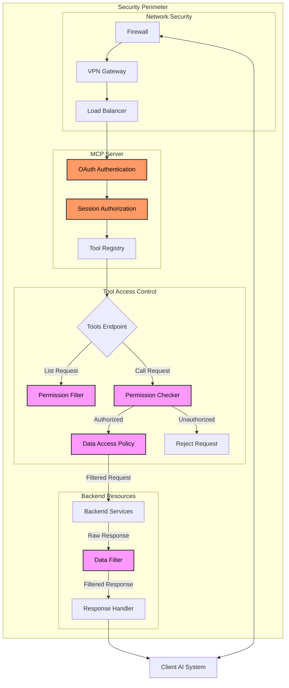
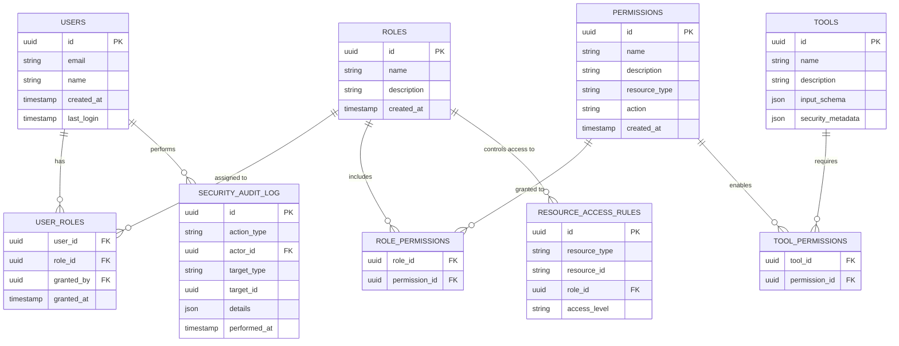

The Model Context Protocol (MCP) has emerged as a powerful standardized framework for AI-to-tool communication, enabling more sophisticated interactions between LLMs and external systems. As organizations deploy MCP servers in production environments, implementing robust access control becomes essential to protect sensitive data and operations while enabling the right level of access for different user groups.

This guide explores how to implement **Role-Based Access Control (RBAC)** for MCP servers, allowing you to grant precisely the right level of access to each user or system while maintaining strong security boundaries around your tools and data.

**This series has 2 parts.** Each one reads on its own.

1. Designing role-based access control (this page)
2. [Enforcement, identity and practice](mcp-tool-security-enforcement-identity.md)

## TL;DR: Implementing RBAC for MCP servers

**Role-Based Access Control** for MCP servers enhances OAuth authentication by associating **tools** with **permissions** and applying **data access policies** during execution. The server filters available tools based on user roles and applies data access constraints, ensuring users can only access authorized tools and data. This approach secures both connection establishment and each individual tool invocation.

```javascript
// Tool registry with permission requirements
const toolRegistry = {
  slack_post_message: {
    tool: slackPostMessageTool,
    requiredPermissions: ["slack:write"],
    dataAccessPolicy: { channelVisibility: "authorized_only" },
  },
};

// Filter tools during ListToolsRequest
server.setRequestHandler(ListToolsRequestSchema, async (request) => {
  const userPermissions = await getPermissionsForUser(
    request.transport.session.userId,
  );
  return {
    tools: Object.values(toolRegistry)
      .filter((t) =>
        t.requiredPermissions.every((p) => userPermissions.includes(p)),
      )
      .map((t) => t.tool),
  };
});

// Enforce permissions during CallToolRequest
server.setRequestHandler(CallToolRequestSchema, async (request) => {
  const userId = request.transport.session.userId;
  const toolEntry = toolRegistry[request.params.name];

  if (!hasRequiredPermissions(userId, toolEntry.requiredPermissions)) {
    return errorResponse("Insufficient permissions");
  }

  const filteredData = await applyDataAccessPolicy(
    toolEntry.dataAccessPolicy,
    request.params.arguments,
    userId,
  );
  return await executeTool(request.params.name, filteredData);
});
```

---

## The need for tool-level access control

While our previous guide covered securing the MCP connection itself through OAuth 2.1 and Bearer token authentication, production systems require deeper security controls that operate at the **tool invocation level**. This multi-layered security approach addresses several critical requirements for modern AI systems integrating with powerful backend capabilities.

Production MCP servers require **granular permission management** that allows different users or applications to access specific subsets of available tools based on their responsibilities and authorization level. These servers must also implement **data privacy protection** since tools often expose sensitive data that should only be accessible to properly authorized users. Proper **regulatory compliance** becomes essential as many organizations operate under strict data protection regulations like GDPR, HIPAA, or CCPA that mandate precise controls over data access. Finally, the principle of least privilege embodied in **operational security** dictates that users should only have access to the minimum set of tools needed to perform their tasks.

MCP servers often serve as gateways to powerful capabilities, from querying databases and accessing internal knowledge bases to modifying production systems or sending authenticated messages. Without proper access controls, an authenticated but malicious user could potentially access sensitive information or perform unauthorized actions that extend far beyond their intended privileges.

Update (2026): the MCP spec has changed in ways that touch the examples below. The [2026-07-28 changelog](https://modelcontextprotocol.io/specification/latest/changelog) removes protocol-level sessions, so code that reads `request.transport.session.userId` should take the user identity from the validated access token on each request instead. The [current authorization spec](https://modelcontextprotocol.io/specification/latest/basic/authorization) also defines how to signal a permission gap. A server answers a request with insufficient scope using HTTP 403 and a `WWW-Authenticate` header carrying `error="insufficient_scope"` and the needed `scope`, and clients can then run a step-up authorization flow. That gives tool-level permissions a standard wire format. The RBAC design itself still applies.

## Security architecture for tool-level access control

Building upon the OAuth authentication framework described in our previous guide, we need to implement a comprehensive RBAC system that operates across multiple dimensions of security. The foundation begins with **role definitions** – named collections of permissions such as "Admin," "Developer," or "Analyst" that map to organizational responsibilities. These roles contain **permissions** that represent fine-grained access controls mapped to specific tool operations and data access patterns.



At the heart of this system sits the **tool registry**, a central configuration that maps each MCP tool to its required permissions and data access policies. This registry serves as the single source of truth for all permission checks throughout the system. When tools are requested or executed, **permission enforcement** applies runtime checks to ensure the requesting user has sufficient authorization for the attempted operation. Beyond simply allowing or denying access, **data access policies** implement row-level security and field-level filtering to ensure users only see data elements they're authorized to access, even within results from allowed tools.

This architecture creates a defense-in-depth approach where multiple security layers work in concert. Initially, OAuth authentication establishes the user's identity with confidence. Once authenticated, role assignments determine which permissions the user holds within the system. During operation, permission checks filter which tools are exposed to the user through the ListTools endpoint. Finally, when tools are executed, data access policies restrict which specific data elements are visible within the tool results.

## Building the role-based security system

Implementing effective role-based security for MCP requires careful design of both the data structures and runtime enforcement mechanisms. The security model must balance flexibility, performance, and maintainability while providing robust protection across diverse deployment environments.

### The data foundation of RBAC

The foundation of our security model lies in a carefully designed data structure that captures the relationships between users, roles, and permissions. These relationships establish who can access what within the MCP environment. We'll implement a standard relational model that follows established RBAC patterns, making it easy to integrate with existing identity systems.

In this model, we create separate tables for **users**, **roles**, and **permissions**, with junction tables mapping the many-to-many relationships between them. The **users** table captures identity information for authenticated users, while the **roles** table defines named responsibility sets like "Admin" or "Analyst." The **permissions** table defines granular access rights such as "slack:read" or "analytics:execute" that can be combined into roles. The **user_roles** table establishes which users have which roles, while **role_permissions** maps which permissions are included in each role.



Beyond basic role-permission mapping, the **resource_access_rules** table implements fine-grained control over specific resources. This table allows us to define which roles can access particular data elements, implementing row-level security across the system. For example, we can specify that the "Sales" role can only view Slack channels in the sales department, while the "Engineering" role can access engineering channels.

```sql
-- Core security model for RBAC in MCP
CREATE TABLE users (
  id UUID PRIMARY KEY,
  email TEXT UNIQUE NOT NULL,
  name TEXT,
  created_at TIMESTAMPTZ DEFAULT CURRENT_TIMESTAMP,
  last_login TIMESTAMPTZ
);

CREATE TABLE roles (
  id UUID PRIMARY KEY,
  name TEXT UNIQUE NOT NULL,
  description TEXT,
  created_at TIMESTAMPTZ DEFAULT CURRENT_TIMESTAMP
);

CREATE TABLE permissions (
  id UUID PRIMARY KEY,
  name TEXT UNIQUE NOT NULL,
  description TEXT,
  resource_type TEXT NOT NULL,
  action TEXT NOT NULL,
  created_at TIMESTAMPTZ DEFAULT CURRENT_TIMESTAMP,
  UNIQUE(resource_type, action)
);

CREATE TABLE user_roles (
  user_id UUID REFERENCES users(id) ON DELETE CASCADE,
  role_id UUID REFERENCES roles(id) ON DELETE CASCADE,
  granted_by UUID REFERENCES users(id),
  granted_at TIMESTAMPTZ DEFAULT CURRENT_TIMESTAMP,
  PRIMARY KEY (user_id, role_id)
);

CREATE TABLE role_permissions (
  role_id UUID REFERENCES roles(id) ON DELETE CASCADE,
  permission_id UUID REFERENCES permissions(id) ON DELETE CASCADE,
  PRIMARY KEY (role_id, permission_id)
);

CREATE TABLE resource_access_rules (
  id UUID PRIMARY KEY,
  resource_type TEXT NOT NULL,
  resource_id TEXT NOT NULL,
  role_id UUID REFERENCES roles(id) ON DELETE CASCADE,
  access_level TEXT NOT NULL,
  UNIQUE(resource_type, resource_id, role_id)
);
```

This schema provides a solid foundation for implementing RBAC while allowing for flexible extensions to meet specific organizational needs. For audit purposes, we can also implement a change history table that tracks modifications to permissions and roles over time:

```sql
CREATE TABLE security_audit_log (
  id UUID PRIMARY KEY,
  action_type TEXT NOT NULL, -- 'grant_role', 'revoke_role', 'create_permission', etc.
  actor_id UUID REFERENCES users(id),
  target_type TEXT NOT NULL, -- 'user', 'role', 'permission'
  target_id UUID NOT NULL,
  details JSONB,
  performed_at TIMESTAMPTZ DEFAULT CURRENT_TIMESTAMP
);
```

### The tool registry: Mapping capabilities to permissions

With our data structures in place, we now need to establish the connection between MCP tools and the permissions required to access them. The **tool registry** serves as the central configuration that maps each tool to its required permissions and data access policies. This registry becomes the single source of truth for all permission checks throughout the system.

The tool registry extends beyond the standard MCP tool definitions to include security metadata for each tool. For each tool entry, we maintain the standard tool definition including name, description, and input schema, but we augment this with two critical security properties: **requiredPermissions** and **dataAccessPolicy**.

The **requiredPermissions** property defines an array of permission identifiers that a user must possess to access the tool. For example, the Slack message posting tool requires the "slack:write" permission, while a knowledge base search tool might require "knowledge:read" permission. The system enforces an "AND" relationship for these permissions – users must have all the listed permissions to access the tool.

The **dataAccessPolicy** property defines more granular constraints on the data the tool can access. These policies vary by tool type but often include visibility rules for specific resources. For instance, a Slack channel listing tool might include a "channelVisibility" policy that restricts which channels a user can see based on their role assignments. Similarly, an analytics tool might include dataset and column visibility rules that filter results based on user permissions.

```javascript
// Tool registry with security metadata (simplified example)
const toolRegistry = {
  slack_list_channels: {
    tool: {
      name: "slack_list_channels",
      description: "List public channels in the workspace with pagination",
      inputSchema: {
        /* schema definition */
      },
    },
    requiredPermissions: ["slack:read"],
    dataAccessPolicy: {
      channelVisibility: "authorized_only",
    },
  },

  slack_post_message: {
    tool: {
      name: "slack_post_message",
      description: "Post a new message to a Slack channel",
      inputSchema: {
        /* schema definition */
      },
    },
    requiredPermissions: ["slack:write"],
    dataAccessPolicy: {
      channelVisibility: "authorized_only",
    },
  },

  knowledge_search: {
    tool: {
      name: "knowledge_search",
      description: "Search the organization's knowledge base",
      inputSchema: {
        /* schema definition */
      },
    },
    requiredPermissions: ["knowledge:read"],
    dataAccessPolicy: {
      documentVisibility: "role_based",
    },
  },

  data_analytics: {
    tool: {
      name: "data_analytics",
      description: "Run analytics queries on organizational data",
      inputSchema: {
        /* schema definition */
      },
    },
    requiredPermissions: ["analytics:read"],
    dataAccessPolicy: {
      datasetVisibility: "role_based",
      columnVisibility: "role_based",
    },
  },
};
```
