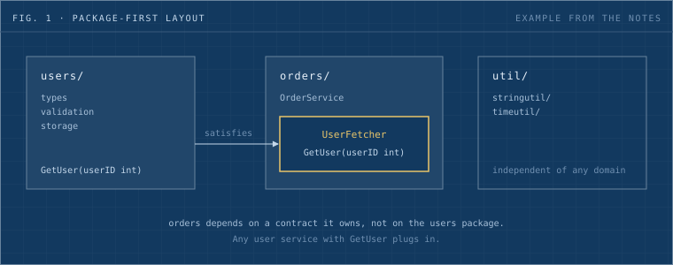

Go pushes [composition over inheritance](https://go.dev/doc/faq#Is_Go_an_object-oriented_language), so the unit you build with is different from other languages. In Go, packages serve as the basic building blocks for creating modular, reusable and maintainable software, and the language encourages you to organize code in a package-oriented way.

This playbook collects five notes from October 2024 into one page. It starts with the package as the unit, then follows the package outward: how its import path works, how to extend what it exposes, how its errors travel, and how generics keep it type safe.



_Fig. 1: A package-first layout from the example in rule 1. The orders package owns the interface it needs, and any user service that fits plugs in. The layout is the notes' example, not a Dwarves repository._

## The five rules

| #   | Rule                                  | In one line                                                                                      |
| --- | ------------------------------------- | ------------------------------------------------------------------------------------------------ |
| 1   | Treat packages as the base unit       | One purpose per package, unexported by default, tests beside the code.                           |
| 2   | An import path is a repository path   | The git path gives each package a unique identity, and `go.mod` pins the version.                |
| 3   | Extend by wrapping, not by editing    | Embed or wrap an existing type to add behavior and leave the original code alone.                |
| 4   | Choose the error pattern on purpose   | Each of eight patterns has a rule of thumb and a failure mode.                                   |
| 5   | Let constraints carry the type safety | Type parameters and constraints are checked at compile time, so a wrong type never gets through. |

<!-- needs Han: a worked example from a real Dwarves Go service would turn this into a field report. Needed: the repo (public or redacted), the PR that applied the rules, `go list -deps ./... | wc -l` before and after, one import cycle removed, build time before and after. If no such refactor exists, the page stays a playbook and makes no field-report claims. -->

## 1. Treat packages as the base unit

Treat your packages as base units. From the outset, structure the project into reusable, well-encapsulated packages, each with a clear purpose.

### Key concepts

**Encapsulation and exporting.** By default, Go keeps all symbols (functions, variables, constants, types) within a package private unless they are explicitly exported. Exported symbols start with an uppercase letter. This enforces encapsulation: only what is necessary reaches external users, and the internal details stay hidden.

For example:

```go
// This function is public and can be used outside the package.
func Add(a, b int) int {
    return a + b
}

// This function is private to the package.
func subtract(a, b int) int {
    return a - b
}
```

**Separation of concerns.** Each package should serve a single purpose or set of related tasks. This makes the codebase more understandable and easier to maintain.

If you are building a web server, for instance, you might separate concerns into packages like:

- `http`: handles HTTP requests and responses.
- `router`: manages routing of different endpoints.
- `db`: manages database interactions.

**Directory structure.** Go's tooling is designed to work with a package-oriented directory structure. Each directory contains its own package, which other parts of your project can import.

Here is an example directory structure:

```text
myproject/
  ├── go.mod
  ├── cmd/            // For command-line tools and executables
  │   └── myapp/
  │       └── main.go
  ├── pkg/            // For libraries and reusable code
  │   └── http/
  │       └── handler.go
  ├── internal/       // For non-public packages
  │   └── config/
  │       └── config.go
  └── vendor/         // Third-party dependencies (if needed)
```

**Testing in packages.** Each package should contain its own unit tests, in the same directory as the package, following Go's testing framework. Test files carry the `_test.go` suffix and can test both exported and internal functions of a package.

Example:

```go
// In mathutil/add_test.go
package mathutil

import "testing"

func TestAdd(t *testing.T) {
    result := Add(2, 3)
    if result != 5 {
        t.Errorf("Expected 5, but got %d", result)
    }
}
```

**Modularity and reusability.** Distinct packages give you reusable building blocks. Teams can share them across projects, and since Go's import system relies on unique paths, there is no conflict as long as each package's import path is unique.

### How to apply

Keep reusability in mind from the start, so your code stays modular, maintainable and adaptable for future projects. All the examples below demonstrate the approach and are not a prescribed layout.

**1. Identify core domains and reusable utility needs.**

- **Define key domains**: break down the main areas of functionality in your project, such as `users`, `orders` or `products` for an e-commerce app.
- **Identify reusable utilities**: list generic functionality, like string manipulation or date formatting, that multiple domains might need. Plan specific utility packages for these, separate from domain logic.

Example structure:

```text
myproject/
  ├── users/
  ├── orders/
  └── util/
       ├── stringutil/
       └── timeutil/
```

**2. Design each package to be self-contained and purpose-driven.**

- Each package should have a **single responsibility**, encapsulating everything it needs for its function. This makes it easier to reuse entire packages across projects.
- Avoid mixing different concerns. A `users` package, for example, should contain everything about user management (types, validation, storage) without unrelated functions.

With a single responsibility, you can reuse the package in another project without modification.

**3. Create generalized, flexible functions.**

- When writing functions within a package, think about how they might be used in other contexts. Avoid overly specific parameters or hardcoded values that tie a function to one scenario.
- For instance, instead of a `ValidateUserEmail` function, create a `ValidateEmail` function in a `validation` utility package, so it applies to emails in any domain.

**4. Use interfaces to decouple dependencies.**

- Define interfaces to allow flexible interactions between packages. Instead of calling functions from another package directly, define an interface in the calling package. Different implementations can then be plugged in as needed.
- For example, if `orders` needs data from `users`, create an interface in `orders` that describes only the needed methods. Any `User` service that meets this interface can be used.

```go
// orders/service.go
package orders

type UserFetcher interface {
    GetUser(userID int) (User, error)
}

type OrderService struct {
    UserService UserFetcher
}
```

Interfaces like this raise reusability because each package relies on general contracts rather than specific implementations.

**5. Structure utility packages for broad use.**

- Create focused utility packages that are purpose-driven and independent of specific domains. For instance, `stringutil` could contain generic string functions, while `timeutil` could handle time parsing and formatting.
- Organized this way, utilities are reusable across any project or domain.

This avoids the common catch-all `utils` package and keeps unnecessary dependencies out of reusable functions.

**6. Document with reusability in mind.**

- Write clear documentation for each package: its purpose, its public API, and how to use it. Write it for another developer (or future you) who may reuse the package in a different context.
- For utility functions, provide examples in the documentation to clarify their general use.

Good documentation makes it easier for others to understand and adopt your package.

**7. Write independent unit tests for each package.**

- Write tests that validate each package's functionality independently of the rest of the project. This ensures correctness and supports reuse, because each package can be reused with confidence and without extra testing.
- Use test files (ending with `_test.go`) within each package and test each function's behavior as if it were in a standalone environment.

**8. Refactor with reusability in mind.**

- As you add features, review and refactor so packages stay focused and reusable. If a package accumulates functions that do not belong, move them into new packages and keep each package aligned with its single responsibility.

Periodic refactoring keeps packages easy to understand, maintain and reuse, and avoids monolithic packages that are hard to untangle or apply to new contexts.

### What this buys you

- **Code organization**: small, focused packages keep the code clean and organized.
- **Reusability**: once written, a package can be reused in many projects or in different parts of a large project.
- **Maintainability**: a well-structured package layout makes code easier to maintain, modify and extend.
- **Collaboration**: teams can work on separate packages concurrently, because each package is an independent unit of functionality.
- **Testing and debugging**: each package is modular, so testing is easier and debugging stays within the context of one package.

## 2. An import path is a repository path

Go's import system, linked directly to git repository paths, was crucial to its early adoption. Unlike most languages, Go ties version control to package management, which improves the developer experience and reusability.

Using the git repository URL as the import path gives each package a unique identity. That removes namespace conflicts and simplifies dependency management.

Example:

```go
import "github.com/username/projectname/package"
```

This avoids complex dependency tools and keeps packages isolated and traceable, a simple structure that keeps Go codebases clean and organized.

### Key benefits

**Global uniqueness.** Git paths give each package a unique identifier (for example `github.com/user/repo/package`). That avoids namespace issues, especially in large projects with many dependencies.

**Direct version control.** Go modules let developers pin dependencies to specific git tags or commits, which gives reproducible builds without a central registry. Any git repository, public or private, can serve as a Go package source, which reduces reliance on third-party registries.

**Modularity and reusability.** Git paths encourage modular, self-contained packages that are easier to reuse and maintain. Direct links to git repositories also simplify code inspection and troubleshooting.

### Comparison to other languages

Most other languages, like Python, Java and Ruby, rely on centralized registries (for example PyPI and Maven) where packages are fetched by name, which often leads to naming conflicts. Go's git-based identifier provides a direct source link and removes the need for centralized naming conventions. Go developers can pull packages directly from repositories, pin versions with `go.mod`, and keep dependency management simple and traceable.

Example `go.mod`:

```go
module myproject

go 1.20

require (
    github.com/user/mathlib v1.3.0
    github.com/otheruser/utils v0.9.2
)
```

Git path-based imports connect package management directly to version control. They prioritize simplicity, clarity and reusability, which are key reasons Go became a preferred language for modular software.

### Go's old GOPATH story

The common telling is that Go began without dependency management, that community tools filled the gap, and that Go Modules swept them away in 2019. The author of a blog post on utcc.utoronto.ca argues that this story is incomplete, because the original Go developers did have a plan for development and dependencies. The points below paraphrase that post.

- **Workspaces.** In Go 1.0, you kept one or more workspaces (today's multi-module workspaces). Each held a project and all its dependencies as cloned, checked-out repositories. Every workspace could carry its own versions of the same packages, and updating a dependency in one workspace did not touch another.
- **`$GOPATH` selects the workspace.** A workspace held source code, precompiled build artifacts and built binaries, all confined under its `$GOPATH`. The original version did not default `$GOPATH` to `$HOME/go`. That default arrived in Go 1.8.
- **Closest cousin.** The result resembles a materialized Python virtual environment. You could archive or send the whole directory tree, or at least its `src/` portion, to preserve it or give it to someone else.
- **The assumption.** The model assumes dependency updates are normally compatible. Go does not remember the identity of the last working version, so going back means digging it out of the git reflog or your own memory. For the same reason, `go get -u` on all dependencies only makes sense if the new versions mostly work.
- **Gaps.** Copying a workspace to preserve or share it was the developer's problem. Go 1.5 added experimental support for vendoring, which let a package with fully vendored dependencies act as a miniature workspace, with drawbacks of its own.
- **The verdict.** The author finds the original story limited and not unreasonable. It could have worked in a world where API compatibility was more common than it is.

Source: [Go, the GOPATH development story](https://utcc.utoronto.ca/~cks/space/blog/programming/GoTheGopathDevelopmentStory).

## 3. Extend by wrapping, not by editing

The extension interface pattern is when an interface embeds another one. It adds new features to an existing object without changing its original code. Three situations call for it:

- **Extending third-party packages**: you want to add methods or change the behavior of existing types without forking or modifying the original package.
- **Adding functionality to interfaces**: a package provides a minimal interface and you want extra behavior on top, without changing the underlying implementation.
- **Testing**: you mock or adapt the behavior of a type, adding logging, metrics or other cross-cutting concerns.

Whether you work with the standard library (`io`, `http`, `sql`), third-party packages or your own codebase, the pattern adds functionality in a flexible, non-intrusive way.

### Extending `io.Reader` and `io.Writer`

The `io.Reader` and `io.Writer` interfaces are simple and widely used. You can extend them to add compression, encryption, logging or buffering.

**Example: adding logging to an `io.Writer`.** To log every write, wrap an existing `io.Writer` and log the data written to it.

```go
type LoggingWriter struct {
    io.Writer  // Embed the original io.Writer
}

func (lw LoggingWriter) Write(p []byte) (n int, err error) {
    fmt.Printf("Writing %d bytes: %s\n", len(p), string(p))  // Log the write
    return lw.Writer.Write(p)  // Call the original Write method
}
```

Usage:

```go
func main() {
    var writer io.Writer = LoggingWriter{Writer: os.Stdout}

    writer.Write([]byte("Hello, World!"))
    // Output:
    // Writing 13 bytes: Hello, World!
    // Hello, World!
}
```

This adds logging to any writer without modifying the original `io.Writer` type.

### Extending HTTP middleware in `http.Handler`

The `http.Handler` interface is central to building web servers in Go. The extension interface pattern is the usual way to create middleware that extends its behavior.

**Example: adding a request logger middleware.** The middleware wraps an `http.Handler` and logs HTTP requests.

```go
type LoggingMiddleware struct {
    handler http.Handler
}

func (lm LoggingMiddleware) ServeHTTP(w http.ResponseWriter, r *http.Request) {
    fmt.Printf("Received request: %s %s\n", r.Method, r.URL.Path)  // Log request
    lm.handler.ServeHTTP(w, r)  // Call the original handler
}
```

Usage:

```go
func main() {
    originalHandler := http.HandlerFunc(func(w http.ResponseWriter, r *http.Request) {
        w.Write([]byte("Hello, World!"))
    })

    loggingHandler := LoggingMiddleware{handler: originalHandler}
    http.ListenAndServe(":8080", loggingHandler)
}
```

This logs incoming requests and wraps the original handler without modifying it.

### Extending `sql.DB` for database connections

You can extend the `sql.DB` type from Go's `database/sql` package to add logging, connection retries or metrics tracking.

**Example: adding query logging to `sql.DB`.**

```go
type LoggingDB struct {
    *sql.DB  // Embed the original sql.DB
}

func (ldb LoggingDB) Query(query string, args ...interface{}) (*sql.Rows, error) {
    fmt.Printf("Executing query: %s\n", query)  // Log the query
    return ldb.DB.Query(query, args...)
}
```

Usage:

```go
func main() {
    db, _ := sql.Open("mysql", "user:password@tcp(127.0.0.1:3306)/dbname")

    loggingDB := LoggingDB{DB: db}
    loggingDB.Query("SELECT * FROM users")
}
```

This logs SQL queries without altering the behavior of `sql.DB`.

### Adding caching to HTTP clients

Go's `http.Client` is widely used for making HTTP requests. You can extend it to add caching, retries or additional logging.

**Example: adding caching to an `http.Client`.** The wrapper caches responses by URL.

```go
type CachingClient struct {
    client   *http.Client
    cache    map[string]*http.Response
}

func (cc *CachingClient) Do(req *http.Request) (*http.Response, error) {
    if cachedResp, ok := cc.cache[req.URL.String()]; ok {
        fmt.Println("Returning cached response")
        return cachedResp, nil
    }

    resp, err := cc.client.Do(req)
    if err == nil {
        cc.cache[req.URL.String()] = resp
    }
    return resp, err
}
```

Usage:

```go
func main() {
    httpClient := &http.Client{}
    cachingClient := &CachingClient{
        client: httpClient,
        cache:  make(map[string]*http.Response),
    }

    req, _ := http.NewRequest("GET", "http://example.com", nil)
    cachingClient.Do(req)  // Fetches from the internet and caches the result
    cachingClient.Do(req)  // Uses the cached result
}
```

This adds caching behavior without altering the original `http.Client` type.

<!-- needs Han: the CachingClient above is the original note's code, kept as written. It stores a *http.Response whose Body can be read once, and its map has no lock. Decide whether to add a one-line caveat that it demonstrates the wrapping shape and is not production caching. -->

### Adding context or timeouts to `http.Request`

Go's `http.Request` does not have built-in timeout functionality, but you can extend the type to add it.

**Example: a timeout extension for `http.Request`.**

```go
type TimeoutRequest struct {
    req *http.Request
    timeout time.Duration
}

func (tr *TimeoutRequest) Do(client *http.Client) (*http.Response, error) {
    ctx, cancel := context.WithTimeout(tr.req.Context(), tr.timeout)
    defer cancel()

    reqWithTimeout := tr.req.WithContext(ctx)
    return client.Do(reqWithTimeout)
}
```

Usage:

```go
func main() {
    req, _ := http.NewRequest("GET", "http://example.com", nil)
    timeoutReq := &TimeoutRequest{
        req:     req,
        timeout: 2 * time.Second,
    }

    client := &http.Client{}
    timeoutReq.Do(client)  // The request will timeout after 2 seconds
}
```

This adds timeout functionality without modifying the original type.

### Decorators for `fmt.Stringer`

Go's `fmt.Stringer` is a simple interface for customizing the string representation of types. The extension interface pattern lets you add behavior when printing.

**Example: adding a prefix to a `fmt.Stringer`.** The wrapper adds a prefix to the string representation.

```go
type PrefixedStringer struct {
    prefix string
    fmt.Stringer
}

func (ps PrefixedStringer) String() string {
    return ps.prefix + ps.Stringer.String()
}
```

Usage:

```go
type User struct {
    Name string
}

func (u User) String() string {
    return u.Name
}

func main() {
    user := User{Name: "John"}
    prefixedUser := PrefixedStringer{prefix: "User: ", Stringer: user}

    fmt.Println(prefixedUser.String())  // Output: User: John
}
```

This wraps the original `fmt.Stringer` and adds a prefix to the output.

### Why extension interfaces earn their place

The examples above show how to wrap a type. A reply in a r/golang thread adds why the pattern matters and how it is usually used: extension interfaces add optional functionality to an API that, by its statically checked type signature, only takes the base interface. The points below paraphrase that reply.

- **`io.WriteString`** is one of the simplest examples. It takes a plain `io.Writer`. If that writer also supports `io.StringWriter` (it has a `WriteString` method), the function uses it for efficiency. Otherwise it falls back to the `Write` method that every `io.Writer` has.
- **`fs.Open`** returns a plain `File`. If the file is actually a directory, you can convert it to a `ReadDirFile` and call the `ReadDir` extension method.

```go
f, _ := fs.Open("dir_or_file") // in real life, handle errors
st, _ := f.Stat()
if st.IsDir() {
    // f is a directory
    d := f.(ReadDirFile)
    d.ReadDir(10)
} else {
    // f is a normal file
}
```

As an alternative to calling `st.IsDir()`, and the more typical choice for extension interfaces, check whether the file implements the interface directly:

```go
f, _ := fs.Open("dir_or_file")
if d, ok := f.(ReadDirFile); ok {
    // f is a directory
    d.ReadDir(10)
} else {
    // f is a normal file
}
```

Source: [What is the extension interface pattern in Go?](https://www.reddit.com/r/golang/comments/i6yehu/what_is_the_extension_interface_pattern_in_go/).

## 4. Choose the error pattern on purpose

Error handling decides whether an application behaves correctly under unexpected inputs or conditions. Many patterns have evolved across languages over the years. This section lists eight, each with a rule of thumb, an example and its trade-offs. The examples run in C, Python, Rust, JavaScript and Go.

<!-- needs Han: the source note surveys patterns across languages and never shows Go's own idiom of returning an error value and checking it. Add that example here, or confirm the page should leave it out. -->

### 1. Return codes and status codes

This is one of the most basic forms of error handling and is common in older, low-level languages such as C. A function returns a value that says whether it succeeded or failed. It might return `0` for success or `-1` for failure. The caller must check the return value and handle any error.

Always check the return values when using this pattern. A missed check easily leads to silent bugs that are hard to trace.

**Example**:

```c
int divide(int a, int b, int *result) {
    if (b == 0) {
        return -1;  // error: division by zero
    }
    *result = a / b;
    return 0;  // success
}

int main() {
    int result;
    if (divide(10, 0, &result) != 0) {
        printf("Error: Division by zero!\n");
    }
}
```

**Pros**:

- Simple and efficient.
- Minimal overhead, so it suits systems with limited resources.

**Cons**:

- Error checking is easily forgotten, which leads to silent failures.
- The code fills with return value checks.

### 2. Exceptions (try-catch)

Exceptions are a more modern, structured way of handling errors, used in languages like Python, Java and C#. When an error occurs, the program "throws" an exception, which a `try-catch` block can catch and handle. This separates normal flow from error-handling logic.

Don't overuse exceptions for flow control, and **never swallow** exceptions without logging or handling them properly. Always catch specific exceptions rather than generic ones like `Exception` in Python or `Throwable` in Java.

**Example**:

```python
try:
    result = 10 / 0
except ZeroDivisionError as e:
    print(f"Error occurred: {e}")
```

**Pros**:

- Clean separation between normal logic and error-handling logic.
- Handles deep errors without cluttering every function with return value checks.
- Allows handling different types of exceptions.

**Cons**:

- Can add runtime overhead.
- Misuse leads to code that is hard to debug, especially when exceptions are caught but not properly handled.

### 3. Error objects or results

This pattern forces the function to return an object that explicitly represents either a successful result or an error. It is common in functional languages like Rust and Haskell, and also in Swift. In Rust, for example, the `Result` type is `Ok` for success or `Err` for failure.

Embrace this pattern when it is available. It forces you to **deal with both the success and the error case** explicitly, which reduces the chance of missed error handling.

**Example** (Rust):

```rust
fn divide(a: i32, b: i32) -> Result<i32, String> {
    if b == 0 {
        return Err("Division by zero".to_string());
    }
    Ok(a / b)
}

fn main() {
    match divide(10, 0) {
        Ok(result) => println!("Result: {}", result),
        Err(e) => println!("Error: {}", e),
    }
}
```

**Pros**:

- Forces explicit error handling, so errors are harder to ignore.
- More functional and compositional, which helps when chaining operations.

**Cons**:

- Can be verbose, especially when several layers of functions must return and propagate `Result` types.

### 4. Assertions

Assertions are a debugging tool that checks whether certain conditions hold. If an assertion fails, the program crashes, usually with a helpful error message. Use the pattern for development and debugging, not for production error handling.

**Don't use assertions for regular error handling.** They exist for development and debugging, not for catching user-facing errors in production.

**Example** (Python):

```python
def divide(a, b):
    assert b != 0, "Division by zero!"
    return a / b

divide(10, 0)  # This will raise an AssertionError
```

**Pros**:

- Simple and effective for catching bugs during development.
- Forces assumptions to be stated explicitly in the code.

**Cons**:

- Typically disabled in production, so they do not handle errors in live environments.
- Not suitable for recoverable errors.

### 5. Callbacks (error-first)

In environments that deal with asynchronous operations, like Node.js, error-first callbacks are a common pattern. The first parameter of the callback is the error (if any), and the second is the result.

When using callbacks, **always check the error argument** first, and handle errors properly in every callback.

**Example** (JavaScript):

```javascript
function divide(a, b, callback) {
  if (b === 0) {
    return callback(new Error("Division by zero"), null);
  }
  callback(null, a / b);
}

divide(10, 0, (err, result) => {
  if (err) {
    console.error(err.message);
  } else {
    console.log(result);
  }
});
```

**Pros**:

- Works well for asynchronous operations.
- Error handling is explicit.

**Cons**:

- Can lead to "callback hell" when several asynchronous operations nest.

### 6. Promise-based error handling

Promises are an evolution of callbacks, mainly used in asynchronous programming (for example in JavaScript). They give cleaner handling of asynchronous operations: `.then()` for success and `.catch()` for errors.

Use promises to make asynchronous code more readable. Pay attention to the **promise chain**, and always handle `.catch()` for potential errors.

**Example** (JavaScript):

```javascript
function divide(a, b) {
  return new Promise((resolve, reject) => {
    if (b === 0) reject(new Error("Division by zero"));
    else resolve(a / b);
  });
}

divide(10, 0)
  .then((result) => console.log(result))
  .catch((error) => console.error(error.message));
```

**Pros**:

- Cleaner and more readable than callbacks, especially with `async/await`.
- Easier to handle chained asynchronous operations.

**Cons**:

- Errors in promise chains are tricky to debug when `.catch()` blocks are misused or omitted.

### 7. Pattern matching

Functional languages like Haskell, Rust and Scala use pattern matching to handle the different outcomes of a computation. It lets developers decompose data structures and handle each case explicitly.

Pattern matching is powerful, but **handle all possible cases**. If you miss one, your program might crash or behave unexpectedly.

**Example** (Rust):

```rust
fn divide(a: i32, b: i32) -> Result<i32, String> {
    if b == 0 {
        Err("Division by zero".to_string())
    } else {
        Ok(a / b)
    }
}

fn main() {
    match divide(10, 0) {
        Ok(result) => println!("Result: {}", result),
        Err(e) => println!("Error: {}", e),
    }
}
```

**Pros**:

- Forces exhaustive handling of the different error cases.
- Gives a clear, readable syntax for handling both success and error cases.

**Cons**:

- Can be overcomplicated for simple error handling needs.

### 8. Panic (crash)

Some languages, like Rust and Go, use panics for non-recoverable errors. A panic crashes the program. In Rust, panics can be caught, but in general the pattern is reserved for situations where the program cannot reasonably continue.

**Use panics sparingly.** Reserve them for truly exceptional, unrecoverable errors, not for ordinary cases like bad user input.

**Example** (Go):

```go
package main

import "fmt"

func divide(a, b int) int {
    if b == 0 {
        panic("Division by zero!")
    }
    return a / b
}

func main() {
    fmt.Println(divide(10, 0))
}
```

**Pros**:

- Useful for catching serious, non-recoverable errors.
- Forces developers to think about critical error scenarios.

**Cons**:

- Crashes the program, which may not be desirable in production.
- Can be overused where graceful error handling is possible.

## 5. Let constraints carry the type safety

Go introduced generics with Go 1.18, officially released in March 2022. The update lets Go developers write more flexible and reusable code by supporting type parameters, so functions and data structures work with different types without sacrificing type safety.

Before 1.18, Go was known for simplicity and type safety but lacked the flexibility generics bring, a feature common in languages like Java, C# and C++. Generics were among the most anticipated features in Go's development, and the 1.18 release was a significant milestone.

Go achieves type safety with generics through **type parameters** and **type constraints**. Here is how it works.

### Type parameters

When you define a function, method or data structure with generics, you specify a type parameter in square brackets `[]`. The type parameter lets the function or type accept different types without being tied to a specific one. The type still has to conform to certain rules, which is where type constraints come in.

Example of a generic function with a type parameter:

```go
func Print[T any](items []T) {
    for _, item := range items {
        fmt.Println(item)
    }
}
```

Here `T` is a type parameter, and `any` is a built-in constraint that allows any type.

### Type constraints

Type constraints limit what types the type parameter `T` can represent. Go enforces type safety by ensuring that the types passed to a generic function or type comply with these constraints. A constraint can be a specific interface, a built-in constraint like `comparable` or `any`, or a custom-defined one.

Example using a constraint:

```go
// A custom constraint interface that requires a type to implement a method
type Stringer interface {
    String() string
}

func ToString[T Stringer](val T) string {
    return val.String()
}
```

In this example, only types that implement the `Stringer` interface can be used as `T`, which ensures type safety at compile time.

### Compile-time checking

Go's compiler checks types at compile time. If the provided type does not satisfy the constraint, the program does not compile, so incorrect types never reach a generic function or data structure. This supports Go's philosophy of simplicity and robustness in type safety.

### Underlying type consistency

Go also leverages underlying types in some constraints. For example, the `comparable` constraint ensures that the type parameter can be compared with `==` or `!=`. For this to work, the compiler ensures that any type passed to a function constrained by `comparable` supports these operations, which prevents runtime errors.

### Explicit and simple type inference

Go simplifies type safety by inferring types when possible. If the compiler can deduce the type parameter from the context, you do not need to specify it, and the compiler still checks that the type is valid under the constraints.

Example with an inferred type:

```go
func Add[T int | float64](a, b T) T {
    return a + b
}

result := Add(3.0, 4.5) // Go infers T as float64
```

### Commutative diagram

$$
\begin{CD}
\text{GenericCode} @>\text{Parse}>> \text{AST} @>\text{TypeCheck}>> \text{TypedAST} \\
@V\text{Instantiate}VV @V\text{Infer}VV @VV\text{Compile}V \\
\text{ConcreteCode} @>>\text{Verify}> \text{TypeSafeCode} @>>\text{Generate}> \text{ExecutableCode}
\end{CD}
$$

This diagram shows how Go handles generic code:

1. Generic code is parsed into an Abstract Syntax Tree (AST).
2. The AST undergoes type checking, which involves constraint checking and type inference.
3. The resulting TypedAST is then compiled into executable code.
4. Alternatively, generic code can be instantiated with concrete types, verified for type safety, and then generated into executable code.

### Summary

Go achieves type safety with generics through a combination of compile-time type checking, constraint satisfaction and type inference:

1. **Type parameters** allow flexibility.
2. **Type constraints** enforce rules about which types are allowed.
3. **Compile-time type checking** prevents invalid types from being used.
4. **Simple and explicit type inference** keeps the code short while constraints maintain safety.

## A checklist to run on your repo

Each line comes from one of the rules above. Run it package by package.

- [ ] Each package has one purpose and its own `_test.go` files beside the code.
- [ ] Only the names that outside code needs are exported.
- [ ] No catch-all `utils` package. Generic helpers sit in focused packages such as `stringutil` and `timeutil`.
- [ ] The calling package defines the interface it needs, listing only the methods it uses.
- [ ] Dependencies in `go.mod` are pinned to a tag or commit.
- [ ] Extra behavior (logging, caching, timeouts) wraps the original type instead of editing it.
- [ ] Every returned status or error value is checked, because a missed check becomes a silent bug.
- [ ] Panics guard only unrecoverable states, never bad user input.
- [ ] Each type parameter carries a constraint, and `any` appears only where any type is valid.

## Related

For concurrency in Go, see [Approaches to manage concurrent workloads like worker pools and pipelines](./approaches-to-manage-concurrent-workloads-like-worker-pools-and-pipelines.md), a separate 2023 note that stays on its own.

This page folds in five October 2024 notes: package first design, Go import design, the extension interface pattern, error handling patterns, and Go type safety with generics.
