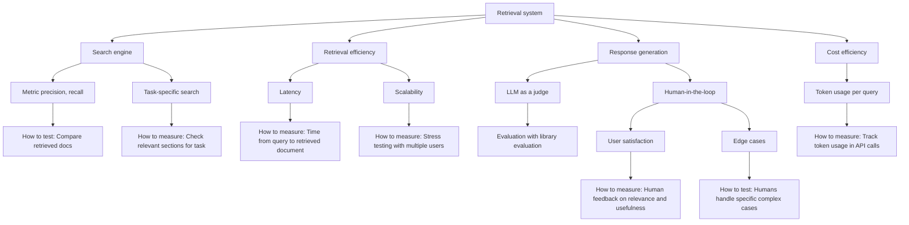
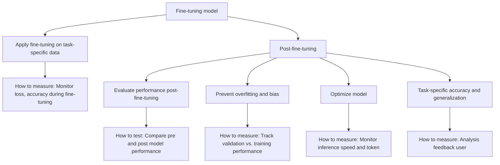
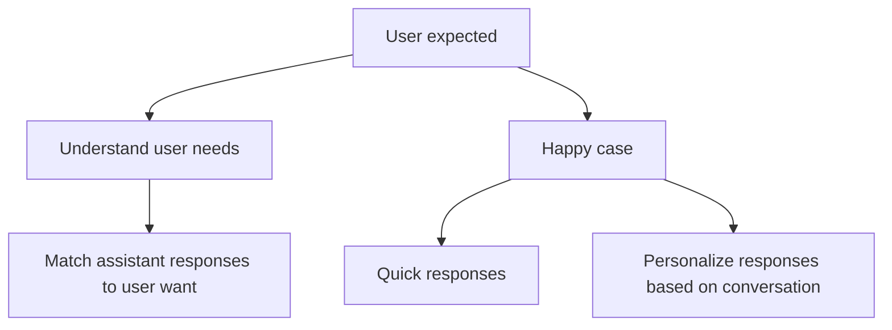
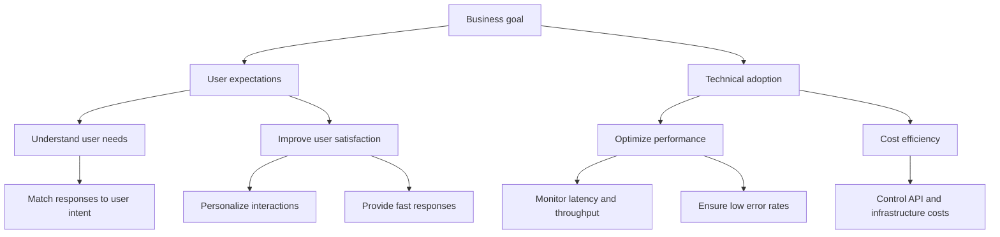

## Overview

Evaluation is a hard part of building an RAG system, especially for application-integrated LLM solving your business problem. This guide outlines a clear, step-by-step approach to effectively evaluating and optimizing the integration of a third-party Large Language Model (LLM) into your application. By following these articles, you'll make sure the model fits your business goals and technical needs.

**This series has 2 parts.** Each one reads on its own.

1. The evaluation checklist (this page)
2. [Types of evaluation and considerations](llm-evaluation-types-and-considerations.md)

## Evaluation checklist

The evaluation checklist helps make sure that all important parts of the LLM are reviewed during integration. Each checklist item should address a key part of the system or model to confirm it meets technical, business, and user needs.

By providing a structured way to assess the system’s performance, the checklist helps we ensure that the model meets both technical and business needs while delivering a positive user experience. For additional insights, you can refer to the following articles: [**LLM product development checklist**](https://www.linkedin.com/pulse/llm-product-development-checklist-how-make-products-generative-pines/) and [**Understanding LLM user experience expectations**](https://blog.kore.ai/cobus-greyling/understanding-llm-user-experience-expectation).

### Product evaluation checklist

**In case RAG system:**

- **Search engine**
  - If a user searches for legal clauses related to "contract termination" the search engine should retrieve documents with high relevance (precision) and not miss any key documents (recall).
  - **Metric**: Precision = 85%, Recall = 90% in test dataset.
  - For a legal query, the system should retrieve and highlight clauses on "contract termination" and ignore irrelevant sections, like "payment terms."
  - **Task-specific accuracy**: 95% task-specific match in legal datasets.
- **Latency**
  - The system should retrieve documents within 2 seconds in a real-time customer support scenario.
  - **Expected latency**: <2 seconds for 95% of queries.
- **Response generation**
  - For a customer query about a "refund policy," the LLM should generate a response that directly references the correct clauses in the retrieved refund policy document.
  - **LLM evaluation**: Coherence score >80% using a library evaluation metric.
  - **Human in the loop:** Annotate response of LLM.
- **Token usage and cost efficiency**
  - For a legal document retrieval and summarization task, the system should use fewer than 10,000 tokens per query to balance cost and performance.
  - **Max token usage**: 10,000 tokens per query to maintain cost-effectiveness. Comparing each model together to find cost effectively.

**In case of fine-tuning model:**

- **Fine-tuning on task-specific data**
  - **Example**: A financial chatbot should correctly identify and respond to "interest rate change" queries 90% of the time in a test set.
  - **Metric**: Fine-tuning loss should decrease steadily, with an accuracy improvement of at least 5% compared to the base model.
- **Evaluate performance post-fine-tuning**
  - **Example**: In a legal document retrieval system, the fine-tuned model should correctly identify relevant clauses with 95% task-specific accuracy.
  - **Metric**: Precision = 90%, Recall = 88% for post-fine-tuning tests.
- **Prevent overfitting**
  - **Example**: If training accuracy is 95%, validation accuracy should be no lower than 93%. If the gap increases, early stopping should be applied.
  - **Metric**: Validation loss should stay within 2% of the training loss.
- **Optimize model efficiency**
  - **Example**: A customer support model should deliver responses in less than 1.5 seconds while using fewer than 8,000 tokens.
  - **Expected latency**: The fine-tuned model should respond in under 1.5 seconds for 95% of queries.
  - **Max token usage**: Limit token usage to under 8,000 tokens per query for cost-efficient operation.
- **Task-specific generalization and user feedback**
  - **Example**: A medical chatbot, after fine-tuning, should correctly diagnose 90% of unseen cases based on the user feedback and test cases.
  - **Task-specific accuracy**: Achieve 93% accuracy in task-specific domains like healthcare diagnostics or legal assistance.

### Business and user expectation

This section is all about putting users first! It helps us understand what users need and ensures they get quick, personalized responses. By matching the assistant’s replies to what users really want, we create a satisfying experience for everyone.

Here, we focus on our goals as a business. This part guides us in making sure our system runs smoothly, stays affordable, and meets user needs effectively. By keeping an eye on performance and costs, we can deliver a reliable and efficient service that users want.

