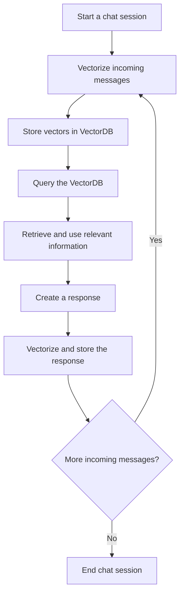

A retrieval-augmented generation (RAG) app is a vector database with a few stages around it. Text goes in as chunks, gets indexed, comes back as candidates, and is ranked before the model sees it. Two more pieces sit at the edges: a cache that skips the pipeline for repeated questions, and a memory that turns past chat messages into retrievable data. This page walks through those stages in pipeline order, with the techniques and code the notes collected.

## Chunking source text

Managing context size, the number of tokens per prompt, is a basic challenge for models like GPT. GPT-3.5 can process up to 4096 tokens, roughly 3000 English words. That makes it hard to consume large documentation or to keep a [long chat history](#long-term-memory-for-chat). Larger context windows in later models may cost more compute and latency.

The workable strategy is chunking. You split large text into smaller segments, feed them to an embedding model, and store them in a vector database for similarity search. The goal is output that stays coherent and meaningful.

### Preprocess first

The data must be high quality before you chunk it. Preprocessing means cleaning out elements that add noise or dilute the content. For web data, remove HTML tags and other non-textual elements.

### Pick a chunking method

After preprocessing, choose a range of chunk sizes to experiment with. Two things drive the choice:

- **Content type**: short messages, lengthy documents, formatted or unformatted content, or specialized formats like Markdown or LaTeX.
- **Embedding model**: token limits and the relevance of its output affect the method.

### Chunking unstructured content

Unstructured content has no specific pattern, so it usually needs fixed-size chunking. You decide the number of tokens per chunk and add overlap between chunks to keep the semantic context intact. Common split points are sentence ends (periods) and line breaks. The LangChain library splits text by chunk size or separator:

```python
text = "..." # your text
from langchain.text_splitter import CharacterTextSplitter

text_splitter = CharacterTextSplitter(
    separator = ".",
    chunk_size = 256,
    chunk_overlap  = 20
)
docs = text_splitter.create_documents([text])
```

Simple symbol-based splitting can fall short. The Natural Language Toolkit (NLTK) and spaCy are built for human language data and create more meaningful chunks:

```python
from langchain.text_splitter import NLTKTextSplitter

text = "..." # your text
text_splitter = NLTKTextSplitter()
docs = text_splitter.split_text(text)
```

```python
text = "..." # your text
from langchain.text_splitter import SpacyTextSplitter

text_splitter = SpaCyTextSplitter()
docs = text_splitter.split_text(text)
```

### Chunking structured content

Formatted content such as Markdown or LaTeX calls for chunking that preserves the original structure.

**Markdown**: This lightweight markup language is often used to format text. Recognizing its syntax (headings, lists, code blocks) lets you divide content by structure and hierarchy, which gives more coherent chunks:

```python
from langchain.text_splitter import MarkdownTextSplitter
markdown_text = "..."

markdown_splitter = MarkdownTextSplitter(chunk_size=100, chunk_overlap=0)
docs = markdown_splitter.create_documents([markdown_text])
```

**LaTeX**: Academic papers and technical documents commonly use LaTeX. A LaTeX splitter parses commands and environments to respect the logical organization of the content, which gives accurate and contextually relevant results:

```python
from langchain.text_splitter import LatexTextSplitter
latex_text = "..."

latex_splitter = LatexTextSplitter(chunk_size=100, chunk_overlap=0)
docs = latex_splitter.create_documents([latex_text])
```

With careful preprocessing and well-chosen chunking, you can extract meaningful and accurate information from even the largest volumes of text.

## Hierarchical retrieval with tree summaries

Flat chunks have a limit. Most retrieval methods return only short, contiguous chunks. That limits how well they represent the large-scale structure of a document, and how well they answer thematic questions that need knowledge from several parts of a text.

RAPTOR (Recursive Abstractive Processing for Tree-Organized Retrieval) addresses this for long documents. The paper is at <https://arxiv.org/html/2401.18059v1>. The approach has three parts:

- It recursively embeds, clusters and summarizes chunks of text.
- It builds a tree with different levels of summarization, from the bottom up.
- At inference time it retrieves from this tree, which integrates information across long documents at different levels of abstraction.


### Building the tree

1. Segment the text into 100-token chunks.
2. Embed the chunks with SBERT.
3. Cluster similar chunks with Gaussian Mixture Models (GMMs).
4. Summarize each cluster with GPT-3.5-turbo.
5. Repeat the process on the summaries, building the tree from the bottom up.

### Querying the tree

- The collapsed tree method outperforms tree traversal.
- It retrieves nodes across all layers based on relevance.
- It uses cosine similarity for matching.

Tree traversal and collapsed tree are the two querying options.

### Results

- It outperforms traditional methods such as BM25 and DPR on question-answering tasks.
- It excels at complex queries that need multi-part information.
- It scales linearly with document length.
- It sets a new state of the art on some benchmarks when paired with GPT-4.

Evaluation used the NarrativeQA, QASPER and QuALITY datasets, with BLEU, ROUGE, METEOR, F1 score and accuracy as metrics.

[Diagram (PDF)](assets/raptor-llm-retrieval.pdf)

## Re-ranking retrieved results

Retrieval returns a heterogeneous set of documents. They relate to the query, but they often carry extraneous details that clutter the generation model's input. The generated text then loses coherence, accuracy or pertinence, which undermines the system's reliability. Re-ranking is the step that addresses this.

### Why retrieval needs a second pass

Embeddings capture semantic information but sometimes lack contrastive information. An embedding may struggle to tell "I love shrimp" from "I used to love shrimp". Both carry a similar semantic meaning, but they mean different things.

Embeddings also have a fixed number of dimensions (for example 1024). That makes it hard to encode all relevant information accurately, especially for longer documents or queries. As a result, the context from the retrieval step is mixed with noise, and a re-ranking step filters it out.

### What re-ranking does

Re-ranking is a second-pass document filter in an information retrieval system. It evaluates and re-orders the retrieved documents so the most relevant and useful ones go to the generation model first. It works like choosing the most relevant references from a pile of study materials during an open-book exam.


### Re-ranking methods

Most methods fall into two types:

1. **Re-ranking models**: Specific models such as a BERT-based reranker or CohereRerank. They understand context and semantics at a deeper level than traditional retrieval methods.
2. **LLM re-ranking**: An LLM reads the whole document and query, so it can capture semantic information more completely.

```python
    reranking_prompt = """the following are passages realated to query {query}. \
      {passage_1} \
      {passage_2} \
      #...
      ranke these passages base on their relevance to the query """
```

Be careful with LLM input, because it has a fixed size limit. In that case, apply a sliding window with bubble sort to find the highest-ranked context.


**Extra**: Reciprocal Rank Fusion (RRF). A RAG system that uses hybrid search or several initial retrievals can apply RRF to unify the rankings from multiple retrieval models.

### Implementation with a hosted re-ranker

We implemented the first method with the popular [Cohere](https://cohere.com/rerank) reranker model. First, prepare the data:

```python
  documents = [
      "Shrimp is the best seafood ever!",
      "I'm allergic to shellfish, including shrimp.",
      "Seafood is delicious, but I prefer fish.",
      "I enjoy a good shrimp scampi.",
      "Shrimp cocktail is a classic appetizer.",
      "I'm not a fan of crustaceans.",
      "Shrimp pasta is one of my favorite dishes.",
      "I've never tried shrimp before.",
      "Seafood is overrated, especially shrimp.",
      "I like all kinds of seafood, including shrimp.",
      "Shrimp is too small for my liking.",
      "I've heard good things about shrimp, but haven't tried it.",
      "Shrimp curry sounds interesting.",
      "I'm not a big fan of seafood, except for shrimp.",
      "Shrimp scampi is a dish I'd like to try.",
      "I prefer beef to seafood.",
      "Shrimp is a good source of protein.",
      "I'm not sure how to cook shrimp.",
      "Shrimp salad sounds refreshing.",
      "I've had bad experiences with shrimp."
  ]
  doc=[]
  for item in documents:
      page = Document(page_content=item,
      metadata={"source": "local"})
      doc.append(page)

  vectorstore = Chroma.from_documents(documents=doc,
                                    embedding=OpenAIEmbeddings())

  retriever = vectorstore.as_retriever()

  llm = Cohere(temperature=0)
  compressor = CohereRerank(model="rerank-english-v3.0", top_n=3)
  compression_retriever = ContextualCompressionRetriever(
  base_compressor=compressor, base_retriever=retriever
  )

  query= 'Do I love eating shrimp?'
```

The list holds 20 strings of opinions about shrimp, from positive to negative, plus some neutral statements. The variety challenges a reranker to find the document that expresses a love for shrimp. We fetch the cosine similarity ranking first, then pass it through Cohere reranking to show the accuracy gain.

**Cosine distance**


**Cohere reranker**


For the query "Do I love eating shrimp?", the top result by cosine distance is not the most accurate context. After the Cohere reranker, the order changes. The top results become "I like all kinds of seafood, including shrimp." and "Shrimp is the best seafood ever!", which fit the query better.

Re-ranking evaluates and prioritizes retrieved documents by relevance and quality, so only the most pertinent information reaches the generation phase. That mitigates noise and gives more coherent, accurate and reliable outputs.

## Query caching

LLMs are costly in processing speed and compute. Query caching cuts that cost by reusing answers, and it relies on a semantic vector database to find queries that mean the same thing.

When an LLM answers a query, the system stores ("caches") the response. If a later query is semantically similar to an earlier one, the system returns the cached answer and skips the extra computation.


Take an e-commerce example. A customer asks an AI assistant, "What are the store's operating hours?" and the response is cached. Another customer later asks, "When does the store open and close?" The system returns the cached answer and sidesteps another processing cycle.

You tune the behavior with a semantic similarity threshold, which trades efficiency against precision. The savings in compute and money help with the ongoing speed problem of large language models. The method applies to any LLM application, in any sector.

## Long-term memory for chat

In a chat application, the text in the model's context window keeps growing. A vector database can archive the conversation history and act as long-term memory. The app then queries it for the most pertinent details to feed into the model during a conversation. This extends the effective context window and makes the app more robust against abrupt topic shifts.

Storing long-term memory in a ChatGPT-based chatbot with a vector database follows these steps:

1. **Begin a chat session**: When a user starts a conversation, create a unique session ID to track it. All dialogue in the session links to this ID.
2. **Vectorize the incoming messages**: As the user and the chatbot exchange messages, use an embeddings model (like GPT or BERT) to turn each incoming and outgoing message into an embedding. The model depends on your needs, but it must capture the semantic content of the text.
3. **Store vectors in the vector database**: Each time a message is vectorized, store the vector, the original text, the session ID and any other metadata (such as the timestamp or the sender). This database is the chatbot's long-term memory.
4. **Query the vector database**: When the chatbot must respond, query for the most relevant previous messages. The query uses the vector of the incoming message and cosine similarity, or another measure, to find the most similar vectors and therefore the most similar messages.
5. **Retrieve and use relevant information**: Use the retrieved messages to help generate a response. You can feed them into the language model as context, use them to influence the chatbot's decisions, or anything else that fits your needs.
6. **Create a response**: Generate the response with the chatbot's language model, using the retrieved information as needed.
7. **Vectorize and store the response**: Vectorize the response and store it like the incoming messages. The chatbot's own answers then become part of its long-term memory too.
8. **Repeat the process**: Repeat steps 2 to 7 for each incoming message until the session ends. As more conversations accumulate, the chatbot draws from a larger pool of past dialogue.



The exact details depend on your application and chatbot design.

## References

- <https://www.pinecone.io/learn/chunking-strategies/>
- <https://arxiv.org/html/2401.18059v1>
- <https://cohere.com/blog/rerank>
- <https://cohere.com/rerank>
- <https://www.rungalileo.io/blog/mastering-rag-how-to-select-a-reranking-model>
- <https://github.com/zilliztech/GPTCache>
