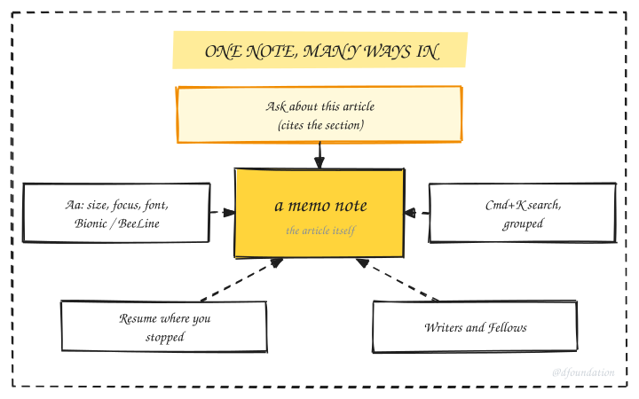
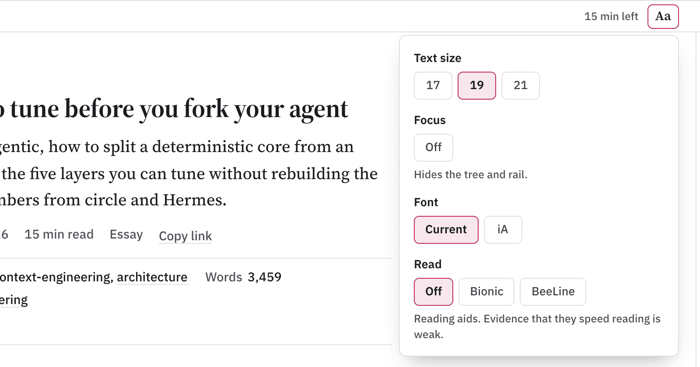
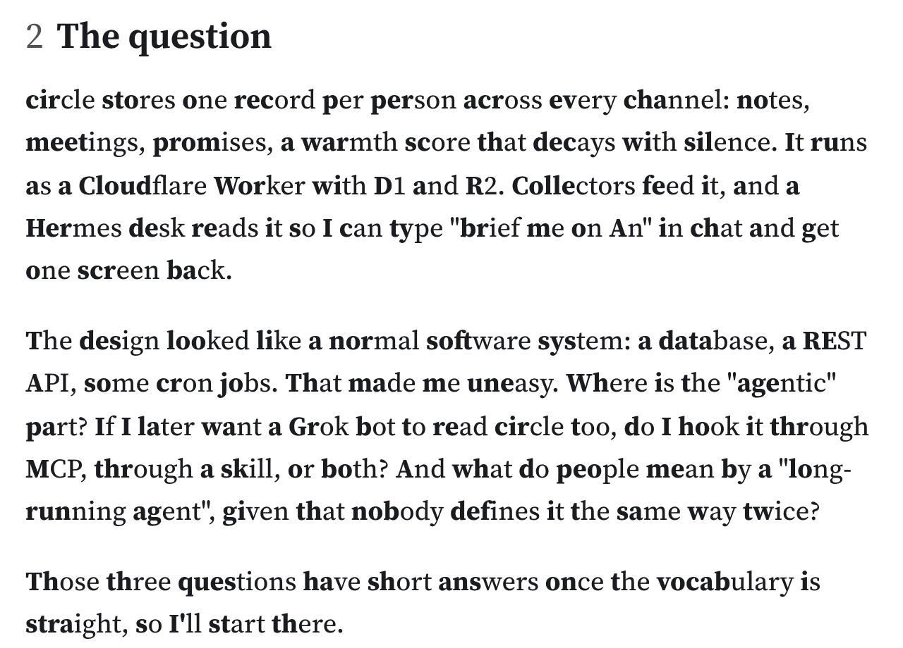
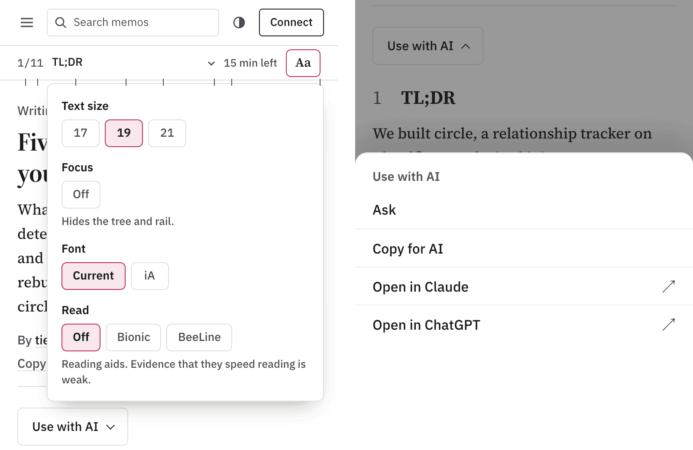
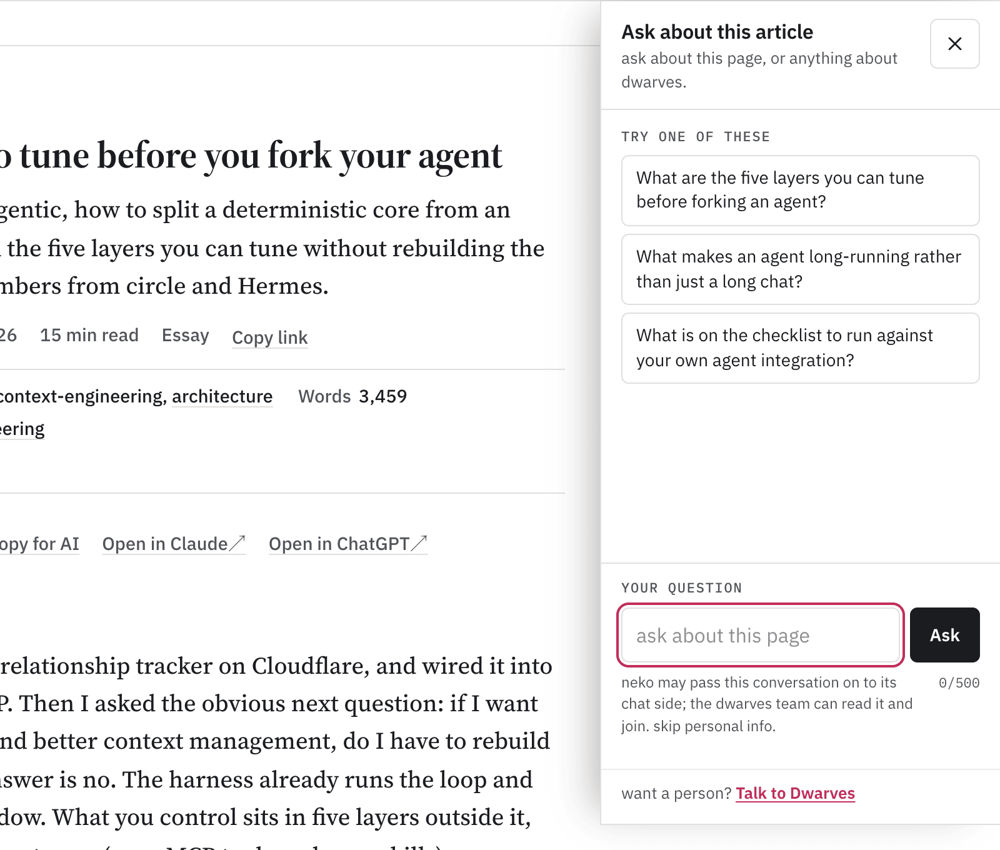
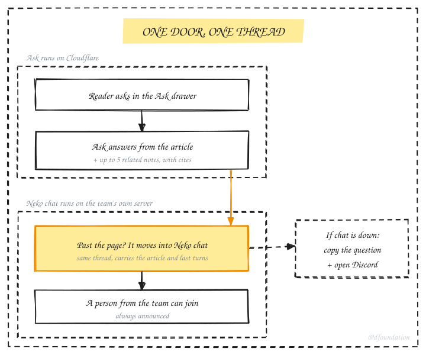
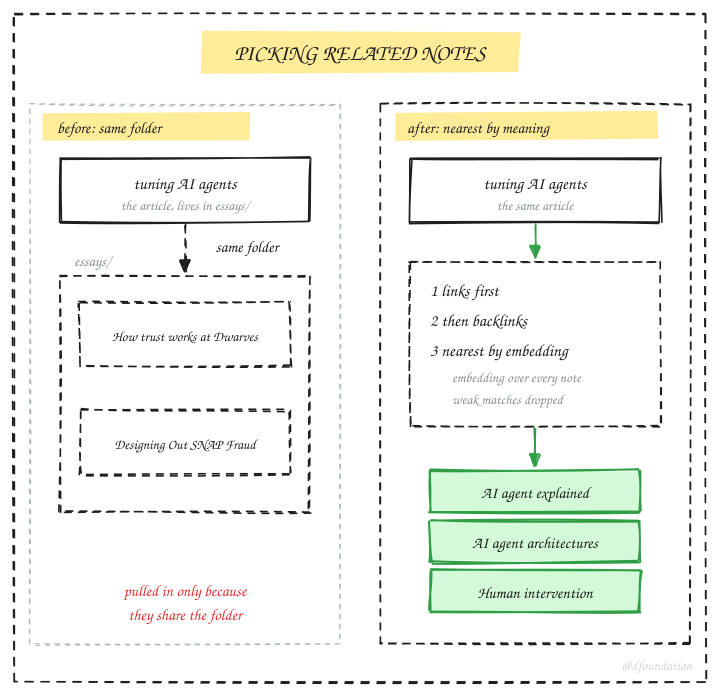
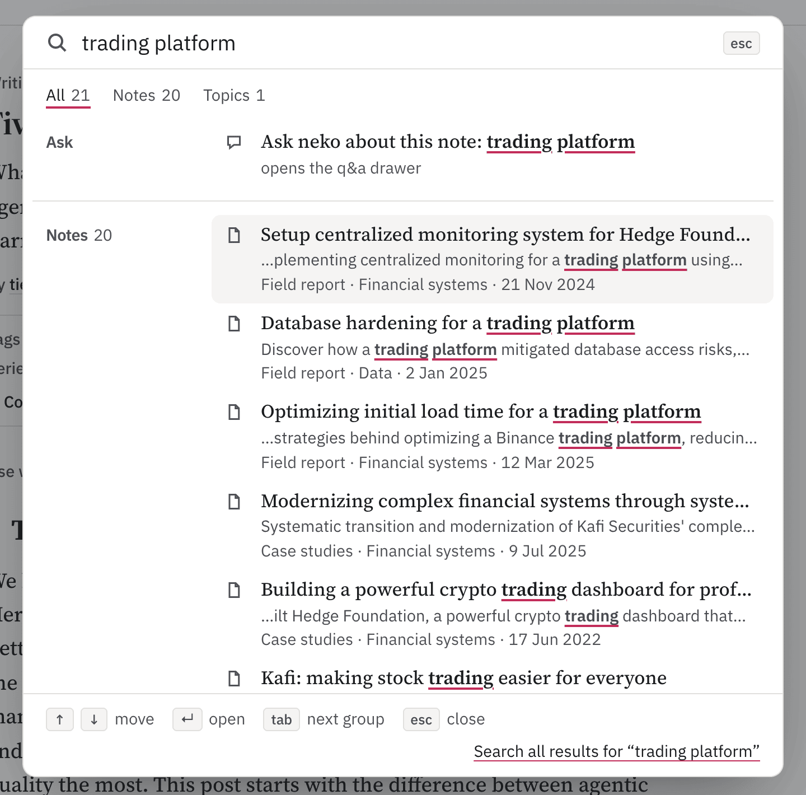
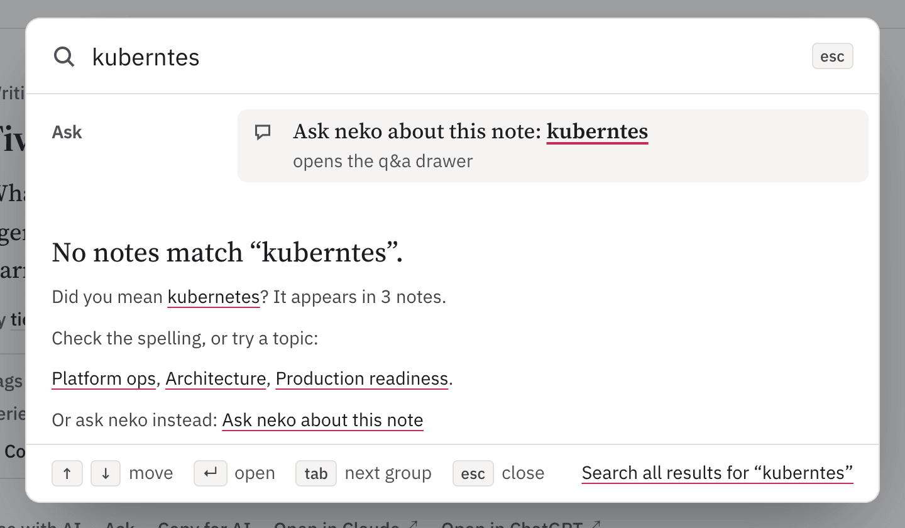
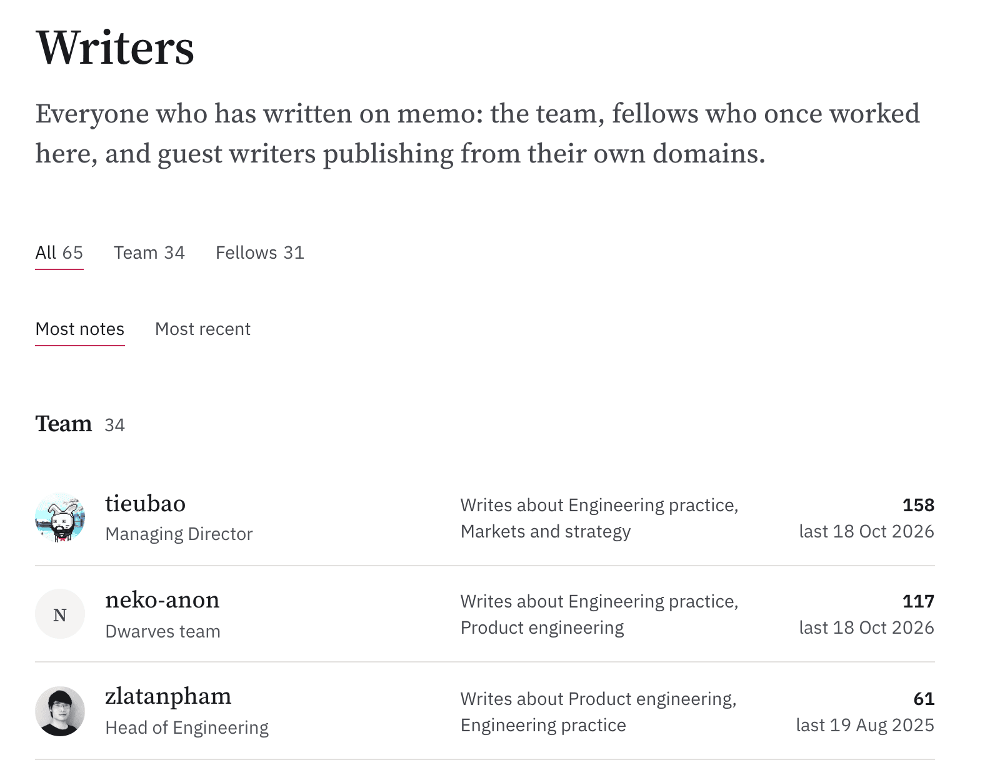

This page lists what memo can do for you as a reader, and we keep it current. When a feature ships, it lands in the log below and gets its own section.

_Fig. 1: one note, many ways in._

## Recently shipped

| Date       | What changed                                                           |
| ---------- | ---------------------------------------------------------------------- |
| 2026-10-19 | Related notes for Ask are picked by meaning, not by folder             |
| 2026-10-18 | Ask hands a question it cannot answer to Neko chat, in the same thread |
| 2026-10-18 | Neko chat answers show the memo posts they cite                        |
| 2026-10-18 | Search groups results and suggests a spelling fix                      |
| 2026-10-18 | Aa reader menu: text size, Focus, font, Bionic and BeeLine, Resume     |
| 2026-10-18 | Writers page lists past members as Fellows, with roles                 |
| 2026-10-18 | Phone tools: Use with AI sheet, quote with link, Save as PDF           |

## Read the way you like

Every note has an **Aa** button in the bar above the text.

- **Text size** at 17, 19 or 21px. The default is 19px in a 600px column.
- **Focus** hides the tree and the side rail and keeps the column centered.
- **Font**: the current face, or an iA Writer style face. Try it on any note by adding `?font=ia` to the URL.
- **Bionic** and **BeeLine** reading modes, off by default. They only touch paragraphs and list items, never code, tables or links. Copy-paste still gives you the original text.
- **Resume**: a long note remembers where you stopped. When you come back, a chip offers "Resume at 4.2, 38%", and the bar shows the minutes left.

_Fig. 2: the Aa menu on a desktop note._

Your choices stay in your browser. Nothing goes to a server.

_Fig. 3: Bionic mode bolds the start of each word._

## On a phone

- **Use with AI** opens as a sheet, so you can hand the note to your own assistant.
- **Quote with a link**: select a passage and copy it with a link back to that exact spot.
- **Code** blocks have line numbers.
- **Save as PDF** prints a clean page without the site chrome.

_Fig. 4: the reader controls and the Use with AI sheet at phone width._

## Ask about the article

The Ask drawer answers questions about the note you are reading. Every answer cites the section it came from, so you can check it.

_Fig. 5: Ask sits beside the article it answers about._

Ask also reads up to five related notes along with the article. When a term is explained better elsewhere on memo, the answer can use that note and says so.

## One thread to Neko

Some questions go past the page. Ask doesn't send you somewhere else. It passes the question to Neko chat in the same thread, with the article and your last few turns attached, so you don't repeat yourself.

_Fig. 6: one thread, from the article to Neko to a person._

- When a person from the team joins, the thread says so, every time.
- When Neko cites a memo post, the answer shows it as a source chip.
- If the chat is down, the drawer gives you a copy of your question and a link to our [Discord](https://discord.gg/dfoundation).

## How related notes are picked

The first version of Ask picked related notes by folder. That was cheap and often wrong: an article on tuning AI agents pulled in "How trust works at Dwarves" and a piece on SNAP fraud, because all three live in `essays/`.

_Fig. 7: the same article, before and after._

Now every eligible note is embedded at build time, and a build only embeds the notes that changed. Related notes are links first, then backlinks, then the nearest notes by meaning above a similarity floor. A note with no close neighbour gets fewer related notes, never weak ones.

The same index lost when we tested it for Neko chat, so chat keeps its topic-based retriever for now. The numbers, the test and what went wrong are in [Picking related notes by meaning](/memo-related-notes).

## Search

Press Cmd+K anywhere.

_Fig. 8: one query, grouped by kind._

- Results come in groups: notes, topics, writers, programs and tags. An empty group stays hidden.
- An exact title ranks first, then the phrase in a title, then all your words, then partial matches.
- A typo gets a "Did you mean" line you can click.

_Fig. 9: "kuberntes" finds its way to kubernetes._

## Writers

The [writers page](https://memo.d.foundation/writers) lists the current team, past members as Fellows, and guest writers, each with a role. The list comes from our team records, so nobody keeps it by hand. A profile opens with a header and a short list of selected work.

_Fig. 10: the team, Fellows and guests on one page._

## How we keep pages honest

- When notes overlap, we merge them into one page. Every author stays on the byline.
- Retired pages become drafts, never deletions, and their old URLs redirect to the page that absorbed them.
- We change a fact only when a current record proves it. Otherwise the page gets a dated snapshot banner, because an old fact marked as old beats a new one we guessed.

## Known gaps

As of October 2026:

- The reader menu hasn't been tested on a real phone with VoiceOver.
- Bionic and BeeLine switch on after the page loads, so plain text shows for a moment first.
- The Ask drawer covers the Aa button while it's open.
- Text inside 11 older figures is still under 12.5px.

Something reads worse than before, or you want a feature? Tell Neko in the Ask drawer or find us on [Discord](https://discord.gg/dfoundation).
